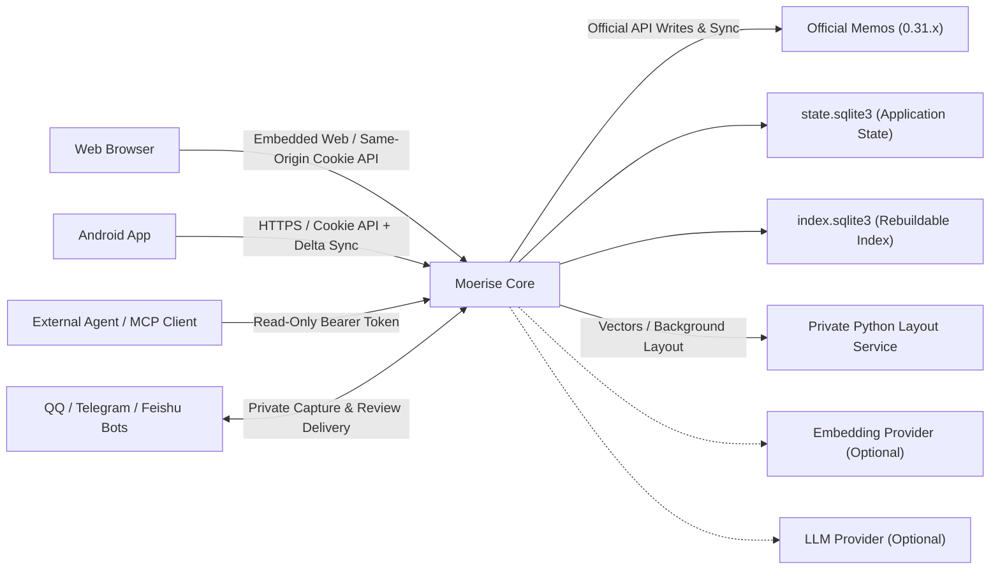

# Moerise

A single-user, self-hosted personal note system built on [Memos](https://usememos.com/).

[简体中文](README.md) · [Getting Started](docs/GETTING-STARTED.md) · [Operations](docs/OPERATIONS.md) · [API Documentation](docs/API-V1.md) · [Contributing](CONTRIBUTING.md)

Moerise stores notes, tags, and attachments in Memos, and adds an embedded bilingual Web UI, a native Android app, hybrid full-text and semantic search, and four workflows: Review, Walk, Insights, and Stargazing. Private QQ, Telegram, and Feishu bots also support quick note capture and scheduled review delivery.

All writes go through official Memos APIs without altering your Markdown or attachments; daily reads query a local synchronized index.

## Features

- **Web & Android Clients**: Embedded light two-column Web UI (English and Simplified Chinese) plus a native Jetpack Compose Android app with offline write queueing, local index reads, and draft recovery. Supports Markdown, native `#tags`, image/file attachments, and in-card editing.
- **Full-Text & Semantic Search**: SQLite FTS5 with Chinese bigram segmentation for keyword filtering; optional OpenAI-compatible or Alibaba Bailian embeddings for semantic search and Reciprocal Rank Fusion (RRF) hybrid ranking.
- **Walk**: Start from any note or a random seed and step through semantically related notes with per-walk deduplication.
- **Stargazing**: Balanced UMAP projects note embeddings into 2D clusters with incremental updates (unchanged notes keep their positions), topic naming, pan/zoom, fullscreen, and click-to-read. A private Python service computes snapshots in the background; see the [Stargazing guide](docs/STARGAZING.md).
- **Insights**: Select any mix of normal or archived notes as context for streaming multi-turn LLM chats. Supports OpenAI Chat Completions, OpenAI Responses, and Anthropic Messages, and saves selected replies back to Memos.
- **Daily Review**: Randomly picks older notes using configurable maturity delay and recent-repeat filters into a fixed daily plan split across scheduled time slots. No unread badges or streaks. Optional delivery to a private QQ bot, Telegram, a Feishu app, or a Feishu group webhook.
- **Read-Only REST & MCP**: Exposes `/api/ext/v1` and a read-only `/mcp` Server (Streamable HTTP) so tools like Claude Desktop and Cursor can search and read notes without write access.
- **Single-Author Isolation & Dual SQLite Storage**: Each instance binds to one Memos author. `state.sqlite3` stores settings, sessions, AI chats, and review plans; `index.sqlite3` stores rebuildable search, vector, and map indexes.

Basic writing, reading, keyword search, and daily reviews work without external models. Semantic search, Walk, and Stargazing require an embedding provider; Insights requires an LLM. When enabled, relevant note text is sent to the model provider you configure.

## Architecture



## Quick Start

Docker Compose is the recommended way to run Moerise. The default stack includes official Memos 0.31.x and can also connect to an existing Memos instance. Prebuilt Core images (with embedded Web) are published on GHCR for `amd64` and `arm64`.

### 1. Initialize Memos and Environment Variables

```bash
git clone https://github.com/Fermin214/Moerise.git
cd Moerise
cp .env.example .env

# Start Memos first to create your account
docker compose up -d memos
```

1. Open `http://localhost:5231` and register your Memos account.
2. In Memos **Settings → Access Tokens**, create a Personal Access Token (PAT).
3. Query your author resource name with the PAT and copy `user.name` (e.g. `users/abc123`):

   ```bash
   curl -H "Authorization: Bearer <your-PAT>" http://localhost:5231/api/v1/auth/me
   ```

4. Fill in `.env`:

| Variable | Value |
| --- | --- |
| `MOERISE_MEMOS_TOKEN` | Memos PAT |
| `MOERISE_MEMOS_USER` | Full `user.name` returned above |
| `MOERISE_MEMOS_INSTANCE_ID` | Unique, stable instance ID (e.g. `primary-memos`) |
| `MOERISE_CURSOR_SECRET` | Random secret for cursor signing |
| `MOERISE_STATE_ENCRYPTION_KEY` | Base64-encoded 32-byte key for encrypted credentials |
| `MOERISE_ACCESS_TOKEN` | Bearer token for external REST/MCP (optional; leave blank to disable) |

Generate independent secrets:

```bash
openssl rand -hex 32     # MOERISE_CURSOR_SECRET
openssl rand -base64 32  # MOERISE_STATE_ENCRYPTION_KEY
openssl rand -hex 32     # MOERISE_ACCESS_TOKEN (optional)
```

### 2. Start Services

```bash
docker compose pull moerise layout
docker compose up -d
```

To build from source instead, run `docker compose up -d --build`.

`.env.example` enables bundled Memos and the layout service via `COMPOSE_PROFILES=memos,stargazing`. To run without Stargazing, disable **Settings → General → Enable stargazing**, remove `stargazing` from `COMPOSE_PROFILES`, and run `docker compose stop layout`. Semantic search and Walk stay available.

Open `http://localhost:3000` and sign in with your Memos username and password. Signed Android APKs are published on [Releases](https://github.com/Fermin214/Moerise/releases); see [Android Install & Upgrade](docs/android/INSTALL.md).

For existing Memos connections, HTTPS reverse proxy setup, backups, and resource profiles, see the [Operations Guide](docs/OPERATIONS.md).

## Documentation

Full index: [Documentation Index](docs/README.md) (detailed guides are written in Simplified Chinese).

| Area | Document | Summary |
| --- | --- | --- |
| **Setup & Operations** | [Getting Started](docs/GETTING-STARTED.md) | First-time setup, account binding, and upgrades |
| | [Operations](docs/OPERATIONS.md) | Configuration, resource profiles, backups, and rollback |
| | [Android Install](docs/android/INSTALL.md) | APK verification, installation, and in-place upgrades |
| **Features** | [Web Interface](docs/WEB.md) | UI behavior, bilingual support, Stargazing, and local builds |
| | [Stargazing](docs/STARGAZING.md) | Balanced UMAP, topic naming, incremental snapshots, and layout service |
| | [Daily Review](docs/DAILY-REVIEW.md) | Sampling rules, daily plans, and slot allocation |
| | [Notifications](docs/NOTIFICATIONS.md) | Review scheduling, delivery retries, and bot channels |
| | [Feishu](docs/FEISHU.md) | Feishu app private capture and group webhook delivery |
| | [QQ](docs/QQ.md) | Private QQ bot note capture and reviews |
| | [Telegram](docs/TELEGRAM.md) | Telegram private capture and scheduled review delivery |
| | [AI & Insights](docs/AI.md) | LLM protocols, material budget, streaming chat, and diagnostics |
| | [Embeddings](docs/EMBEDDING.md) | Vector providers (OpenAI / Bailian), chunking, and generations |
| | [Search & Walk](docs/SEARCH.md) | FTS5 search, cosine similarity, RRF ranking, and random walk |
| | [System Settings](docs/SETTINGS.md) | Layered config, encrypted secrets, and versioned updates |
| | [Privacy & Telemetry](docs/PRIVACY.md) | Optional usage/error counters, retention, and opt-out |
| **Architecture & Dev** | [Product Architecture](docs/PRODUCT-ARCHITECTURE.md) | Components, dual-database split, and security boundaries |
| | [Codebase Guide](docs/CODEBASE.md) | Source map and change checklists |
| | [System Design](docs/DESIGN.md) | Embedded Web design and frontend modules |
| | [API v1](docs/API-V1.md) | Client `/api/app/v1`, read-only `/api/ext/v1`, and `/mcp` |
| | [Development Guide](docs/DEVELOPMENT.md) | Local tooling, test suites, and release workflow |
| | [Android Development](docs/ANDROID.md) | Android modules, toolchain, benchmarks, and releases |
| | [Scripts](scripts/README.md) | Acceptance, benchmark, and evaluation scripts |
| | [Roadmap](docs/ROADMAP.md) | Delivered milestones and future plans |

## License

Licensed under the [MIT License](LICENSE). Reused Memos styles and assets retain their [upstream license](web/MEMOS-LICENSE).
