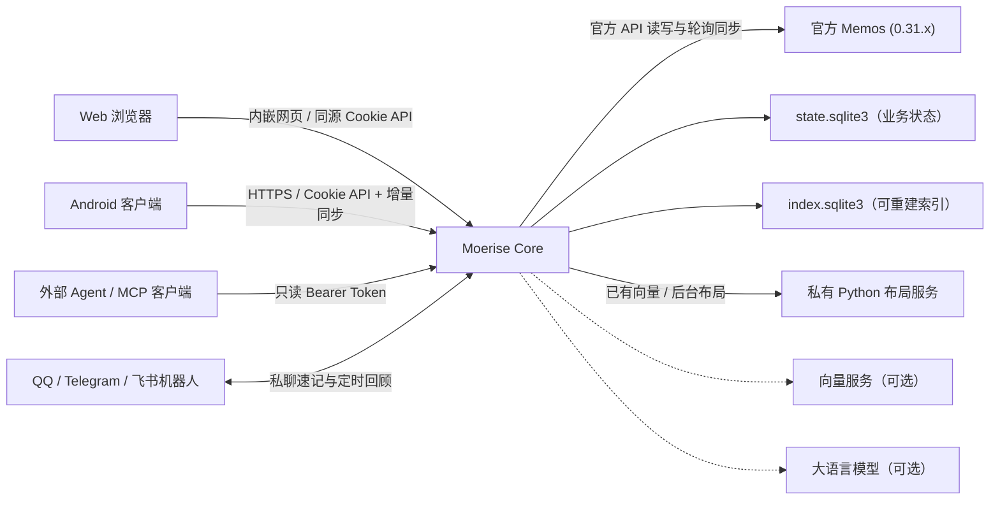

# Moerise

基于 [Memos](https://usememos.com/) 的单用户自托管个人笔记系统。

[English](README.en.md) · [快速上手](docs/GETTING-STARTED.md) · [运行与恢复](docs/OPERATIONS.md) · [API 文档](docs/API-V1.md) · [参与贡献](CONTRIBUTING.md)

Moerise 使用 Memos 保存笔记原文、标签和附件，提供内嵌于服务端的双语 Web 界面、原生 Android 客户端、全文与语义混合检索，以及「回顾」「漫步」「洞察」「观星」四个模块，并支持通过 QQ、Telegram 和飞书机器人私聊速记与定时接收回顾。

所有写入都通过 Memos 官方 API 完成，原文、原生 `#标签` 和附件保持原样；日常读取走本地同步索引。

## 核心功能

- **多端记录与阅读**：内置浅色两栏式 Web 界面（中英双语），提供配套 Android 原生客户端（Jetpack Compose，支持离线记录队列、本地索引直读与恢复）。支持 Markdown 写作、原生 `#标签`、图片附件管理与卡片内就地编辑。
- **全文与语义混合检索**：使用 SQLite FTS5 中文预分词索引实现关键词筛选；接入 OpenAI 兼容或阿里云百炼 Embedding 后，支持语义搜索和基于 RRF 的混合检索。
- **漫步 (Walk)**：从指定笔记或随机起点出发，按向量相似度与受控随机抽样在历史笔记间跳转，单次漫步自动去重。
- **观星 (Stargazing)**：使用均衡 UMAP 将笔记向量投影为二维星群，支持增量定位（未变笔记坐标固定）、主题聚类命名、平移缩放、全屏及点星阅读原文。布局由独立 Python 服务后台计算，页面直接读取快照，详见[观星指南](docs/STARGAZING.md)。
- **洞察 (Insights)**：自由选择正常或归档笔记作为上下文材料，与大模型进行流式多轮对话与追问，支持 OpenAI Chat Completions、OpenAI Responses 与 Anthropic Messages 协议，可将选中的回复或对话保存回 Memos。
- **每日回顾 (Review)**：按成熟等待期与近期去重规则随机抽取历史笔记，生成固定的全天回顾计划并按时段分配。不设未读红点或打卡计数，可按需推送至 QQ 私聊、Telegram、飞书应用私聊或飞书群 Webhook。
- **只读外部接口与 MCP**：提供 `/api/ext/v1` 机器 REST API 与 `/mcp` 只读 MCP Server，供 Claude Desktop、Cursor 等外部工具检索和阅读笔记，服务端仅开放只读权限。
- **单作者隔离与双库存储**：单个实例绑定一名 Memos 作者。`state.sqlite3` 保存设置、会话、AI 对话与回顾计划；`index.sqlite3` 保存可随时从 Memos 重建的检索、向量与星图索引。

基础记录、阅读、关键词检索和每日回顾不依赖外部模型。语义检索、漫步与观星需要 Embedding 模型，AI 洞察需要大语言模型；启用模型功能后，相关笔记正文会发往你配置的模型服务。

## 系统架构



## 快速开始

推荐使用 Docker Compose 部署（默认内置官方 Memos 0.31.x，也支持对接已有 Memos 实例）。内嵌 Web 的 Core 镜像发布在 GHCR，提供 `amd64` 与 `arm64` 架构。

### 1. 初始化 Memos 与环境变量

```bash
git clone https://github.com/Fermin214/Moerise.git
cd Moerise
cp .env.example .env

# 先启动 Memos 创建账户
docker compose up -d memos
```

1. 打开 `http://localhost:5231` 注册 Memos 账户。
2. 在 Memos「设置 → 访问令牌」生成个人访问令牌（PAT）。
3. 用 PAT 查询作者资源名，记下响应中的 `user.name`（如 `users/abc123`）：

   ```bash
   curl -H "Authorization: Bearer <你的-PAT>" http://localhost:5231/api/v1/auth/me
   ```

4. 在 `.env` 中填入以下必填项：

| 变量 | 说明 |
| --- | --- |
| `MOERISE_MEMOS_TOKEN` | Memos PAT |
| `MOERISE_MEMOS_USER` | 上一步返回的完整 `user.name` |
| `MOERISE_MEMOS_INSTANCE_ID` | 唯一且稳定的实例标识，如 `primary-memos` |
| `MOERISE_CURSOR_SECRET` | 分页签名的独立随机密钥 |
| `MOERISE_STATE_ENCRYPTION_KEY` | 加密持久凭据的 32 字节 Base64 密钥 |
| `MOERISE_ACCESS_TOKEN` | 外部 REST/MCP 访问密钥（可选，留空关闭外部接口） |

生成随机密钥：

```bash
openssl rand -hex 32     # MOERISE_CURSOR_SECRET
openssl rand -base64 32  # MOERISE_STATE_ENCRYPTION_KEY
openssl rand -hex 32     # MOERISE_ACCESS_TOKEN（可选）
```

### 2. 启动完整服务

```bash
docker compose pull moerise layout
docker compose up -d
```

从源码构建运行可使用 `docker compose up -d --build`。

`.env.example` 默认通过 `COMPOSE_PROFILES=memos,stargazing` 同时启用内置 Memos 和观星布局服务。不需要观星时，可在「设置 → 通用」关闭「启用观星」，从 `COMPOSE_PROFILES` 移除 `stargazing` 并执行 `docker compose stop layout`，语义检索和漫步不受影响。

启动后访问 `http://localhost:3000`，使用绑定的 Memos 用户名和密码登录。Android 客户端可从 [Releases](https://github.com/Fermin214/Moerise/releases) 下载对应版本的签名 APK，安装步骤见 [Android 安装与升级](docs/android/INSTALL.md)。

更多配置、对接已有 Memos、HTTPS 反向代理和资源规格档位见[运行与恢复指南](docs/OPERATIONS.md)。

## 文档导航

完整索引见[文档导航](docs/README.md)。

| 领域 | 文档 | 说明 |
| --- | --- | --- |
| **入门与运维** | [快速上手](docs/GETTING-STARTED.md) | 首次安装、账号绑定与 Compose 升级 |
| | [运行与恢复](docs/OPERATIONS.md) | 环境变量、资源档位、热备份、恢复与回滚 |
| | [Android 安装与升级](docs/android/INSTALL.md) | APK 安装、校验与覆盖升级说明 |
| **功能说明** | [Web 界面](docs/WEB.md) | 页面交互、双语切换、观星操作与本地构建 |
| | [观星](docs/STARGAZING.md) | 均衡 UMAP、语义主题、增量更新与布局服务 |
| | [每日回顾](docs/DAILY-REVIEW.md) | 抽取规则、全天计划与时段分配 |
| | [通知与推送](docs/NOTIFICATIONS.md) | 通知调度、发送记录重试与机器人收发 |
| | [飞书接入](docs/FEISHU.md) | 飞书应用私聊速记与群 Webhook 推送 |
| | [QQ 接入](docs/QQ.md) | 私人 QQ 机器人私聊速记与回顾 |
| | [Telegram 接入](docs/TELEGRAM.md) | Telegram 私聊速记与定时回顾推送 |
| | [AI 洞察](docs/AI.md) | 大模型协议、材料预算、流式会话与连接检查 |
| | [向量模型](docs/EMBEDDING.md) | Embedding 协议适配、分块与索引代次 |
| | [检索与漫步](docs/SEARCH.md) | FTS5 分词、向量检索、RRF 融合与随机漫步 |
| | [系统设置](docs/SETTINGS.md) | 分层配置、凭据加密与版本化热更新 |
| | [隐私与统计](docs/PRIVACY.md) | 可选匿名统计范围、保留期与关闭方式 |
| **架构与开发** | [产品与架构](docs/PRODUCT-ARCHITECTURE.md) | 组件职责、数据边界与安全模型 |
| | [代码导览](docs/CODEBASE.md) | 源码入口、目录职责与修改清单 |
| | [系统设计](docs/DESIGN.md) | Web 集成、通信契约与前端模块设计 |
| | [API 规范](docs/API-V1.md) | `/api/app/v1`、只读 `/api/ext/v1` 与 `/mcp` 接口 |
| | [开发指南](docs/DEVELOPMENT.md) | 本地研发环境、测试套件与发布流程 |
| | [Android 开发](docs/ANDROID.md) | Android 工程结构、工具链、性能与发行 |
| | [开发脚本](scripts/README.md) | 联合验收、性能基准与质量评测 |
| | [路线图](docs/ROADMAP.md) | 已完成阶段与后续规划 |

## 开源协议

本项目基于 [MIT License](LICENSE) 开源。复用的 Memos 样式与资源遵循其[上游开源协议](web/MEMOS-LICENSE)。
