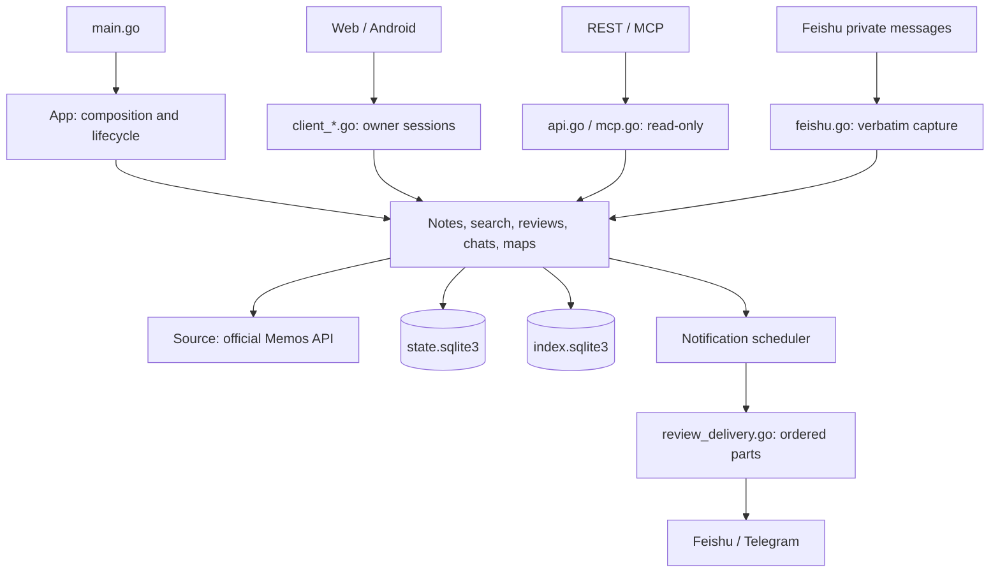

# Moerise Codebase Guide

[简体中文](CODEBASE.md)

This guide covers the repository layout, service dependencies, and common change entry points. See [Product Architecture](PRODUCT-ARCHITECTURE.en.md) for behavior and [Development](DEVELOPMENT.en.md) for setup and tests.

---

## 1. Reading Order

1. **Process entry**: `main.go` parses commands and loads configuration. `internal/app.go` composes services and manages their lifecycle.
2. **Request entry**: `internal/client_api.go` handles owner sessions for Web and mobile clients. `internal/api.go` and `internal/mcp.go` handle external read-only requests.
3. **Business services**: Follow a route to notes, search, reviews, chats, or maps. Routes handle protocols and access checks; shared services own business rules.
4. **Data boundaries**: `internal/memos*.go` calls official Memos APIs. `internal/store.go` manages the two local databases, transactions, and sync state.

`internal/` is one Go package, organized by feature prefixes. `App` explicitly composes shared services. Follow the relevant prefix when adding files. Before extracting a package, define its responsibility, dependency direction, and public interface.

---

## 2. Repository Layout

| Path | Purpose |
| --- | --- |
| `main.go`, root `*_test.go` | CLI, configuration checks, backup/restore, model diagnostics, and command tests |
| `internal/` | Core services, platform adapters, API contracts, and adjacent unit tests |
| `internal/migrations/state/` | Durable product schema; `001.sql` is the installation baseline |
| `internal/migrations/index/` | Rebuildable index schema; `001.sql` is the installation baseline |
| `web/src/` | Browser application source |
| `web/test/` | Node unit tests and Playwright browser flows |
| `tests/` | Real Memos integration tests with the `integration` build tag |
| `tests/testdata/` | Retrieval labels and fictional chat quality datasets |
| `scripts/acceptance/` | Joint Compose, browser, Core, and real Memos acceptance flows |
| `scripts/performance/` | CPU benchmarks and search quality evaluation |
| `scripts/lib/` | Shared process utilities and their tests |
| `deploy/resources/` | Compose resource profiles by CPU count and memory |
| `.github/workflows/` | Go, Web, browser, and real Memos CI checks |
| `docs/` | Paired Chinese and English product, development, API, and operations docs |

The root holds conventional entry points: `Dockerfile` and `compose.yaml` define deployment; `.env.example` and `config.example.json` provide configuration templates; `go.mod`/`go.sum` pin Go dependencies. `.dockerignore`, `.gitignore`, and `.gitattributes` govern build context, version control, and text formats. `LICENSE`, `CONTRIBUTING*`, and `AGENTS.md` describe licensing and contribution conventions.

`.local/` holds local configuration, disposable data, and reports. `web/dist/` contains generated assets. Both are excluded from version control.

---

## 3. Core Module Index

Paths below are relative to `internal/`. Corresponding `*_test.go` files sit beside their implementations.

| Module | Entry points and responsibility |
| --- | --- |
| Application and configuration | `app.go` composes and closes services; `config.go` and `config_environment.go` validate deployment configuration; `resources.go` derives CPU/memory budgets |
| Routes and access | `api.go` and `external_policy.go` enforce the external allowlist; `client_api.go` handles owner routes; `mcp.go` exposes read-only tools |
| Contracts | `models.go`, `client_models.go`, and `chat_models.go` define messages; `openapi.go` embeds `openapi.json` and `docs.html` |
| Memos adapter | `memos.go` calls the official API and normalizes data; `memos_live.go` handles live pagination and filters; `memos_stats.go` aggregates tags and calendars; `memos_auth.go` adapts official authentication |
| Sessions and settings | `sessions.go` manages encrypted sessions and CSRF; `settings.go` persists encrypted settings; `settings_api.go` exposes settings; `settings_runtime.go` applies changes |
| Notes and attachments | `notes.go` and `notes_live.go` read originals and timelines; `records.go` handles create idempotency; `notes_mutations.go` edits, archives, and deletes; `attachments.go` manages attachment writes |
| Client adapters | `client_notes.go`, `client_attachments.go`, `client_search.go`, `client_discovery.go`, `client_chat.go`, and `client_map.go` expose shared services to owner sessions |
| Sync and storage | `sync.go` completes pagination before publishing projections; `store.go` manages databases, bindings, jobs, and watermarks; `maintenance.go` backs up, restores, and rebuilds indexes |
| Search and walks | `chunks.go` preserves source offsets; `search_index.go` maintains FTS5; `search.go` ranks hybrid results; `related.go` finds related notes; `discovery.go` selects walk candidates; `discovery_api.go` adapts read-only requests |
| Vectors and maps | `embedding.go` adapts embedding protocols; `vector_index.go` builds and publishes generations; `map_layout.go` computes layouts; `map_store.go` persists them; `map.go` manages background snapshots and read caches |
| Daily reviews | `reviews.go` selects notes and reads plans; `review_plans.go` freezes rules and slot allocations; `reviews_api.go` exposes read-only queries |
| AI chats | `chat_selection.go` resolves selected materials; `chat.go` orchestrates generation; `chat_store.go` persists messages; `llm*.go` adapts model protocols and errors; `models_api.go` provides diagnostics |
| Notifications and channels | `notifications.go` owns scheduling, attempts, and outcome resolution; `notification_channels.go` binds recipients; `review_delivery.go` creates ordered parts; `feishu_delivery.go`, `feishu_review_parts.go`, and `telegram_delivery.go` adapt platforms |
| Feishu capture | `feishu.go` records private messages verbatim; `feishu_crypto.go` verifies callbacks and encrypts queues; `feishu_client.go` handles platform credentials, resources, and messages |

---

## 4. Frontend Module Index

| Path | Purpose |
| --- | --- |
| `web/src/app.js` | Startup, sessions, note lists, editing, and attachments |
| `routes.js`, `draft.js`, `errors.js` | Navigation, draft recovery, and error messages |
| `settings.js`, `insights.js`, `map.js` | Lazy-loaded settings, AI insights, and map pages |
| `chat-stream.js`, `markdown.js` | SSE parsing and Markdown rendering |
| `i18n.js`, `en.js` | Language selection, message binding, and English translations |
| `styles.css`, `shell.css`, `memos.css` | Style entry, application layout, and Memos login styles |
| `index.html`, `favicon.svg` | HTML entry and site icon |
| `web/build.mjs`, `web/server.mjs` | Content-hashed builds, compressed assets, same-origin proxy, and caching |
| `web/MEMOS-LICENSE` | License for the login code and styles derived from Memos |

---

## 5. Change Checklist by Feature

| Change | Related entry points |
| --- | --- |
| Requests, responses, or access | Routes, Go models, `openapi.json`, [API docs](API-V1.en.md), and interface tests |
| Deployment or product settings | `config*.go`, `settings*.go`, templates, settings UI, and [Operations](OPERATIONS.en.md) |
| Database structure | A new numbered SQL migration, related queries, backup/restore, and integration tests |
| Sync, originals, or attachments | Memos adapter, `sync.go`, note services, and real Memos integration tests |
| Delivery channels | Notification queue, shared review parts, platform adapter, and [Notifications](NOTIFICATIONS.en.md) |
| Interface text | Chinese source messages, `en.js`, and the relevant browser flow |

Place new tools in the appropriate script directory and update the [script guide](../scripts/README.en.md). Register both language versions of public docs in the [documentation index](README.md). Name tests by feature and write generated reports to `.local/`.
