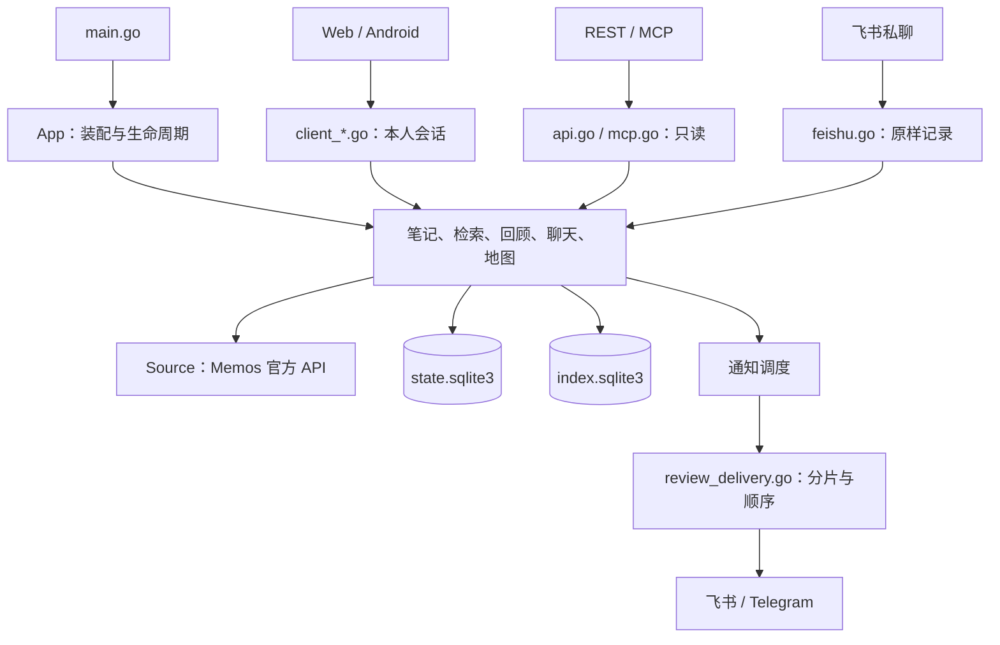

# Moerise 代码导览

本指南介绍仓库布局、服务依赖与常见改动入口。产品行为见[产品与架构](PRODUCT-ARCHITECTURE.md)，环境准备和测试命令见[开发指南](DEVELOPMENT.md)。

---

## 一、从哪里开始阅读

1. **进程入口**：`main.go` 解析命令、加载配置，再由 `internal/app.go` 创建服务并管理生命周期。
2. **请求入口**：`internal/client_api.go` 接收 Web 与移动端本人会话请求；`internal/api.go` 和 `internal/mcp.go` 接收外部只读请求。
3. **业务服务**：沿路由找到笔记、检索、回顾、聊天或地图服务。路由负责协议和权限，业务规则放在共享服务中。
4. **数据边界**：`internal/memos*.go` 访问 Memos 官方 API；`internal/store.go` 管理本地双库、事务和同步状态。

`internal/` 是一个 Go 包，按业务前缀组织文件，共享服务由 `App` 显式装配。增加文件时沿用所属业务的前缀；提取独立包时，先明确其职责、依赖方向和对外接口。

---

## 二、仓库目录

| 路径 | 用途 |
| --- | --- |
| `main.go`、根目录 `*_test.go` | 命令行、配置检查、备份恢复和模型诊断命令及其测试 |
| `internal/` | Core 业务服务、平台适配、接口契约和相邻单元测试 |
| `internal/migrations/state/` | 产品状态库结构；`001.sql` 为首次安装基线 |
| `internal/migrations/index/` | 可重建索引库结构；`001.sql` 为首次安装基线 |
| `web/src/` | 浏览器应用源码 |
| `web/test/` | Node 单元测试与 Playwright 浏览器流程 |
| `tests/` | 带 `integration` 构建标签的真实 Memos 集成测试 |
| `tests/testdata/` | 检索问题标注与虚构聊天质量评测数据 |
| `scripts/acceptance/` | Compose、浏览器、Core 与真实 Memos 的联合验收 |
| `scripts/performance/` | CPU 配置基准与检索质量评测 |
| `scripts/lib/` | 脚本共用的进程管理工具及测试 |
| `deploy/resources/` | 按 CPU 核数和内存划分的 Compose 资源配置档位 |
| `.github/workflows/` | Go、Web、浏览器和真实 Memos 的 CI 检查 |
| `docs/` | 产品、开发、接口与运维文档 |

根目录保留通用入口：`Dockerfile` 和 `compose.yaml` 定义部署，`.env.example` 与 `config.example.json` 提供配置模板，`go.mod`/`go.sum` 固定 Go 依赖。`.dockerignore`、`.gitignore`、`.gitattributes` 分别约束构建上下文、版本管理和文本格式。`LICENSE`、`CONTRIBUTING*` 与 `AGENTS.md` 说明许可证和贡献约定。

`.local/` 用于本地配置、临时数据和报告，`web/dist/` 是构建产物；两者均不进入版本管理。

---

## 三、Core 模块索引

以下路径均相对于 `internal/`。同名 `*_test.go` 与实现放在一起。

| 模块 | 源码入口与职责 |
| --- | --- |
| 应用与配置 | `app.go` 装配与关闭；`config.go`、`config_environment.go` 校验部署配置；`resources.go` 识别 CPU/内存并计算后台预算 |
| 接口与权限 | `api.go`、`external_policy.go` 管理外部只读白名单；`client_api.go` 管理本人会话路由；`mcp.go` 暴露只读工具 |
| 数据契约 | `models.go`、`client_models.go`、`chat_models.go` 定义请求与响应；`openapi.go` 嵌入 `openapi.json` 和文档页 `docs.html` |
| Memos 适配 | `memos.go` 处理官方 API 与数据规范化；`memos_live.go` 处理实时分页与筛选；`memos_stats.go` 聚合标签和日历；`memos_auth.go` 适配官方登录 |
| 会话与设置 | `sessions.go` 管理加密会话与 CSRF；`settings.go` 保存加密产品设置；`settings_api.go` 提供设置接口；`settings_runtime.go` 热更新服务 |
| 笔记与附件 | `notes.go`、`notes_live.go` 读取原文和时间线；`records.go` 处理创建幂等；`notes_mutations.go` 处理编辑、归档和删除；`attachments.go` 管理附件写入 |
| 客户端适配 | `client_notes.go`、`client_attachments.go`、`client_search.go`、`client_discovery.go`、`client_chat.go`、`client_map.go` 将共享服务接到本人会话接口 |
| 同步与存储 | `sync.go` 完整分页并发布投影；`store.go` 管理双库、绑定、任务与同步水位；`maintenance.go` 负责备份、恢复和索引重建 |
| 检索与漫步 | `chunks.go` 分块并保留原文偏移；`search_index.go` 维护 FTS5；`search.go` 混合排序；`related.go` 查找相关笔记；`discovery.go` 选择漫步候选；`discovery_api.go` 适配只读接口 |
| 向量与地图 | `embedding.go` 适配向量协议；`vector_index.go` 构建和发布向量代次；`map_layout.go` 计算布局；`map_store.go` 持久化布局；`map.go` 管理后台快照与读取缓存 |
| 每日回顾 | `reviews.go` 选择笔记并读取计划；`review_plans.go` 冻结规则与时段分配；`reviews_api.go` 提供只读查询 |
| AI 聊天 | `chat_selection.go` 解析所选材料；`chat.go` 编排生成；`chat_store.go` 保存会话和消息；`llm*.go` 适配模型协议与错误；`models_api.go` 提供模型诊断 |
| 通知与渠道 | `notifications.go` 管理调度、发送尝试和结果确认；`notification_channels.go` 绑定任务接收方；`review_delivery.go` 生成有序回顾分片；`feishu_delivery.go`、`feishu_review_parts.go`、`telegram_delivery.go` 适配平台 |
| 飞书记录 | `feishu.go` 接收私聊并原样记录；`feishu_crypto.go` 验证回调和加密队列；`feishu_client.go` 处理平台凭据、资源与消息 |

---

## 四、前端模块索引

| 路径 | 用途 |
| --- | --- |
| `web/src/app.js` | 页面启动、会话、笔记列表、编辑与附件交互 |
| `routes.js`、`draft.js`、`errors.js` | 导航状态、草稿恢复与错误文案 |
| `settings.js`、`insights.js`、`map.js` | 按需加载的设置、AI 洞察和地图页面 |
| `chat-stream.js`、`markdown.js` | SSE 消息解析与 Markdown 渲染 |
| `i18n.js`、`en.js` | 语言选择、消息绑定与英语翻译 |
| `styles.css`、`shell.css`、`memos.css` | 应用样式入口、主界面布局与 Memos 登录界面样式 |
| `index.html`、`favicon.svg` | HTML 入口和站点图标 |
| `web/build.mjs`、`web/server.mjs` | 带内容摘要的静态构建、压缩资源、同源代理与缓存策略 |
| `web/MEMOS-LICENSE` | Memos 衍生登录界面代码与样式的许可证 |

---

## 五、修改功能时要一起看什么

| 改动 | 关联入口 |
| --- | --- |
| 请求、响应或权限 | 路由、Go 模型、`openapi.json`、[API 文档](API-V1.md)和相应接口测试 |
| 部署或产品设置 | `config*.go`、`settings*.go`、配置模板、前端设置页与[运行指南](OPERATIONS.md) |
| 数据表结构 | 新增编号 SQL、对应读写、备份恢复与集成测试 |
| 同步、原文或附件 | Memos 适配、`sync.go`、笔记服务和真实 Memos 集成测试 |
| 推送渠道 | 通知队列、共享回顾分片、平台适配与[通知文档](NOTIFICATIONS.md) |
| 界面文字 | 中文源文案、`en.js` 和对应浏览器流程 |

新增工具先放到用途相符的脚本目录，并补充[脚本说明](../scripts/README.md)。新增公开文档在[文档导航](README.md)登记入口。测试按功能命名，生成报告写入 `.local/`。
