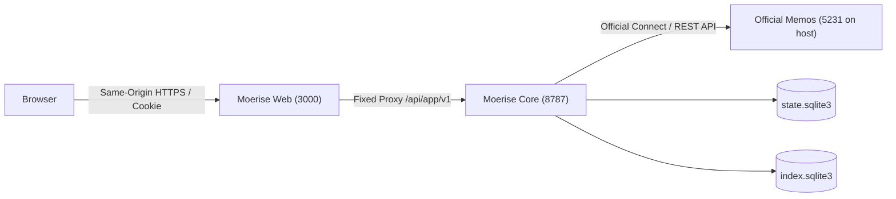

# Moerise Web Integration & System Design

[简体中文](DESIGN.md)

This document describes Web integration, client/server communication, and the implementation of core interaction modules.

---

## 1. Integration & Topology

Moerise uses **Memos + Moerise Core + Moerise Web** as independently deployed components:



### Key Decisions

1. **One public Web origin**:
   - Browsers access Web at an origin such as `https://notes.example.com`.
   - Web serves HTML/static assets and forwards only `/api/app/v1/*` to Core.
2. **Separate credentials**:
   - Browsers hold an opaque Moerise session cookie with `HttpOnly`, `SameSite=Lax`, and `Secure` on HTTPS.
   - The Memos PAT remains server-side in Core.
   - External tools use an independent read-only Bearer token for `/api/ext/v1` and `/mcp`.
3. **Small frontend**:
   - Vanilla JavaScript, HTML, and CSS require no runtime framework bundle.

---

## 2. Communication & Security

### 1. Authentication & Session Lifecycle

- **Memos authentication**:
  - Web accepts the Memos username and password.
  - Core calls official authentication, obtains access and refresh credentials, and verifies the bound author.
  - Core persists encrypted refresh credentials in `state.sqlite3` and issues a browser session cookie.
- **Cookies**:
  - HTTPS uses `__Host-moerise_session`; loopback HTTP uses `moerise_local_session`.
  - Both use `HttpOnly`, `SameSite=Lax`, and `Path=/`; HTTPS adds `Secure`.
- **CSRF**:
  - Login returns a `csrf_token` held in browser memory.
  - Login checks `Origin`. Subsequent authenticated non-read requests require `X-CSRF-Token` and an `Origin` matching `web.public_origin`.

### 2. Idempotent Writes

- Creation requires a client-generated `Idempotency-Key`.
- Core stores its request hash and assigned source ID in `state.sqlite3`.
- Retrying an uncertain result reuses the key and complete body to avoid duplicate source notes.

---

## 3. Frontend Modules

### 1. Layout & Languages

- **Two columns**: A 260px sidebar provides navigation, search, calendar/tags, and settings. The main reading area is capped at 760px and adapts to mobile screens.
- **Language switching**: Chinese phrases are message keys in `i18n.js`. Browser language selects the initial locale; manual switching updates DOM text without refreshing, preserving drafts, map position, and active chat streams.

### 2. Timeline & Inline Editing

- **Live timeline**:
  - Normal notes are ordered by creation time descending.
  - Load More continues through `page_token` paging.
  - Search, tags, and calendar dates form one combined filter.
- **Editing**:
  - Open Edit from the note's More menu.
  - `Ctrl+Enter` saves and `Esc` cancels.
  - Ordinary content edits preserve creation time and timeline order.

### 3. Cognitive Map

- **Background snapshots**: After vector readiness, Core runs PCA and local spiral placement. Ordinary changes are combined at 24-hour intervals; unchanged data skips computation.
- **Local interaction and live reading**: The browser renders published coordinates and handles pan/zoom locally. Arrow keys pan, `+`/`-` zoom, `Home` fits the map, and `R` rereads the snapshot. Selecting a point retrieves live note content and attachments.

### 4. Streaming AI Insights

- **Explicit selection**: Use selected historical notes as context; material bodies are limited to 20,000 Unicode code points.
- **SSE**: POST generation requests stream incremental output. Users can stop generation. Restart preserves saved interrupted text without automatically calling the model again.
- **Saving**: Completed assistant replies can be saved unchanged to Memos with persistent idempotency.

---

## 4. Container Topology

[compose.yaml](../compose.yaml) defines the full deployment. The service relationships are summarized below:

```yaml
services:
  memos:
    profiles: [memos, local]
    image: neosmemo/memos:0.31.0
    restart: unless-stopped
    volumes:
      - memos-data:/var/opt/memos

  moerise:
    build: .
    restart: unless-stopped
    volumes:
      - state-data:/data/state
      - index-data:/data/index
      - backup-data:/backups
    environment:
      - MOERISE_MEMOS_BASE_URL=http://memos:5230
      - MOERISE_WEB_ENABLED=true

  web:
    build: ./web
    restart: unless-stopped
    depends_on:
      moerise:
        condition: service_healthy
    environment:
      - CORE_ORIGIN=http://moerise:8787
      - PUBLIC_ORIGIN=${MOERISE_PUBLIC_ORIGIN}
    ports:
      - "127.0.0.1:3000:3000"
```

Web runs as a non-root user and communicates with Core over the internal Docker network. Full Compose settings include health checks, named volumes, and service limits.
