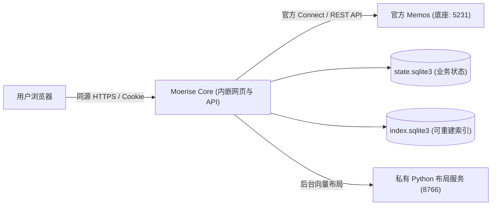

# Moerise Web 集成与系统设计

本文档阐述 Moerise Web 客户端的系统集成设计、前后端通信契约以及核心交互模块的技术实现方案。

---

## 一、集成方案与系统拓扑

Moerise 由 **Memos、内嵌 Web 的 Moerise Core** 与独立布局服务组成：



### 关键设计决定

1. **统一单域名与同源接口**：
   - 浏览器仅访问 Moerise Web 暴露的对外服务地址（如 `https://notes.example.com`），无需跨域。
   - Core 内嵌静态资源与 HTML，直接处理 `/api/app/v1/*`，附件与 SSE 无需经过额外代理。
2. **多层鉴权凭据隔离**：
   - 浏览器持有 Moerise 颁发的不透明会话 Cookie（`HttpOnly`、`SameSite=Lax`、`Secure`）。
   - Memos 长期管理员 PAT 仅保存在 Core 服务端，不暴露给前端浏览器。
   - 外部自动化与 AI 工具通过独立的只读 Bearer Token 访问 Core 的 `/api/ext/v1` 和 `/mcp`。
3. **原生模块与职责边界**：
   - Web 前端使用原生 JavaScript、HTML 和 CSS，没有第三方运行时依赖。浏览器负责输入、呈现、导航与视口；静态分发、身份、写前作者核验、业务规则和持久状态由 Core 管理。

---

## 二、通信契约与安全机制

### 1. 认证与会话生命周期

- **Memos 身份认证适配**：
  - 用户在 Web 登录页输入 Memos 用户名和密码。
  - Core 调用 Memos 官方认证协议验证凭据，获取访问令牌与刷新 Cookie，并校验账号是否属于实例绑定的作者。
  - 校验通过后，Core 在 `state.sqlite3` 中加密记录持久化会话，并通过响应头向浏览器设置会话 Cookie。
- **Cookie 安全策略**：
  - 生产 HTTPS 环境使用前缀安全 Cookie：`__Host-moerise_session`；本地回环调试使用 `moerise_local_session`。
  - 设置 `HttpOnly` 防止 XSS 窃取，设置 `SameSite=Lax` 防止跨站伪造，设置 `Path=/`。
- **CSRF 双重防御**：
  - 登录成功后，Core 向前端返回唯一的 `csrf_token`，仅保存在浏览器运行内存中。
  - 登录请求校验 `Origin`；登录后的非只读请求（POST / PATCH / DELETE）还需提供 `X-CSRF-Token`，且 `Origin` 必须精确匹配配置的 `web.public_origin`。

### 2. 请求幂等性设计

- **保存防重复**：
  - 创建笔记必须附带客户端生成的 `Idempotency-Key`（UUID 或唯一随机串）。
  - Core 将该幂等键与请求摘要保存在 `state.sqlite3` 中。
  - 当遭遇弱网超时或连接异常中断时，用户点击重试将复用相同幂等键，确保 Memos 中绝不产生重复条目。

---

## 三、前端核心模块设计

### 1. 布局与双语国际化

- **响应式布局**：
  - 侧栏和边距随窗口调整，正文限制阅读宽度，地图使用完整工作区。回顾与漫步固定阅读框，长文在框内滚动。
  - 视口不超过 960px 时使用手机工具栏与导航抽屉，支持边缘滑动、搜索展开和屏幕安全区。
  - 切换布局保留筛选、输入焦点与笔记草稿；导航抽屉使用原生模态 `dialog` 管理焦点。
- **双语自适应与热切换**：
  - 采用中文词条作为 Message Key，通过 `i18n.js` 进行客户端映射。
  - 按浏览器语言顺序匹配，登录页和设置支持手动切换或恢复跟随浏览器，偏好仅保存在本机。
  - 原地更新界面文案，保留表单、草稿、地图视口与对话状态。
- 设置按模块使用顶部横向页签，高级参数直接展示，切换页签保留输入并统一保存。
- 回顾与漫步使用卡片动画，遵守 `prefers-reduced-motion`；漫步预览和关联结果均来自 Core 接口。

### 2. 时间线与卡片即时编辑

- **实时时间线加载**：
  - 默认以 `created_desc` 倒序展示未归档笔记。
   - 点击「加载更多」继续读取分页（基于 `page_token` 游标机制）。
  - 搜索支持关键词、语义和混合方式，与标签、日期筛选组合使用；筛选栏仅展示标签和日期，清除筛选保留搜索词与搜索方式。
- **卡片内即时编辑**：
   - 从卡片的「更多操作」菜单进入编辑，支持 `Ctrl+Enter` 快速保存、`Esc` 取消。
  - 编辑只修改 Memos 中的正文或标签，创建时间不变，不影响时间线排序。
  - 请求层保留会话代次、Cookie、内存 CSRF、超时与取消；CSRF 续取后仅重放一次原请求。编辑与删除携带 `source_hash`，结果不明的写入保持同一幂等键与冻结请求体。
  - 卡片正文、元信息、原生标签和附件共用呈现模块，编辑器继续管理独立草稿。屏外卡片按真实测量值建立尺寸占位，聚焦或编辑时恢复完整布局。

### 3. 观星

- Core 复用已发布笔记向量，由独立服务生成均衡 UMAP、主题和星体属性；普通变化按一分钟间隔合并，未变笔记复用坐标，读取不触发布局计算。
- Canvas 铺满工作区，提供星图与摄影氛围、平移缩放、主题聚焦、键盘和全屏操作。辉光源于真实密度，近景摘要按需读取。
- 快照保存在索引库，模型保存在独立布局卷；计算过程不持有同步与向量构建的后台锁。没有文本向量的笔记通过列表读取。
- 预览与详情读取 Memos 实时原文；桌面侧边展示详情，窄窗口使用底部面板。
- 正式星图的密度计算与 Canvas 绘制在 Worker 中运行，通过可转移 ImageBitmap 交回页面合成；保留星核、光晕、密度色彩及模糊参数。页面合并在途重绘与最新视图，丢弃过时代次，空间网格用于点选。
- 页面维护可见点位中的约 120 个键盘按钮，并保留选中与聚焦项。Worker 错误或超时回退到分批计算和绘制，优先使用 `scheduler.yield()`，缺失时使用定时器让步。切页销毁 Worker、帧请求和点位节点。

算法参数、增量与迁移规则见[观星](STARGAZING.md)。

### 4. 流式 AI 洞察

- **灵活选材**：
  - 支持多选任意历史笔记作为会话的上下文材料。
  - 材料区域直接展示，选择器逐页请求候选；选中状态独立于候选页和筛选，取消过时请求并隔离迟到响应。分页失败保留候选与游标，重试同一页。
  - 材料限制按 Unicode 码点统计，读取候选接口的 `character_limit` 和来源复查接口的 `limit`；缺字段时兼容默认 20,000。选择完成后由 Core 复查实时原文与材料规模，客户端校验提供即时反馈。
- **Server-Sent Events (SSE) 流式传输**：
  - 客户端通过 POST 请求发起会话，并通过 SSE 协议实时接收大模型 token 流。
   - 支持主动停止生成与持久会话；重启后保留中断文本，不自动续调模型。
  - 满意的 AI 产出支持一键幂等保存为 Memos 笔记。
  - token 接收与呈现分离，每 100 ms 合并更新。围栏外的完整段落保留 DOM，未完成尾部超过 4096 字符时先显示安全文本，终态重新执行完整安全 Markdown 解析；国际化跳过正文子树。

### 5. 共享交互与生命周期

- `dom.js`、`notes.js`、`modal.js` 和 `menus.js` 提供共享 DOM、卡片、原生模态与菜单。菜单对 Popover、Invoker、Anchor 和 focusgroup 分别检测；显式 ARIA 语义与键盘回退保持一致。
- `router.js` 管理 URL 和 history entry，进入页面聚焦正文，筛选保留输入焦点，详情返回恢复来源链接。同一页面的片段记录共用页面 key 并保持节点，继承地图视口、笔记来源和列表位置；跳回地址相同但 key 不同的页面记录时恢复其独立状态。脏设置或洞察输入遇到跨页历史返回时，先恢复来源 entry，再确认是否返回。
- 历史位置优先读取 `Navigation.currentEntry.index`，History API 回退只使用同一索引链。旧浏览器遇到没有索引的记录时，重建来源记录后确认，保持地址与表单一致；该兼容分支清理目标记录之后的前进历史。
- `leave-guard.js` 仅在存在输入时注册 `beforeunload`，确认默认聚焦“继续编辑”。笔记草稿留在会话内，设置字段与未提交洞察输入离开前确认；浏览器存储仅保存语言偏好。
- 页面工厂持有请求与事件的生命周期，销毁时取消；共享请求以会话代次隔离私人数据，退出清理草稿、快照和有界尺寸缓存。隐藏页面暂停轮询，恢复时重读持久状态。
- CSS 按 `tokens → shell → auth → pages → interaction` 分层，保留视觉变量，统一焦点、点击区域与高对比处理。正文排版限定在笔记内容区域，避免覆盖控件和设置说明。

---

## 四、运维与容器编排拓扑

仓库根目录的 [compose.yaml](../compose.yaml) 定义完整编排；以下为服务关系摘要：

```yaml
services:
  memos:
    profiles: [memos, local]
    image: neosmemo/memos:0.31.0
    restart: unless-stopped
    volumes:
      - memos-data:/var/opt/memos

  moerise:
    build: .
    ports:
      - "127.0.0.1:3000:8787"
    restart: unless-stopped
    volumes:
      - state-data:/data/state
      - index-data:/data/index
      - backup-data:/backups
    environment:
      - MOERISE_MEMOS_BASE_URL=http://memos:5230
      - MOERISE_WEB_ENABLED=true
      - MOERISE_LAYOUT_URL=http://layout:8766

  layout:
    build: ./services/layout
    restart: unless-stopped
    volumes:
      - layout-data:/data
    mem_limit: 1g
    cpus: 1.0

```

Core 容器以非 root 用户运行，默认将回环地址的 3000 端口映射至容器内 8787 端口。
