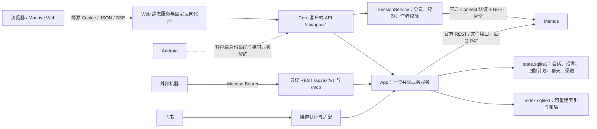
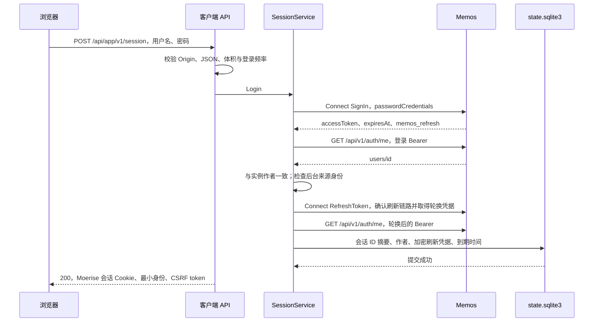

# Moerise Web 集成技术设计

日期：2026-10-28

代码基准：`adeb94ec38c2a85173ee8d66573b944cedb2f354`

范围：ROADMAP 3.1 的实施设计，以及 3.2—3.9、Android 的接口与生命周期边界。

产品依据：[PRD](PRD.md)、[ROADMAP](ROADMAP.md)。

工程依据：[产品与架构](PRODUCT-ARCHITECTURE.md)、[API v1](API-V1.md)。

产品规则以 PRD 为准。登录表单沿用 Memos；登录后的可见文案、元素、布局与样式严格遵循 Moerise-Web 原型。原型文件为 `.local/web-integration/2026-10-28/prototype/Moerise-Web/Main.dc.html`；页面映射与演示逻辑替换见第 10 节。

协议实现与集成测试见 `internal/memos_auth.go`、`internal/sessions.go`、`internal/notes_live.go` 和 `tests/client_acceptance_test.go`。

## 1. 推荐方案

继续采用 **Memos + Moerise Core + Moerise Web**。Web 是独立构建和部署的客户端；Core 是 Go 模块化单体，在同一进程内增加客户端 API、浏览器会话和最小应用装配层。

浏览器只访问一个 Moerise 域名。Core 通过官方协议访问 Memos 的账户、笔记和附件能力，通过共享业务服务提供回顾、检索、模型及渠道能力。浏览器持有 Moerise 的不透明会话 Cookie；Memos 会话凭据、后台 PAT、机器访问令牌分别管理。

| 架构决定 | 推荐 | 确定时机 |
| --- | --- | --- |
| 客户端 API | 增加 `/api/app/v1`，承接 Web，供 Android 复用 | 3.1 |
| 机器入口 | `/api/ext/v1` 和 `/mcp` 使用独立 Bearer 与只读操作白名单；不开放笔记/产品状态写入或结构化生成 | 3.1 |
| Memos 登录协议 | Core 调用官方 Connect 的 SignIn、RefreshToken、SignOut；身份使用已实测的 REST `/api/v1/auth/me` | 3.1 |
| 浏览器会话 | 随机会话 ID；刷新凭据加密保存在既有 `state.sqlite3`；访问令牌仅在内存缓存；重启可续期 | 3.1 |
| 作者身份 | 登录用户资源名必须与实例绑定用户一致；不根据登录用户名自动更换绑定 | 3.1 |
| 原生笔记能力 | 共享笔记服务调用 Memos 官方 API，按操作提供明确接口 | 3.1 起 |
| 时间线来源 | 客户端直接读取 Memos，默认 `NORMAL + created_desc`；机器保留独立的索引列表和默认值 | 3.1 |
| 业务装配 | 一个 App 持有一套 Store、服务、Provider 和工作循环 | 3.1 |
| 动态配置 | App 管理有效配置和资源替换；日常设置进入产品状态，基础设施留在部署环境 | 边界在 3.1 确定，3.3 实现 |
| 后续能力 | 回顾增加全天计划/时段分配；漫步修正选取；聊天持久化且单独编排；地图增加布局 | 随 3.5—3.8 |

不增加第二个业务后端、Redis、独立身份服务或任务平台。保留 `internal/` 单包组织，新增文件按职责命名。Web 遵循 PRD 已确定的两栏布局、侧栏顺序、跨页筛选和详情交互；技术方案不重新定义布局与视觉。

## 2. 已有资产与关键事实

### 2.1 代码及审计依据

| 资产或限制 | 依据 | 设计含义 |
| --- | --- | --- |
| `NewAPI` 创建 Records、Reviews、Search、AI、Notifications、Feishu，随后创建 MCP | `internal/api.go:34` | 第二个客户端 Handler 不能再调用一次 `NewAPI` 来取得服务 |
| `serve` 持有写锁、Store、MemosClient、模型、HTTP Server 和后台循环 | `main.go:136` | 装配归属应从 HTTP 对象收拢到 App，延续一进程一套后台运行链路 |
| Store 同时持有 state/index，两份数据库各限制一个连接，包含进程内回顾锁和向量锁 | `internal/store.go:22`、`:36`、`:151` | 持续复用同一个 Store；SQL 事务不得跨上游网络调用 |
| 认证只识别配置中的机器 Bearer；`/me` 输出凭据和绑定信息 | `internal/api.go:90`、`:312` | `/me` 可复用身份字段，不能直接充当浏览器登录 |
| `Source` 已有身份、获取、同步分页和创建；同步分页固定按更新时间升序 | `internal/memos.go:17`、`:157` | 同步分页不能直接充当面向用户的时间线分页 |
| 笔记列表先取索引候选，再逐条读取来源 | `internal/api.go:373`、`internal/store.go:604` | 能复用读取和游标基础，但全新来源笔记要等候选索引发现 |
| 创建已经持久幂等，完成时刷新投影；独立 tags 会排序并加前缀，空正文被拒绝 | `internal/records.go:25`、`:141`、`:255` | 复用幂等与投影；3.1 只传原正文，3.2 修正纯附件和共享标签处理 |
| 附件只有元数据；下载函数面向渠道图片，整体读入内存、限制 10 MiB | `internal/models.go:91`、`internal/attachments.go:33` | 浏览器图片和普通文件读取需专门的受控流式接口 |
| `API.Settings`、`Store.Settings`、客户端和 Provider 各持构造配置 | 资产审计 R1、R2 | 3.3 不能只修改设置表或对某一个 Settings 赋值 |
| 结构化 AI、语义漫步与客户端产品行为存在差距 | 资产审计 3.2、ROADMAP 阶段三 | 共享底层资产，不能直接包装成聊天或随机语义漫步 |

沿用资产审计关于共享服务、来源检查、附件访问、密钥生命周期、OpenAPI 和动态配置的结论。PRD 审计中的产品疑问以已确认决策及 PRD 为准。全面拆包、旧生成端代码删除、漫步算法修改不属于 3.1；外部机器只读限制属于 3.1。

### 2.2 Memos 认证协议实测

认证适配采用以下固定镜像的协议：

```text
neosmemo/memos:0.31.0@sha256:24c2707ddd8fbd2ceaa7a61ecab86a53cdcde640b24ce572b73da14b00b5785f
```

| 操作 | 结果 | 对设计的约束 |
| --- | --- | --- |
| REST `POST /api/v1/auth/signin` | 200；刷新 Cookie 出现在 `Grpc-Metadata-Set-Cookie`，响应没有标准 `Set-Cookie` | 不能按浏览器原生 Cookie 登录方案直接接入这条链路 |
| REST `POST /api/v1/auth/refresh`，显式携带提取出的刷新 Cookie | 401 | 只改写登录响应头不足以构成完整续期方案 |
| Connect `AuthService/SignIn` | 200，取得访问令牌和刷新 Cookie | 用作 Core 的登录适配 |
| REST `GET /api/v1/auth/me`，携带登录返回的 Bearer | 200，用户与创建账户一致 | 核验登录身份的可靠路径 |
| REST `/api/v1/auth/me` 只带刷新 Cookie | 401 | Cookie 不能直接替代身份核验的 Bearer |
| Connect `RefreshToken` | 200，刷新 Cookie 轮换；旧 Cookie 再刷新为 401 | 每个会话必须串行刷新并持久替换刷新凭据 |
| Connect `SignOut`，携带访问令牌及刷新 Cookie | 200；该刷新凭据再次使用为 401 | 上游退出需要一并传递两类凭据 |
| 上游退出后，再用原短期访问令牌读取 `/auth/me` | 200 | Moerise 的退出必须先撤销本地会话 |

客户端 API、应用装配和浏览器流程的完成判据见第 11 节。

上游固定标签源码用于理解令牌轮换、认证与响应头；运行镜像的协议行为优先用于选择接入路径。升级 Memos 时通过真实集成测试检查登录、续期和退出协议。

## 3. 推荐架构与通信边界



统一的是浏览器访问源和客户端契约，不要求把 Memos 的全部 API 转发给浏览器。

| 能力 | 访问路径 | 原因 |
| --- | --- | --- |
| Memos 账户认证 | 客户端 → Core SessionService → 官方认证接口 | 密码短暂传递；上游令牌只进入服务端 |
| 时间线、笔记读写、标签、附件 | 客户端 → Core NoteService → 官方 Memos API | 统一作者范围、错误、幂等、附件身份和客户端模型 |
| 搜索、回顾、漫步、聊天、地图、设置 | 客户端 → 对应共享业务服务 | Web 与其他入口共享产品状态及规则 |
| 机器 REST/MCP | 独立 Bearer 与只读白名单 → 同一读取服务 | 调用方自带模型分析；不复用 Cookie 或传出 PAT |
| Memos 自有界面 | 使用配置的 Memos 公开地址 | 独立维护、升级及账户管理 |

3.1 不建立任意路径的 `/memos/*` 透传，也不把后台 PAT 自动附到任意浏览器请求。这样可以避免客户端绕过作者范围调用 Memos 的管理接口、账户接口或其他作者的资源。以后增加一种原生笔记操作，只增加对应共享操作和请求映射。

同源客户端 API 由 Core 持有；Web 静态服务只做静态文件和固定路径转发。Core 内部直接调用 Go 服务，不通过 loopback HTTP 转调已有 REST。

只读按业务操作判断，不能简单禁止全部 POST：搜索和无持久副作用的漫步读取可使用 POST。外部令牌即使含 `notes:write`、`reviews:write`、`discovery:write`、`sync:write` 或 `ai:generate`，也不能进入写入、状态变更或生成操作。MCP 的工具发现和直接调用使用同一白名单。

运维通知确认等必要写入保留业务服务，通过绑定作者会话的受控管理适配调用；可在 `/api/app/v1/admin/notifications` 下复用管理业务和 DTO，沿用 CSRF、Origin 与回执核验，不建设对应 Web 页面。含机器认证的旧 Handler 不能只换前缀直接挂载。外部机器路由不能借“管理接口”恢复写权限。3.1 只迁移维持既有发送恢复所必需的管理操作，不扩展设置或回顾编辑能力。

## 4. 身份、会话与凭据

### 4.1 凭据分工

| 凭据 | 所属方与存放位置 | 允许用途 |
| --- | --- | --- |
| Memos 用户密码 | 登录请求期间的内存 | 交给 Memos SignIn；不写入产品状态、日志或配置 |
| Memos 刷新令牌 | Core 会话表中的加密字段 | 维护该次用户登录和撤销该次上游会话 |
| Memos 短期访问令牌 | Core 每会话内存缓存 | 核验真实用户、上游退出；不送往浏览器 |
| Moerise 浏览器会话 ID | HttpOnly Cookie；数据库只保存摘要 | `/api/app/v1` 浏览器身份 |
| CSRF token | 会话属性及客户端运行内存 | 核验浏览器状态变更请求；不能单独取得身份 |
| Memos PAT | 服务端启动配置 | 后台同步、读取和受控笔记操作 |
| Moerise 机器访问令牌 | 服务端配置、机器调用方 | Scope 与只读操作白名单同时生效；只访问外部读取能力 |
| 状态加密主密钥 | `.env` 或部署 Secret | 保护会话及 3.3 设置密文；按用途派生子密钥 |

Memos 登录用户、后台 PAT 所属用户、实例绑定的 `users/{id}` 必须相同。用户名可修改，不作为持久身份键。管理员角色不能扩大到其他作者。用户登录失败、过期或被禁用时，客户端入口不得回退到后台 PAT 来取得用户身份。

笔记操作仍由已有后台 MemosClient 执行，是经过本人会话验证后的实例内委托。MemosClient 的凭据始终固定，不按浏览器请求原地更换。共享业务继续检查来源版本、PAT 身份与笔记作者；客户端入口额外检查真实登录用户，二者承担不同职责。

绑定作者会话具有原生客户端的本人操作能力，包括对应阶段的笔记写入和日常设置；模型或渠道操作仍受配置状态限制。客户端权限不通过复制一条机器全权令牌取得，新增设置接口也不自动增加机器令牌的权限。

### 4.2 登录流程



Core 使用 `net/http` 调用三种官方 Connect unary 方法，协议采用 HTTP POST、JSON 及 `Connect-Protocol-Version: 1`。3.1 无需引入整个 Memos Go 模块或 protobuf 生成工具链。其方法路径为：

```text
/memos.api.v1.AuthService/SignIn
/memos.api.v1.AuthService/RefreshToken
/memos.api.v1.AuthService/SignOut
```

登录请求由 Moerise DTO 映射到 Memos `passwordCredentials`；错误映射为客户端错误代码。只提取预期的 `memos_refresh` Cookie，检查响应结构、时间及体积，不透传上游响应头和令牌。认证 HTTP Client 不设置全局 CookieJar，按会话显式附带 Cookie，避免不同登录混用。固定来源、超时和禁止重定向延续现有 MemosClient 的方式。

身份不匹配时返回 403 `ACCOUNT_NOT_BOUND`，清理临时凭据并尝试退出刚创建的上游会话；不更换绑定、不创建 Moerise 账户。首次登录同时验证续期链路，可以发现只放通 REST 的外部反向代理，也避免把无法续期的会话当成成功登录。

3.1 实现密码登录。capabilities 明确登录方式；仅开放 SSO、需要额外认证步骤或禁用密码的外部实例返回明确的不支持状态，不用输入 PAT 代替用户登录。官方其他登录方式的适配按真实部署需要补充。

### 4.3 会话保持与数据

使用既有 `state.sqlite3` 保存会话，使刷新页面、关闭再打开浏览器以及 Core 正常重启后可以继续登录。访问令牌无需落盘；重启后用加密保存的刷新令牌重新取得访问令牌。

新表概念字段如下；实际迁移使用实现时的下一个编号，不修改已应用 SQL。

```text
client_sessions
  session_hash          primary key，256 位随机 ID 的 SHA-256
  instance_id
  user_name
  source_binding_hash   绑定实例 ID、作者与规范化来源根地址
  refresh_ciphertext    带版本、nonce 的 AEAD 密文
  refresh_expires_at
  csrf_token
  created_at
  updated_at
  revision              刷新凭据替换与撤销的并发校验
```

新增部署字段建议为 `MOERISE_WEB_ENABLED`、`MOERISE_PUBLIC_ORIGIN`、`MOERISE_STATE_ENCRYPTION_KEY`。只运行机器 Core 的部署可关闭客户端入口；启用时要求公开 Origin 和加密密钥完整。主密钥不复用分页密钥、PAT 或飞书 Secret；会话和设置使用不同用途的派生密钥，密文关联会话摘要及来源绑定。

登录时以 Memos 刷新凭据的到期时间确定本地会话的固定期限。上游续期只替换刷新凭据，不延长本地会话期限；Cookie 仅在登录时设置、退出时清除，读取和业务响应不重写 Cookie。3.1 不额外引入空闲退出或“记住登录”选项；有界会话清理和登录限流由服务端实现。

数据库事务只更新会话元数据，不持有事务等待 Memos 网络返回。过期会话在访问时删除，附加低频、有界清理，不建设独立调度平台。

备份会包含刷新凭据密文，加密主密钥随部署配置单独保管。**恢复产品快照后清除客户端会话，要求重新登录**，防止旧 Cookie 随快照重新生效。普通重启和升级保留有效会话；索引重建不删除会话。加密密钥替换可以使会话失效，日常设置密钥迁移则在 3.3 单独处理。

### 4.4 每次请求、续期和退出

一次受保护的客户端请求按顺序执行：

1. 检查会话 Cookie、数据库会话、来源绑定及到期时间，构造可信的客户端身份。
2. 没有可用访问令牌或接近到期时，按会话加锁，使用官方 RefreshToken；将轮换后的刷新凭据提交后才向等待请求交付新访问令牌。
3. 用用户访问令牌读取官方 `/api/v1/auth/me`，核验作者及有效用户；3.1 不缓存这一身份判断。
4. 检查操作权限；写请求同时检查 Origin 和 CSRF。调用共享业务，由其执行后台来源和资源范围检查。

同一会话只允许一个续期请求。数据库 revision 校验避免已退出会话被并发续期重新创建。续期返回之后、持久替换之前崩溃，可能失去可用刷新凭据；该会话重新登录，不重放不确定的令牌轮换来伪造成功。

上游明确拒绝用户凭据时删除本地会话并返回 401。网络或上游服务故障返回 503，保留本地会话，允许恢复后重试。后台 PAT 被拒绝属于来源配置错误，即使用户登录有效，笔记业务也返回来源故障，不转换成用户密码错误。

`DELETE /api/app/v1/session` 在内存保留退出所需凭据快照，先持久撤销本地会话、失效访问缓存，再尝试官方 SignOut，最后清除 Cookie，返回 204。上游退出需要有效的访问令牌；必要的刷新只服务于该次退出清理，不能重建已撤销的本地会话。上游不可达也能退出 Moerise；本地撤销失败返回 503，不能仅删除 Cookie 后声称服务器会话已撤销。没有有效会话时，经过 Origin 检查即可清除 Cookie 并幂等返回 204。

退出与刷新共用会话锁和 revision；已取得身份的请求在发起新的写操作前检查会话是否撤销。退出不撤销机器令牌、后台 PAT 或其他设备会话。已经提交到 Memos 的笔记不会因退出回滚；后续聊天流在退出时取消。

Memos 中单独撤销 Moerise 对应的上游刷新会话，要到下一次刷新才能被这套协议发现；用户短期访问令牌可能继续有效，上游源码给出的生命周期为 15 分钟。3.1 采用这一有界失效窗口并覆盖测试。`/auth/me` 每次核验能检查账号身份，但不能据此声称刷新会话撤销立即生效；Moerise 本地退出立即撤销本地会话，不改用后台 PAT 掩盖撤销。

### 4.5 浏览器边界

正式 HTTPS 环境使用 `__Host-moerise_session`，属性为 `Secure; HttpOnly; SameSite=Lax; Path=/`，不设置 Domain。本地 HTTP 联调使用独立 Cookie 名并只允许 loopback Origin。Cookie 的到期时间与本地会话一致。

所有登录及状态变更请求精确检查配置的公开 Origin，拒绝缺失、不匹配和 `null` Origin；客户端 JSON 采用明确 Content-Type。登录后写请求携带会话对应的 `X-CSRF-Token`。跨源不开放带凭据 CORS。浏览器路径不接受 Authorization 来切换身份；机器路径只按已有 Bearer 认证，忽略 Cookie。

代理头只来自配置的可信代理；不能用任意 `X-Forwarded-Host` 或 `X-Forwarded-Proto` 推导合法 Origin。登录限流使用已核实的来源地址和账户维度，返回统一错误，保留 Memos 的上游频率限制。

身份与私人内容响应使用 `Cache-Control: no-store`。会话令牌不进入 URL、localStorage、静态配置或客户端日志。笔记 Markdown 在客户端安全渲染，原始 HTML、危险链接与附件主动内容不能取得执行权限。浏览器退出后清空运行内存中的私人数据；历史返回时重新核验会话。

## 5. 两种部署方式

### 5.1 一体化 Compose

```text
使用者 → 同一个公开 Origin → Web 静态服务及固定代理
                                 └─ Core:8787
                                      └─ Memos:5230
```

目标服务为官方 `memos`、`core`、`web` 三个组件。Web 镜像中的轻量 HTTP 服务可以同时承担静态分发和到 Core 的固定反向代理，不必额外增加网关服务。TLS 可接入部署者已有入口，3.4 再确定默认交付方式。

Core 的 `memos.base_url` 使用容器内地址；`memos.public_url` 用于打开 Memos 原文。Web 构建产物只使用相对路径 `/api/app/v1`，不包含容器地址、PAT、模型或渠道凭据。Memos、state、index 各有独立数据卷，Web 静态文件不要求可写产品数据卷。

已有 `compose.yaml` 提供 Core 和 local profile 的 Memos，没有 Web。3.1 的测试环境可以复用它的镜像及网络结构；完整首启、服务依赖、健康检查、持久化和升级在 3.4 交付。

### 5.2 连接外部 Memos

Web 和 Core 结构相同，仅改变 Core 的 Memos 连接配置。浏览器无需访问外部 Memos 域名，不依赖第三方 Cookie 或外部 Memos 的 CORS 配置。

Core 到外部来源必须能访问：

```text
GET  /api/v1/instance/profile
GET  /api/v1/auth/me
POST /memos.api.v1.AuthService/SignIn
POST /memos.api.v1.AuthService/RefreshToken
POST /memos.api.v1.AuthService/SignOut
以及笔记、附件对应的官方 REST 与文件接口
```

外部反向代理只放通 `/api/v1/*` 的情况需要补齐官方认证路径。Core 保持证书校验及固定来源，不跟随重定向发送密码和令牌。Memos 自带界面可使用另一个公开域名，其 Cookie 不与 Moerise 共用。

### 5.3 首次建立绑定

已有实例继续通过部署配置提供 Memos 根地址、稳定实例 ID、用户资源名及本人 PAT。浏览器登录验证这一绑定，不接管后台同步凭据。

全新 Compose 的顺序为：启动官方 Memos → 用其官方入口创建首个账户 → 创建本人 PAT 并取得资源名 → 填写 Core 部署参数 → 启动 Core/Web。Core 缺少绑定时应给出简洁的配置错误，不能自动注册用户或用首位登录用户抢占实例。

3.4 以官方账户创建和受控绑定为基础设计可执行的首启说明与命令。部署参数不能提供一个并不存在的用户或 PAT，也不能由首位浏览器访问者自动更换实例作者。

空 Memos 数据卷还没有用户和 PAT，仅凭预填 `memos.user/token` 无法完成真正的全新单步启动。3.4 必须明确首次 `docker compose up -d` 后的官方账户创建及受控绑定路径，或设计一次性的安装命令，再据此验证 PRD 的首启体验；不能以三个容器都启动替代这一流程。

## 6. 最小应用装配层

### 6.1 对象所有权

增加 `internal/app.go`，仍使用 `package moerise`，通过普通构造函数建立如下单一对象图：

```text
App
  Store                 一个，持有 state/index
  Source                一个后台 MemosClient，固定本人 PAT
  Notes                 一个共享笔记读取服务
  Records               一个共享 RecordService，复用创建 gate
  Reviews               一个共享 ReviewService
  Search                一个共享 SearchService，复用向量缓存
  LegacyAI              仅供旧任务恢复及迁移，3.1 不挂外部生成路由
  Chat                  3.7 增加共享聊天编排，复用 Provider 与 Notes/Records
  Notifications         一个通知协调对象
  Feishu                可选，一个入站服务及平台客户端
  Sessions              一个会话服务及无全局 Cookie 的认证客户端
  Sync / Vector         各至多一个后台循环
  Providers             LLM、Embedding 各至多一套有效实例
```

客户端 API、机器 REST 和 MCP 仅持有上述对象引用。MCP Handler 可以按请求构造协议工具集合，但不能按请求新建业务服务和 Provider。Feishu 构造函数内部额外建立 Search 的行为在接入装配时改为注入同一 Search，避免先创建后覆盖。

写锁、Store、客户端和 Provider 的唯一关闭责任归 App。HTTP Handler 不自行关闭共享资源。维护命令可以继续使用轻量 Store，不为 backup、restore 或 check-config 启动全部后台服务。

### 6.2 NewAPI 的迁移范围

1. 把 `NewAPI` 中的业务构造移到 `NewApp`；依赖按 Store → Source → Notes/Records/Reviews/Search → 模型 → 必要旧 AI 恢复依赖 → Notifications/Feishu → Handler 顺序建立。
2. 把 `verifySource`、`liveMemo`、列表业务与游标解析中可共享的部分收拢到 NoteService 或小的共享读取辅助函数。
3. `API` 保留机器路由、参数解析、Scope、错误和响应适配，使用 `NewAPI(app)` 一类显式依赖构造。
4. MCP 列表直接调用 `Notes.ListIndexed`，不再构造 HTTP Request 调用 `a.notes`。
5. 客户端 Handler 调用 `Notes.ListLive`、`Notes.Get`、`Records.Create` 等相同服务。
6. 机器路由挂只读操作白名单；必要通知管理操作增加受控客户端适配。不要为移除外部写权限而删除幂等、回执检查或恢复服务。

构造签名变更同步修改仓库调用方和测试夹具，不建立同时各自装配完整应用的两种生产构造路径。接口按消费方增加，例如将时间线读取能力作为小接口，不把编辑、删除和文件流一次性塞入 `Source`，迫使全部只读夹具实现无关方法。

### 6.3 启动、关闭和故障

启动：取得既有状态写锁 → 打开并迁移数据库 → 构造客户端/服务/Provider → 挂载两类 API → 启动一次后台循环及监听。任一步骤失败按反向顺序释放已经取得的资源。

登录和时间线不等待索引全量完成；来源认证可用时直接读取来源。索引状态仍影响搜索、模型等对应能力。`/health/live` 只表达进程存活；既有 `/health/ready` 的同步就绪含义保持稳定，客户端通过自己的能力状态区分笔记和索引可用性。Web 启动依赖 Core 的 HTTP 可访问性，不以全量索引就绪作为代理和登录入口的启动门槛。

关闭：停止接收新请求和设置修改 → 使用现有时限排空普通 HTTP 请求，取消需要终止的流 → 取消并等待后台循环 → 关闭平台客户端、Provider、认证及来源 HTTP Client → 关闭 Store → 释放写锁。正常关闭过程中先排空请求再取消业务循环，避免提前取消导致会话和创建结果无法持久化；严重存储故障则进入整体终止。

3.1 延续已有后台持久化故障导致进程退出的策略，不同时重写工作监督。来源/模型暂时不可用按已有重试和降级处理，不因为一个登录或客户端请求错误停止全进程。新增装配需要验证后台异常能让进程退出并关闭 HTTP，避免留下只有页面可访问的失效进程。

## 7. 3.1 接口与首个闭环

### 7.1 客户端契约

`/api/app/v1` 名称表示原生客户端能力；Cookie、CSRF、Origin 仅属于浏览器认证适配。业务 DTO 使用 Memos 资源名及 Moerise 类型，不携带 DOM、页面状态或视觉概念。

| 方法与路径 | 功能与返回 | 3.1 工作 |
| --- | --- | --- |
| `POST /api/app/v1/session` | 登录；200、最小用户身份、会话到期、CSRF token；设置 Cookie | 新增认证适配 |
| `GET /api/app/v1/session` | 200、核验后的绑定身份、时区、会话到期、CSRF token；无效会话为 401 | 新增；不能调用机器 `/me` 伪装用户 |
| `DELETE /api/app/v1/session` | 撤销本地会话、尝试上游退出、清除 Cookie；204 | 新增 |
| `GET /api/app/v1/capabilities` | 登录方法及经筛选的功能状态；匿名只返回启动所需信息 | 新增最小响应；详细索引状态需登录 |
| `GET /api/app/v1/notes` | `notes`、`next_page_token`；来源时间线分页 | 增加共享 LiveList，复用 Note 及来源校验 |
| `GET /api/app/v1/notes/{memo_id}` | 最新 `Note`，不记录阅读 | 复用读取业务，增加客户端适配 |
| `POST /api/app/v1/notes` | 必填 `Idempotency-Key`；首次 201、重放 200，返回 `Note` | 原生 DTO 映射到单一 Records.Create，不传独立 tags |

上述均为拟新增客户端接口，不能按已实现契约调用。必要通知管理适配复用旧通知结果与确认 DTO，具体路径随客户端 OpenAPI 一起确定；其用途仅为受控恢复。

身份响应只包含 `instance_id`、`user.name`、必要显示名、时区和会话信息。不返回机器凭据名称、机器 Scope、PAT、Provider 配置原对象或刷新令牌。能力响应采用明确状态，例如 disabled、ready、building、unavailable；基本笔记能力不因模型未配置而关闭。

客户端错误沿用 `error.code/message/retryable/request_id`。401 表示用户会话失效；403 表示作者不匹配或请求边界错误；503 表示来源、凭据配置或服务暂时故障；创建继续沿用既有结果不明错误。客户端错误不带 `WWW-Authenticate: Bearer`，避免复用机器 `writeError` 时产生错误认证提示。

3.1 随实现增加客户端路径及 Cookie security scheme，更新机器只读白名单和受控管理入口的 OpenAPI。原生创建只接受实际正文；3.2 补附件，不增加“独立 tags 转正文前缀”语义。旧协议在关闭外部入口前仍按代码描述，不能提前发布未实现的 API。

最小请求约定如下；响应继续使用既有 Note 字段，登录响应采用前述最小身份结构。

```text
POST   /api/app/v1/session
       JSON: {"username":"...", "password":"..."}
GET    /api/app/v1/notes?state=NORMAL&order=created_desc&page_size=20
GET    /api/app/v1/notes?state=NORMAL&order=created_desc&page_size=20&page_token=...
POST   /api/app/v1/notes
       Idempotency-Key: <一次提交的稳定键>
       X-CSRF-Token: <会话属性>
       JSON: {"content":"  原正文\n#标签\n"}
DELETE /api/app/v1/session
       X-CSRF-Token: <会话属性>
```

列表初始参数沿用 `state=NORMAL/ARCHIVED`、`page_size=1..100` 和有界不透明 `page_token`。原生时间线暂只支持明确声明的排序白名单；筛选和排序加入签名上下文。请求拒绝未知、重复及无效参数，来源故障不作为空列表返回。

### 7.2 时间线选择与分页

客户端时间线推荐直接从 Memos 列表取得候选，再复查作者、必要筛选和原文，以覆盖从 Memos 自有界面或其他原生入口创建的内容。每次刷新第一页即可读取来源变化，不需要等待同步轮询。按既有规则刷新相关投影，不能因此推进全量同步水位。

`Notes.ListIndexed` 继续保留机器 REST/MCP 的索引候选、更新时间键值游标和索引代次约束。两种列表复用 Note、作者检查、错误及最新原文读取，不强行共用不同语义的游标。

`Notes.ListLive` 增加面向时间线的来源分页调用，不改变 `Source.ListPage` 的同步排序。由服务端构建绑定作者与状态的上游过滤，不接受客户端任意 CEL。上游分页令牌通过 Moerise 签名封装，至少绑定列表种类、来源、作者、状态、排序及筛选；不能把索引列表的 token 用到 LiveList。重建索引不应使 LiveList 游标失效。

3.1 默认并验证 `created_desc`，由绑定作者、创建时间和资源名形成稳定排序；修改旧笔记不改变其位置。若上游置顶或展示时间设置影响排序，适配器应显式指定创建时间排序并验证，不把其默认行为带入 Web。排序值通过白名单映射，不能原样拼接到 Memos `orderBy`；上游是否支持次级资源名排序以协议探针确认，不虚构排序字段。分页集合随来源变化；客户端按资源名合并，以 `next_page_token` 判断结束，不将短页当成永久缺失。

只采用已有索引列表是更少代码的备选，但会把“来源新增后刷新仍不出现”带进原生笔记入口，并使索引重建影响基本时间线。该备选只适合机器索引视图，因此不作为完整 Web 的基础。

### 7.3 创建

3.1 客户端只提交 `content`，Handler 映射为独立 tags 为空的内部 `CreateNote`，复用创建幂等和来源写入。首个切片支持非空白文本，保留换行、首尾空白与正文标签，沿用 64 KiB 文本上限和 PRIVATE；不将现有非空正文限制写成全产品规则。3.2 把共享校验改为“有非空白正文或至少一个合法附件”，正文空但带图片或普通文件也合法；文本和附件均空才拒绝，不补占位或默认标签。

每次独立提交使用新幂等键，网络重试、结果不明和重新取得登录态后重试使用原键及原请求体。会话 ID 不加入已有实例级写入幂等键，退出再登录不能使同一次不明写入变成重复笔记。返回确认后的 Note 刷新客户端数据，接着用来源列表验证真实保存。

业务继续核验绑定来源、分配稳定资源 ID、恢复部分附件和写后更新投影。3.1 不复制 Memos CreateMemo 调用到客户端 Handler，也不为浏览器另外建立创建队列。

## 8. 3.2 的接口边界

| 能力 | 共享组件与接口方向 | 实施前需要确定的边界 |
| --- | --- | --- |
| 编辑 | NoteService.Update；客户端 PATCH；Memos 官方 UpdateMemo | 原正文编辑、字段白名单、来源版本及冲突反馈；不以更新时间重排主时间线 |
| 删除 | NoteService.Delete；客户端 DELETE；Memos 官方 DeleteMemo | 删除与归档的区别、附件归属、重复删除及失败结果 |
| 标签 | Memos 原文标签与聚合；需要时增加标签聚合接口 | 显示真实正文，不拆散重拼；精确筛选及日期/状态组合，不自动改写历史 |
| 附件添加和移除 | 附件服务；官方创建、关联及删除 API | 纯附件合法；上传大小、关联失败、孤立附件清理随实现确定 |
| 附件查看和下载 | `GET/HEAD /api/app/v1/notes/{memo_id}/attachments/{attachment_id}/content` | 身份、父笔记关联、MIME、Range、下载文件名 |
| 基础搜索 | 默认 keyword，复用 SearchService；语义/混合显式选择 | 日期/标签/状态与关键词共同生效；需补有界分页和索引状态，不能只筛已加载页 |

3.2 同时完成 PRD 的跨页搜索/日期/标签跳转、可移除筛选条件、归档独立入口、卡片内编辑及快捷键、独立详情路由和来源返回、删除确认。详情地址必须可直接访问和刷新，未登录先登录再回原目标；返回信息只接受站内受限路径。恢复来源页时保留其筛选和浏览位置，不把这些页面状态放入共享笔记 DTO。

原生写入不接收用于隐式改写正文的独立标签数组。共享 Records 增加原文写入路径或修正 prepareNote；飞书纯附件同步移除“附件：文件名”正文。旧写入幂等摘要与稳定资源名保留版本识别，已存在请求按原摘要/结果恢复，新请求按新规则计算，不能让升级重试创建第二条笔记。

编辑、删除、附件变更均在共享服务中核验父笔记作者，使用官方接口，并按来源结果更新投影。不把 Memos 数据库路径或表结构引入 Core。修改、删除能力按需新增小接口，不扩大外部 MCP 的操作集合。

编辑和删除提交读取时的 `source_hash`，共享服务写入前复查来源，版本变化返回 `SOURCE_CHANGED`，由客户端刷新后重新编辑。Memos 0.31 的更新协议没有原子条件更新；来源复查与写入之间发生的外部写入仍按最后一次写入生效，单进程锁不能消除来自 Memos 界面的竞争。

客户端列表使用 `GET /api/app/v1/notes`，`query` 为基础关键词，重复 `tag` 参数按精确 AND 组合，`date=YYYY-MM-DD` 按产品时区限定创建日期；`state` 选择正常或归档，排序固定为 `created_desc`。全部条件在服务端分页前应用，并绑定到签名游标。`GET /tags?state=...` 返回全范围标签及数量，`GET /calendar?state=...&month=YYYY-MM` 返回该月每日创建数量；两者均以官方来源为准。

创建与编辑中的新增附件使用 `{filename,type,content}`，`content` 为 Base64 原始字节；单次最多十个，原始总大小不超过 8 MiB。编辑使用 `PATCH /notes/{id}`，允许 `content`、`state`、新增 `attachments` 与 `remove_attachments`，携带 `source_hash` 和稳定 `Idempotency-Key`。删除使用 `DELETE /notes/{id}` 并提交 `source_hash`。客户端附件 DTO 只提供资源名、文件名、类型、大小及 Core 同源读取路径。

Web 详情地址为 `/notes/{id}`，可选 `from` 保存受限站内来源地址；直接打开、刷新和登录后恢复均通过同一路由。时间线筛选写入 URL，历史条目保存滚动位置，详情返回恢复来源筛选与位置。

文件接口只接收资源 ID。先验证登录、来源身份、父笔记和附件真实关联，再以固定 Memos 地址读取，禁止接受任意 URL。图片使用安全的内容类型和 nosniff；主动内容和普通文件按下载处理，支持受限流式读取和取消。Range、HEAD 和上游错误按同一身份路径处理，不通过 302 暴露带凭据地址。

既有 `DownloadAttachment` 可借用资源解析和固定来源规则，其 10 MiB 整体读入方式不宜作为通用浏览器下载实现。3.1 可将附件显示留给 3.2，但登录和 API 边界必须容纳该受保护文件路径。

来源附件字段由标准化 DTO 对外给出服务端读取路径；Memos 返回的内部路径不能直接当作浏览器图片 URL。原始附件和笔记继续由 Memos 保存，Core 不增加原文或文件持久副本。

## 9. 设置与运行边界

### 9.1 配置分层

| 类型 | 数据位置与推荐优先关系 |
| --- | --- |
| 基础设施 | 监听、来源绑定、PAT、机器令牌、Origin、加密主密钥、目录；延续默认值 → JSON → 非空环境覆盖，变化通过重启生效 |
| 日常产品设置 | 回顾、时区、模型、默认 Prompt、飞书/Webhook 等；没有持久记录时从部署配置初始化，已有记录以后以持久值为准 |
| 有效运行配置 | App 构造的不可变版本，组合基础设施及持久产品设置 |

日常字段的 `.env` 值作为首次初始化来源，后续以 Web 已保存的值为准。配置状态加密主密钥后，将既有有效产品配置迁入设置表，保留显式自定义时长。字段、时区过渡和连接故障的生效语义见[产品设置](SETTINGS.md)。

设置加密写入 `state.sqlite3`，索引重建不清空；只读挂载的 JSON 不作为 Web 表单的写入目标。设置接口通过独立 DTO 表达“保持密钥”“替换密钥”“清空密钥”，拒绝遮蔽文本。读取只给出 configured 状态，不序列化整个 Settings。

### 9.2 保存后生效

App 是配置和 Provider/渠道客户端的唯一所有者。基础设施使用启动配置，业务日常字段使用同一有效版本；请求与后台工作单元通过应用读取锁访问设置及资源。

设置按以下顺序生效：

1. 获取应用更新锁并等待旧操作排空，最多等待 5 秒，超时返回忙错误。
2. 校验设置版本、字段和密钥操作，构造变化涉及的模型及渠道资源；构造不发起远端连接检查，合法配置可在远端暂时不可用时保存。
3. 原子迁移旧队列密文，以版本条件写入加密设置，再发布有效配置与资源引用。
4. 关闭已排空的旧资源，返回新的设置版本。持久写入后进程中断时，重启从保存的版本建立服务。

设置修改复用 Store、Records、Reviews、Handler 和后台循环。整体排空保证一个请求或工作单元只使用一个配置版本，按需替换 Provider 与渠道客户端。

LLM 变更只替换 LLM Provider；Embedding 变更涉及向量空间、新代次构建及原子发布；不能用新模型查询旧向量。关闭飞书推送不取消 Core 的当天计划生成。回顾参数与时段配置保存后不重新抽取或改分已固定计划，后续日期使用新设置。

设置响应显式给出渠道的文字/图文能力。URL-only Webhook 是合法文字配置；不能强制填写应用图片凭据才能保存，也不能展示成已具备图文能力。各时段的配置与实际冻结分配分别读取，设置页不负责临时换组。

飞书队列新密文使用稳定状态密钥。保存设置前，在独立事务中迁移旧事件、搜索与漫步引用、AI 请求、结果及回复分片；无法解密则拒绝保存。迁移保留任务、去重与回执状态；设置版本写入失败时，旧设置仍可读取已迁移的稳定密文。

## 10. 后续功能如何承接

| 阶段 | 可复用基础 | 对应阶段增加的业务 | 3.1 要避免的耦合 |
| --- | --- | --- | --- |
| 3.4 部署 | 同源路径、公开 Origin、固定来源、独立数据卷 | 完整 Web 镜像、首启说明、健康检查和升级流程 | 浏览器知道容器地址；把 PAT 放进前端环境 |
| 3.5 模型 | Provider 接口、向量代次及状态 | 最小通用 Embedding、配置检查及运行资源更新 | Handler 私建 Provider；以登录会话持有索引实例 |
| 3.6 每日回顾 | 批次与排除历史、共享 Note、图片接口、持久队列 | 全天计划、互不重复的时段分配、只读 Web 契约及最近一次补发 | 刷新抽样、每时段重复整批、纯普通文件占名额、阅读打卡 |
| 3.6 漫步 | 语义召回、路径去重、来源核验 | 关联候选内随机；删除主题/近期阅读权重和固定产品路径上限 | 最高分 continue、按数组顺序伪造关联强度、将资源限制报为耗尽 |
| 3.7 聊天 | `LLMProvider.Generate`、消息数组、流式回调、Notes、Records | 持久会话、消息、材料引用、归档选材、恢复/删除、Prompt、主动保存 | 套用旧结构化分析的额外召回、归档过滤、截断和固定结果格式 |
| 3.8 地图 | 向量空间、代次、笔记资源 ID | 一笔记一点、稳定二维布局、版本和点集接口 | Web 自己维护权威坐标；用 Cookie 会话作为布局键 |
| 3.9 完整产品 | 真实 Memos 集成及浏览器闭环 | 新部署、外部来源、重启、升级、恢复和跨功能实际流程 | 用接口单测代替真实产品流程 |
| Android | `/api/app/v1` DTO、共享服务、错误、幂等和流协议 | 设备凭据存放及客户端身份传输适配 | 给移动端分发后台 PAT 或机器全权令牌 |

客户端业务只需要已认证的实例作者及操作能力。3.1 不强制把 HTTP Cookie 传入 Records、Search 或 Reviews；账号归属由共享来源和入口身份共同保证。Android 阶段可以用独立的原生客户端会话适配到同一身份，不预设 OAuth 服务，也不把静态机器令牌改称移动登录态。

3.7 使用 POST fetch 读取同源 SSE，可沿用 CSRF；客户端断开必须传递取消。Web 固定代理不缓冲生成流，超时覆盖模型最大请求窗口，不能把 EOF 当成功。自然聊天的事件格式单独定义，保留明确完成/错误事件，不冒用既有结构化 `content.kind/citations`。

聊天生成、追问和总结都不写 Memos；主动保存通过 Records，使用稳定幂等键并保留原回复 Markdown，不压平换行或自动加标签。持久会话、恢复、删除属于 3.7 的明确交付范围。

地图坐标属于可重建派生状态，放在 index 或同类可重建存储；用户日后保存的地图偏好才进入产品状态。算法、增量稳定性阈值和后台计算成本在 3.8 用真实笔记数量验证。

### 10.1 页面与能力映射

表中 `/api/app/v1` 下的接口均为拟新增客户端契约；3.1 先落实第 7 节，其余字段与路径随对应阶段补 OpenAPI。已有 ext/MCP 操作只能复用 Go 业务，不由浏览器直接携带机器令牌调用。

| 页面或交互 | 业务能力与复用范围 | 客户端 API 方向 | 数据来源 | 阶段 |
| --- | --- | --- | --- | --- |
| 登录、底部用户菜单、退出 | 新增 Sessions，复用来源绑定检查 | `POST/GET/DELETE /session`、`GET /capabilities` | Memos 官方认证；state 会话 | 3.1 |
| 主时间线与顶部创建 | Notes.LiveList；Records 幂等和投影可复用 | `GET/POST /notes`，默认 `NORMAL + created_desc` | Memos；state 创建幂等 | 3.1，完整交互 3.2 |
| 侧栏关键词、日期、标签与条件清除 | 受限过滤、标签聚合、日历计数；不能只筛已加载笔记 | `POST /search` 默认 keyword；`GET /notes`、`/tags`、`/calendar` | Memos 原文/时间/标签；搜索索引 | 3.2 |
| 归档独立入口 | 正常/归档范围与归档操作，原型需补 | `GET /notes?state=ARCHIVED`、受限 `PATCH /notes/{id}` | Memos 官方状态 | 3.2 |
| 卡片内编辑、Ctrl+Enter、Esc | Notes.Update、来源版本与冲突反馈 | `PATCH /notes/{id}` | Memos；同步更新投影 | 3.2 |
| 独立详情、跨入口返回、删除确认 | Notes.Get/Delete；路由和来源返回由客户端持有 | `GET/DELETE /notes/{id}` | Memos；站内来源路由 | 3.1 读取，3.2 完整操作 |
| 图片/文件添加、预览、下载、移除 | 共享原文写入及受保护附件流；不建设附件独立页面 | 创建/编辑附件契约；受保护 `/notes/{id}/attachments/{id}/content` | Memos 文件与父笔记关联 | 3.2 |
| 设置与渠道能力提示 | 持久设置、版本校验、密钥操作与 App 热替换 | `GET/PATCH /settings`、必要连接检查 | state；App 有效配置与 Provider | 3.3 |
| 同源部署及外部 Memos | 固定代理、相对 API 路径、官方连接 | Web 静态入口与 `/api/app/v1/*` | 三组件及独立数据卷 | 3.1 契约，3.4 完整交付 |
| 模型配置与索引状态 | 通用 Embedding、LLM Provider、向量代次 | 设置和能力/索引状态接口 | state 设置；index 向量代次 | 3.5 |
| 每日回顾全部结果、详情跳转 | Reviews 日计划读取，复用来源检查 | `GET /reviews/daily` 返回完整计划条目，无 replace/open/skip | state 计划与排除历史；Memos 正文 | 3.6 |
| 随机/指定起点、继续、停止 | Discovery 关联候选内随机，同次去重；停止不必写阅读历史 | `POST /walks/start`、`/walks/next`；停止取消请求并释放临时状态 | index 语义候选；Memos；独立漫步路径 | 3.6 |
| AI 选材、一键洞察、Prompt、自由提问 | Notes 选材，新增 Chat 编排，所有已选含归档 | `POST /chats`、`GET/PATCH /chats/{id}`、消息提交/流 | state 材料引用/会话；Memos；LLM | 3.7 |
| 会话恢复、删除、主动保存 | Chat 持久状态；Records 真实笔记保存 | 会话列表/读取/删除、消息流读取、消息保存操作 | state 消息与保存关联；Memos | 3.7 |
| 二维地图、平移缩放、预览与详情 | Map 布局服务复用向量；Notes 读取 | `GET /map` 带布局版本；`GET /notes/{id}` | index 向量/坐标；Memos | 3.8 |
| 发送结果不明确认与历史恢复 | 复用通知状态机、回执和旧任务恢复 | 受控管理 API、日志；无独立 Web 异常页 | state 渠道记录与必要密文 | 3.1 入口隔离；3.6/3.9 兼容 |

基础搜索的日期、标签和状态必须在服务端与关键词共同应用，再分页。索引未准备或来源故障应分别反馈，不返回伪空结果；机器 SearchService 的 hybrid 默认不随 Web 改变。标签聚合和日历计数须覆盖目标范围，不能从浏览器加载的一页推导全量数量。日期按服务端产品时区换算为创建时间区间，具体计数与分页实现随 3.2 确定。

### 10.2 原型冲突与演示逻辑

`Main.dc.html` 是视觉和交互参考。浏览器已核实两栏导航、回顾进入详情及“返回每日回顾”；详情 `#/notes/5` 刷新后仍显示时间线，生产路由需替换。源码位置以原包解压文件为准。

| 原型位置或行为 | 需要落实的处理 | 阶段 |
| --- | --- | --- |
| `parse` 删除全部正文标签，只保留首个标签；编辑再拼一个标签；无标签默认“想法”（约 289—291、327 行） | 提交和回显真实正文，保留所有标签与空白，不自动补标签 | 3.1 创建，3.2 编辑 |
| 空正文不能保存，附件按钮无动作（约 151—170、291 行） | 共享校验允许纯图片/普通文件；接真实附件上传、关联与失败恢复 | 3.2 |
| `notes`、筛选和编辑只在内存，固定日期和资源 ID（约 260—309 行） | 接来源列表、稳定资源名、服务端分页/组合过滤；补归档入口 | 3.1/3.2 |
| `history.replaceState` 只改地址，无路由恢复（约 286 行） | 详情深链、刷新、浏览器前后退、来源返回和登录后回原地址 | 3.2 |
| 回顾固定 `[5,7,10]`、内存进度、最后一步“完成”（约 196—202、316、328 行） | 改读 Core 完整全天计划；可遍历所有条目，不要求完成或写阅读记录；取消完成语义，“再看一遍”只重置展示位置 | 3.6 |
| 漫步按 ID 排出 3 个候选，强弱按序号贴标签、setTimeout 模拟（约 321—322、345—346 行） | 真实语义召回与候选内随机；同次去重，无主题/阅读权重和固定路径上限；不伪造语义分数 | 3.6 |
| AI 固定拼接回复，材料只来自样例，200 字阈值，聊天在内存（约 308、310—314、326 行） | 服务端选材含归档、真实 LLM 流、取消、持久会话和恢复/删除；字符上限随 3.7 确定 | 3.7 |
| AI 保存压平换行并补“想法”标签，保存标记只在内存（约 315 行） | 原回复幂等保存到 Memos；持久记录保存关联，不自动创建或改写 | 3.7 |
| 地图使用固定或随机 `x/y`，无真实布局（约 248—249、309、350 行） | Core 提供可重建的稳定二维布局，补平移缩放；不能把样例坐标当语义索引 | 3.8 |
| 设置是静态文字，用户菜单无真实会话 | 3.1 接登录/退出；3.3 补可保存表单、密钥语义和渠道能力 | 3.1/3.3 |

演示运行时、内存样例、CDN fallback 和运行时编译不作为生产构建。生产 Web 需独立构建、锁定依赖、接真实 API，并补加载、失败、空结果和受保护资源处理。原型没有定义的布局细节沿 PRD 和视觉设计补全，不能凭样例推导新的产品功能。

前端应用目录、生产构建和路由在 3.1 接入前选定，3.4 负责镜像与完整部署封装；不把生产前端构建推迟到 3.4，也不引入另一套业务后端。

### 10.3 产品状态与服务修改

以下是按功能增加的概念结构，表名、索引与迁移编号随实现确定；不在 3.1 提前创建后续空表。

| 状态或组件 | 最小修改 | 迁移与验证 |
| --- | --- | --- |
| Sessions / App | state 会话、固定身份、独立认证客户端；单一装配及受控管理入口 | 3.1 新迁移；刷新/退出竞争、正常重启和快照失效 |
| Records / Feishu / NoteService | 允许纯附件、原文与标签原样；补编辑/删除/文件流 | 3.2 保留旧幂等摘要识别；文本、图片、文件与部分失败重试，不批量改旧笔记 |
| 产品设置 / Provider / 渠道客户端 | 设置版本、加密字段、首次初始化、发布与排空 | 3.3 新迁移；并发更新、密钥保持/清空、重启及旧队列可解密 |
| ReviewPlan / SlotAllocation / Notifications | 每日唯一计划、冻结设置版本/时区、全量有序条目、各时段不交叉的条目引用 | 3.6 新增计划/分配关系；同事务保存计划、分配与选入排除历史，通知引用确定分配 |
| Discovery 路径 | 保留已访问集合；不依赖跨入口阅读历史；候选随机 | 3.6 验证去重与抽样；可用分块 state 或有界令牌承载路径，不设固定产品长度 |
| ChatSession / Message / MaterialRef | 持久会话、消息角色/内容/状态、选定资源名与来源版本、Prompt/模型有效版本、稳定请求 ID | 3.7 新迁移；刷新/重进恢复、归档全选、失效来源反馈、取消/中断和主动删除 |
| ChatSave / Records | 消息版本到 Memos 资源的关联、稳定保存幂等键 | 3.7 同次保存重试不重复；删除聊天不连带删除已主动保存的 Memos 笔记 |
| MapLayout | 绑定来源、作者、向量代次与布局版本的坐标 | 3.8 放 index，重建不删除产品状态；验证稳定性与增量变化 |
| LegacyAI / 渠道旧数据 | 停止新生成，保留未完成发送和确认；完成后删无用内容密文，留必要元数据 | 3.7 停新，3.9 按依赖清理；不删除已应用迁移或误删 LLM Provider |

**回顾计划：** 日计划按绑定来源、作者、产品时区和当地日期唯一。按冻结的时段及每次数量计算全天目标数，等概率选取不重复候选后分配；不足时使用实际数量。关闭推送仍生成计划，Web 返回全部条目，不以时段是否到达隐藏。纯普通文件在抽取前排除，不能入选后再让它占名额。来源故障不提交空计划。已固定结果读取时仍检查有效来源，失效条目保留位置、不补抽。

调度在恢复时区分“尚未入队的错过时段”和“已经存在的队列”。前者只为当天最近一个错过时段新建任务，其余标记为跳过；后者继续原状态机，unknown 不自动重发。跨日不补建旧计划。新通知绑定明确 plan/slot/item 引用，不在发送时重新抽样。文字渠道跳过纯图片、图文只发文字，不补数量；发送来源变化停止余片。数量不足分配顺序、时区切换的日界过渡在 3.3/3.6 确定，不能改变已冻结计划。

旧批次升级时保留其资源名、历史、原通知引用和恢复状态，不重新抽取或重写已入队任务；旧日结果以兼容视图读取，新生成计划采用新分配结构。取消换组入口不删除历史 batch_id 的读取能力，也不删除恢复所需旧表。

**漫步路径：** 语义召回产生合格集合，再在集合内随机；同标签与近期阅读不改变权重。有界候选检索和请求预算可以存在，但触及预算必须返回可继续的技术状态，不能假报候选耗尽。不得把旧 token 的 100 条限制写成产品规则；路径承载方式和候选抽样在 3.6 根据真实开销确定。

外部机器漫步保持无持久副作用的读取形态。原生客户端若使用 state 保存长路径，不能向外部机器令牌开放这类路径创建、更新或阅读状态写入。

**聊天：** 保存材料引用和每次使用的版本摘要，不另建 Memos 原文权威库。每次生成以明确选中的全部笔记为输入，归档不排除；来源已失效或总字符数超限时反馈并要求调整，不能静默删选材、截断或补入历史。来源核验由共享 Notes 完成，具体批量和校验策略兼顾身份/内容正确性与响应速度。

用户消息、助手消息及会话状态持久保存；流式增量可有界批量落盘，完成事件在最终消息持久化后发出。中断、取消、失败与完成分开保存，Core 重启不把中断当成功或自动重跑模型。保留已保存消息供恢复，历史很长时的模型上下文预算与重试协议随 3.7 实现，不删除产品会话来满足模型窗口。会话删除清理其消息、材料和必要关联；来源失效不自动抹除已有聊天历史，也不把历史回复当成仍然有效的来源正文。

### 10.4 后续功能的验证修改

复用真实 Memos、通知模拟服务和已有失败恢复夹具，按阶段修正与新规则冲突的测试预期。

| 阶段 | 必要验证 |
| --- | --- |
| 3.2 | 原文含多标签/换行/空白无改写，纯图/纯文件合法，完全空输入拒绝；编辑旧笔记不置顶，归档独立；详情直达/刷新/返回、删除确认、附件越权与失败重试 |
| 3.3 | 持久值优先、密钥保持/替换/清空、并发版本冲突、资源替换失败、旧任务解密；渠道能力符合实际，设置变更不改当天计划 |
| 3.5 | 两类模型独立开关；Embedding 切换不混用向量代次，LLM 切换不重建向量 |
| 3.6 回顾 | 两时段各 3 条得到 6 条不同笔记；选中未读/未送达仍排除；纯文件不占额，纯图可入；候选不足/空池/来源故障分开；全天可读、仅补最近一次、旧队列/旧批次及 unknown 恢复 |
| 3.6 漫步 | 可控随机源验证从合格语义集合抽样；标签和跨入口阅读记录不影响权重；同次不重复，长路径可继续，资源限制不报耗尽；结束取消进行中的请求 |
| 3.7 | 手选归档不被日期/标签二次过滤；超限不截断；会话刷新、重进、重启恢复及主动删除；流中断状态、原文保存幂等；关闭 Embedding 仍可聊天 |
| 3.8/3.9 | 一笔记一点、布局版本/增量稳定和重建；正式浏览器跨功能闭环、两种部署、升级/重建保留产品状态；外部机器禁写/禁生成，旧结果仅在完成后清理内容 |

## 11. 实施顺序与完成判据

### 11.1 3.1 实施切片

| 顺序 | 组件与改动 | 可独立检查的结果 |
| --- | --- | --- |
| I0 | 固定客户端 DTO、密码认证、会话到期/撤销边界、created_desc、机器只读白名单和管理隔离；复用认证探针，补列表排序探针 | 3.1 不再等待回顾、聊天或视觉细节决策；已确认产品规则直接进入契约 |
| I1 | `internal/app.go`、`main.go`、`internal/api.go`、`internal/mcp.go`、飞书构造点 | 共享对象只构造一次；外部机器不能写入或调用旧生成；受控通知恢复及既有后台链路可用 |
| I2 | `internal/memos_auth.go`、`internal/sessions.go`、新增 state 迁移、配置及恢复清理 | 用户身份和 PAT 区分；重启恢复；续期串行；退出不能复活 |
| I3 | `internal/notes.go`、时间线来源适配、客户端路由及错误输出 | 本人分页、来源新增/修改可读取、模型关闭仍可用 |
| I4 | 原正文创建适配、OpenAPI Cookie/机器边界、正式 Web 最小登录与时间线页面、同源固定代理 | 同一 Records 完成创建；沿 PRD 布局方向接入真实 API，私人凭据不进入浏览器 |
| I5 | 复用真实 Memos 测试框架，连接正式 Web 和真实浏览器 | 登录 → 创建时间倒序时间线 → 原文幂等创建 → 刷新/重启 → 退出 → 旧会话被拒绝 |

新文件名称表达职责，代码落点可随邻近文件调整。3.1 不实现完整编辑、删除、设置、聊天或地图；其共享接口边界已经在第 8—10 节给出。

### 11.2 首个端到端流程

复用 `tests/acceptance_test.go` 的独立 Memos、随机账号、临时数据库、真实服务进程和回收机制。3.1 使用正式 Web 的最小登录、时间线与创建页面，通过同源固定代理操作真实 API。极小静态夹具可用于自动化检查 Cookie/CSRF 边界，不能代替正式 Web 的浏览器闭环。

| 步骤 | 输入或操作 | 必须观察到的结果 |
| --- | --- | --- |
| 1 | 启动固定 Memos、Core 和同源测试入口；Embedding/LLM/飞书关闭 | 基本登录和笔记能力独立可用 |
| 2 | 未登录读取时间线；错误密码登录 | 401；不返回私人正文或创建会话 |
| 3 | 用本人账户登录 | 设置 Moerise HttpOnly Cookie；响应身份与绑定一致；响应没有 Memos/PAT/机器令牌 |
| 4 | 读时间线并翻页；来源预先有多页、创建时间相同的本人笔记、归档及其他作者笔记 | 正常笔记创建时间倒序，稳定处理同时间条目；不重复、不漏读，不泄露其他作者 |
| 5 | 提交含首尾空白、换行、中文和正文标签的纯文本笔记，携带唯一幂等键 | 官方 Memos 保存原正文、本人作者、PRIVATE；返回确认后的 Note |
| 6 | 用同键同请求重放；同键不同正文提交 | 重放只对应一条来源笔记；不同正文返回 409 |
| 7 | 浏览器刷新；另从 Memos 创建笔记、修改旧笔记，再刷新第一页 | 登录保持；来源新增可见，旧笔记不因修改置顶；不等待增量轮询 |
| 8 | 重启 Core，再读取；触发一次续期并并发发出两次读取 | 会话可恢复；只有一条续期链路替换刷新凭据；读取成功 |
| 9 | 浏览器退出，重新使用复制出的旧 Cookie；访问浏览器历史 | 旧 Cookie 被服务器拒绝；历史返回不再取得私人数据 |
| 10 | 同一测试中的机器 Bearer 和 MCP 调用；用含写 Scope 的外部令牌尝试写操作及旧生成 | 只读调用成功；写入、状态变更和生成被拒绝；浏览器退出不撤销机器凭据 |

浏览器网络记录和存储检查应确认：只有 Moerise Cookie，没有返回或存放后台 PAT、Memos 刷新凭据及机器令牌；私人 API 响应不可缓存。验证覆盖 Cookie、Origin、同源代理和真实请求，不能只用 Go HTTP Client 代替。

再增加三个真实集成分支：非绑定账户登录返回 403；来源临时断开返回 503 且恢复后可继续；两种部署拓扑均走通相同接口，其中外部 Memos 分支使用与 Web 不同的来源地址及独立生命周期。

### 11.3 少量专项验证

以下边界难以稳定由浏览器端到端触发，使用可控 HTTP 源和临时数据库补充：

| 边界 | 验证重点 |
| --- | --- |
| 刷新与退出竞争 | 旧 revision 不能写回已撤销会话；轮换结果丢失转为重新登录 |
| Cookie/机器身份隔离 | Cookie 不能调用机器接口；Bearer 不能登录客户端；机器 REST/MCP 即使有写 Scope 也不能写；必要受控管理操作可恢复 unknown |
| CSRF 与来源 | 错误/缺失/null Origin、错误 CSRF、伪造代理头不能通过状态变更检查 |
| 凭据故障区别 | 用户拒绝为 401；PAT 错误、网络故障为 503；不返回缓存私人内容 |
| 装配退出 | 构造中途失败、后台异常和正常关闭都只关闭一次资源，不遗留后台循环 |
| 快照与加密 | 普通重启保留会话；产品快照恢复清空会话；索引重建不清会话；错密钥不能解出凭据 |
| 游标类型 | LiveList、索引列表、其他作者/来源和不同排序的游标不可互换 |

修改实现后按范围运行 `go test ./...`、`go vet ./...`、格式检查，以及真实 Memos 集成；认证竞争相关代码使用支持 race 的 Linux 环境。复用资产审计已有结果，不为设计文档重新运行全量产品测试。

### 11.4 3.9 扩展验收

3.9 在正式 Web、新环境 Compose、外部 Memos 三类使用条件下覆盖纯附件与完整 CRUD、原文标签、创建时间排序/归档入口/关键词默认、组合筛选与详情返回。回顾验证全天固定、时段不重复、选入排除、纯文件不入池、仅补最近一次和 Web 全量展示；漫步验证语义候选随机、同次去重、无主题/阅读权重和固定路径上限。

聊天验证选中归档全部参与、来源失效反馈、流式追问/取消、刷新与重启恢复、主动删除、原回复幂等保存；同时验证地图稳定、设置生效、渠道能力、机器只读与历史任务恢复。旧 AI 结果在确认完成后清理内容副本，Web 会话按独立删除规则保存。

重启、受支持版本升级、索引重建后，设置、回顾和渠道记录保持；恢复备份保留业务状态但清除浏览器会话。模型和飞书关闭时，时间线、创建、编辑、删除、关键词搜索与每日回顾仍按各自依赖工作。首个完整版本不以 API 可调用或原型演示作为完成标准。

## 12. 分阶段技术细节与清理

同源客户端入口、App 所有权、持久会话、创建时间排序、原文标签、纯附件合法性、机器只读、回顾计划和持久聊天已确定。下表只列实现时仍需选定的技术细节，不重新讨论产品行为。

| 事项 | 技术边界 | 实施阶段 |
| --- | --- | --- |
| 上游兼容与列表探针 | 固定已测认证协议；确认创建时间排序、同时间分页和置顶影响；密码以外登录方式明确能力状态 | 3.1 接口落地前 |
| 编辑并发与附件限制 | 明确官方条件更新能力，定义实际可保证的冲突反馈；上传/流式大小和关联失败恢复 | 3.2 |
| 设置字段与应用失败 | 部署只初始化日常字段，持久值主导；定义连接暂时失败、应用排空和时区日界过渡 | 3.3 |
| 首启与默认部署入口 | 官方首建账户和受控绑定的可执行命令，固定代理、TLS 及数据卷编排 | 3.4 |
| 回顾与漫步实现 | 候选不足的固定分配顺序；漫步候选抽样、路径承载和资源限制协议，不能改成产品路径上限 | 3.6 |
| 聊天协议与预算 | 字符阈值、历史上下文预算、流断开后的消息恢复/取消/重试与材料版本处理；不删选材或取消持久会话 | 3.7 |
| 地图算法与成本 | 一笔记一点，稳定布局版本；算法、增量更新阈值及实际规模 | 3.8 |
| Android 身份传输 | 复用业务契约，增加设备凭据安全存放及传输适配，不分发后台 PAT | Android |

清理分三层执行：3.1 停止外部写入及旧生成调用，保留共享服务与迁移；3.6/3.7 交付新计划、漫步和聊天，停止旧生成新任务；完整 Web 稳定后，在 3.9 按引用删除旧生成专用编排、失效命令提示及多余测试，完成旧结果内容清理。

所有清理都保留已应用迁移、旧数据识别、历史批次读取、去重元数据、回执确认和未完成任务恢复。聊天 Provider、流式能力、搜索和向量基础不随旧生成删除。公开接口的移除、错误与文档在实际修改代码时同步，不以设计文字伪装成已发布契约。

## 13. 证据索引

### 本地依据

- `docs/PRD.md`：账户复用、完整客户端、单作者、设置与部署边界。
- `docs/ROADMAP.md`：3.1—3.9、洞察材料与连续讨论、Android 依赖。
- `docs/PRODUCT-ARCHITECTURE.md`、`docs/API-V1.md`：来源范围、状态/索引、既有接口和凭据。
- `.local/audits/2026-10-28/REPORT.md`：3.1—3.2 资产、4.1—4.3 装配与组织、R1/R2/R11、Web 和验证差距。
- `.local/audits/2026-10-28/prd-compliance/REPORT.md`：产品冲突及行为测试预期；已确认决策覆盖其中的未决假设。
- `.local/product-decisions/2026-10-28-prd-audit-decisions.md`：产品规则的决定依据，已落实到 PRD。
- `Moerise-Web.zip` 与解压的 `prototype/Moerise-Web/Main.dc.html`：视觉/交互参考、演示数据和需替换的客户端逻辑。
- `main.go`、`internal/api.go`、`store.go`、`memos.go`、`mcp.go`：对象图、现有认证、读取、同步和生命周期。
- `internal/records.go`、`attachments.go`、`models.go`：创建、附件和资源契约。
- `internal/config.go`、`config_environment.go`、`maintenance.go`：启动配置、恢复和重建。
- `internal/llm.go`、`ai_generation.go`、`search.go`、`feishu.go`、`notifications.go`、`vector_index.go`：后续复用与配置边界。
- `tests/acceptance_test.go`、`docs/DEVELOPMENT.md`、`docs/OPERATIONS.md`、`compose.yaml`：真实 Memos 框架及部署基础。

### 上游依据

Memos `v0.31.0` 标签解析到提交 `2b2192d4e153bd04f1d325b60fd880cf00d68b01`。身份和协议选择同时使用本地固定镜像实测，避免只依据源码注释推定 HTTP 行为。

| 编号 | 官方来源 | 用途 |
| --- | --- | --- |
| U1 | `https://github.com/usememos/memos/blob/2b2192d4e153bd04f1d325b60fd880cf00d68b01/proto/api/v1/auth_service.proto` | 账户认证服务和字段 |
| U2 | `https://github.com/usememos/memos/blob/2b2192d4e153bd04f1d325b60fd880cf00d68b01/server/api/v1/auth_service_session.go` | 刷新轮换、上游退出、Cookie 和到期处理 |
| U3 | `https://github.com/usememos/memos/blob/2b2192d4e153bd04f1d325b60fd880cf00d68b01/server/api/v1/header_carrier.go` | Connect 与 gRPC 响应头传递 |
| U4 | `https://github.com/usememos/memos/blob/2b2192d4e153bd04f1d325b60fd880cf00d68b01/server/api/v1/connect_interceptors.go` | Cookie 元数据和独立 Bearer 认证 |
| U5 | `https://github.com/usememos/memos/blob/2b2192d4e153bd04f1d325b60fd880cf00d68b01/server/api/v1/v1.go` | REST、文件和 Connect 路由注册 |
| U6 | `https://github.com/usememos/memos/blob/v0.31.0/server/auth/authenticator.go` | 用户访问令牌、刷新凭据与用户状态核验 |
| U7 | `https://connectrpc.com/docs/protocol/` | unary POST、JSON、版本头和标准响应头 |
