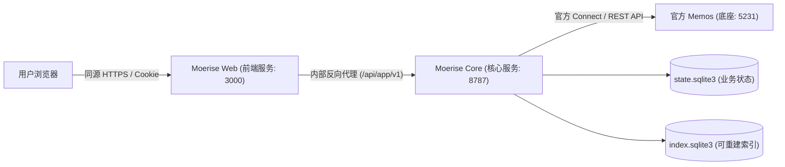

# Moerise Web 集成与系统设计

本文档阐述 Moerise Web 客户端的系统集成设计、前后端通信契约以及核心交互模块的技术实现方案。

---

## 一、集成方案与系统拓扑

Moerise 采用 **Memos + Moerise Core + Moerise Web** 的三层架构，保证轻量解耦与最小化运维复杂度：



### 关键设计决定

1. **统一单域名与同源反向代理**：
   - 浏览器仅访问 Moerise Web 暴露的对外服务地址（如 `https://notes.example.com`），无需跨域。
   - Web 服务端内置轻量同源反向代理，将 `/api/app/v1/*` 路径转发至内部 Core 服务，静态资源与 HTML 由 Web 直接分发。
2. **多层鉴权凭据隔离**：
   - 浏览器持有 Moerise 颁发的不透明会话 Cookie（`HttpOnly`、`SameSite=Lax`、`Secure`）。
   - Memos 长期管理员 PAT 仅保存在 Core 服务端，不暴露给前端浏览器。
   - 外部自动化与 AI 工具通过独立的只读 Bearer Token 访问 Core 的 `/api/ext/v1` 和 `/mcp`。
3. **前端无庞大第三方框架依赖**：
   - Web 前端采用原生现代 JavaScript、HTML5 与原生 CSS 构建，无运行时依赖打包，加载极快、资源占用极低。

---

## 二、通信契约与安全机制

### 1. 认证与会话生命周期

- **Memos 身份认证适配**：
  - 用户在 Web 登录页输入 Memos 用户名和密码。
  - Core 调用 Memos 官方认证协议验证凭据，获取访问令牌与刷新 Cookie，并校验账号是否属于实例绑定的作者。
  - 校验通过后，Core 在 `state.sqlite3` 中加密记录持久化会话，并通过响应头向浏览器设置会话 Cookie。
- **Cookie 安全策略**：
  - 生产 HTTPS 环境使用前缀安全 Cookie：`__Host-moerise_session`；本地回环调试使用 `moerise_local_session`。
  - 设置 `HttpOnly` 防止 XSS 窃取，设置 `SameSite=Lax` 防止跨站伪造，设置 `Path=/`。
- **CSRF 双重防御**：
  - 登录成功后，Core 向前端返回唯一的 `csrf_token`，仅保存在浏览器运行内存中。
  - 登录请求校验 `Origin`；登录后的非只读请求（POST / PATCH / DELETE）还需提供 `X-CSRF-Token`，且 `Origin` 必须精确匹配配置的 `web.public_origin`。

### 2. 请求幂等性设计

- **保存防重复**：
  - 创建笔记必须附带客户端生成的 `Idempotency-Key`（UUID 或唯一随机串）。
  - Core 将该幂等键与请求摘要保存在 `state.sqlite3` 中。
  - 当遭遇弱网超时或连接异常中断时，用户点击重试将复用相同幂等键，确保 Memos 中绝不产生重复条目。

---

## 三、前端核心模块设计

### 1. 布局与双语国际化

- **两栏式极简布局**：
  - 左侧固定 260px 侧边栏：集成用户状态、全局搜索框、快捷时间线入口、每日回顾、随机漫步、AI 洞察、认知地图与系统设置。
  - 右侧主工作区：最大宽度 760px，兼顾桌面端易读性与移动端自适应。
- **双语自适应与热切换**：
  - 采用中文词条作为 Message Key，通过 `i18n.js` 进行客户端映射。
  - 首次加载依据浏览器 `navigator.language` 自动匹配，用户也可在界面手动切换。
  - 切换语言时原地更新 DOM 文本，不刷新页面、不销毁草稿内容、不重置地图视口或正在进行的 AI 聊天流。

### 2. 时间线与卡片即时编辑

- **实时时间线加载**：
  - 默认以 `created_desc` 倒序展示未归档笔记。
   - 点击「加载更多」继续读取分页（基于 `page_token` 游标机制）。
  - 搜索、标签点击与日历按月筛选作为统一筛选条件联动刷新时间线。
- **卡片内即时编辑**：
   - 从卡片的「更多操作」菜单进入编辑，支持 `Ctrl+Enter` 快速保存、`Esc` 取消。
  - 编辑只修改 Memos 中的正文或标签，创建时间不变，不影响时间线排序。

### 3. 2D 认知地图

- **轻量每日快照分发**：
   - Core 在向量索引就绪后运行 PCA 投影与局部螺旋避让算法；普通变化按 24 小时间隔合并，无变化时跳过计算。
  - 前端通过不可变数据快照渲染全图点位，加载性能极高。
- **平滑交互与实时查阅**：
  - 支持鼠标滚轮平滑缩放、拖拽平移，以及快捷键控制（方向键平移、加减键缩放、`Home` 复位全图、`R` 刷新快照）。
  - 点击画布上的笔记点位，弹窗卡片实时请求 Memos 获取最新正文与附件预览。

### 4. 流式 AI 洞察

- **灵活选材**：
  - 支持多选任意历史笔记作为会话的上下文材料。
  - 严格限制笔记正文字符规模（默认 20,000 Unicode 码点以内），防止超出模型上下文或产生高额费用。
- **Server-Sent Events (SSE) 流式传输**：
  - 客户端通过 POST 请求发起会话，并通过 SSE 协议实时接收大模型 token 流。
   - 支持主动停止生成与持久会话；重启后保留中断文本，不自动续调模型。
  - 满意的 AI 产出支持一键幂等保存为 Memos 笔记。

---

## 四、运维与容器编排拓扑

仓库根目录的 [compose.yaml](../compose.yaml) 定义完整编排；以下为服务关系摘要：

```yaml
services:
  memos:
    profiles: [memos, local]
    image: neosmemo/memos:0.31.0
    restart: unless-stopped
    volumes:
      - memos-data:/var/opt/memos

  moerise:
    build: .
    restart: unless-stopped
    volumes:
      - state-data:/data/state
      - index-data:/data/index
      - backup-data:/backups
    environment:
      - MOERISE_MEMOS_BASE_URL=http://memos:5230
      - MOERISE_WEB_ENABLED=true

  web:
    build: ./web
    restart: unless-stopped
    depends_on:
      moerise:
        condition: service_healthy
    environment:
      - CORE_ORIGIN=http://moerise:8787
      - PUBLIC_ORIGIN=${MOERISE_PUBLIC_ORIGIN}
    ports:
      - "127.0.0.1:3000:3000"
```

Web 容器作为非 root 用户运行，仅对外暴露 3000 端口，前端和核心服务之间通过 Docker 内部网络安全通信。
