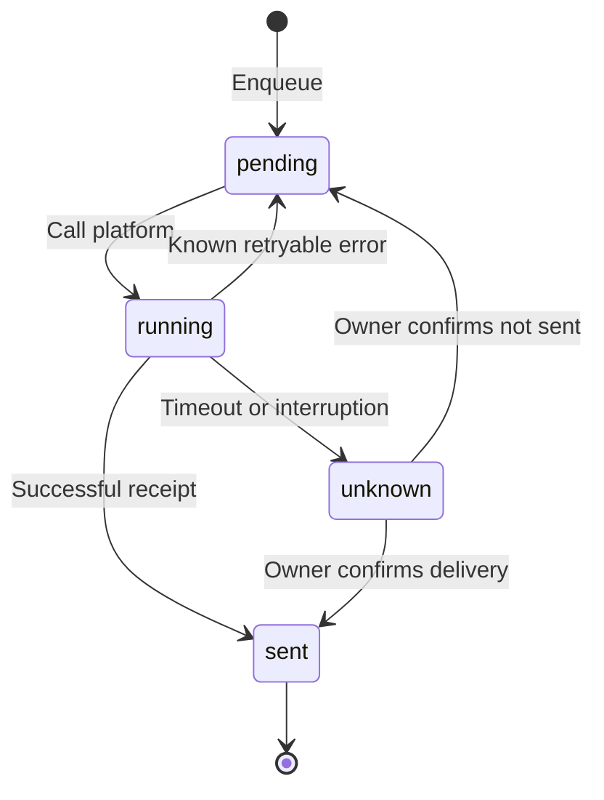

# Moerise Notification Scheduling & Delivery Queue

[简体中文](NOTIFICATIONS.md)

The shared scheduler and persistent queue in `internal/notifications.go` drive daily reviews, text chunking, platform retries, and uncertain-delivery resolution. Task state lives in `state.sqlite3` and survives restarts and index rebuilding.

---

## 1. Scheduling & Daily Plans

```json
{
  "notifications": {
    "enabled": true,
    "times": ["09:00", "18:00"]
  },
  "timezone": "Asia/Shanghai"
}
```

1. **Timezone and times**:
   - Scheduling follows the configured IANA timezone.
   - `times` contains distinct `HH:MM` values, up to 24 per day. Without a list, the single `time` field is used, default `09:00`.
2. **Slot binding**:
   - At delivery time, the scheduler uses the day's saved `slot_id` allocation to create its batch.
   - Empty slots are recorded as processed without sending an empty message.
3. **Downtime and day boundaries**:
   - Recovery creates tasks only for the most recent due slot of the same day; other missed slots are skipped.
   - Previous-day plans are not created retroactively. Existing queued tasks recover independently; Web shows the daily plan.

---

## 2. Delivery State & Retry Policy



| State | Meaning |
| --- | --- |
| `pending` | Waiting for a first attempt or a retry after backoff, including HTTP 429 |
| `running` | Platform UUID and attempt recorded; request in progress |
| `unknown` | Network interruption, timeout, unconfirmed response, or process interruption; automatic resend paused |
| `sent` | Successful platform receipt or owner confirmation |

### Backoff & Rate Limits

- **Error classification**: Known retryable errors use backoff. Timeouts and interrupted attempts enter `unknown` rather than automatically resending.
- **Telegram limits**: `retry_after` cooldowns are persisted across tasks and restarts.

---

## 3. Text Chunks & Images

`review_delivery.go` maintains an ordered pipeline:

1. **Message sequence**:
   - One header: `「今日回顾」` for Feishu or `Daily review` for Telegram.
   - Each note sends **full text chunks → original images → tag/date footer**.
   - A chunk must be `sent` before the next proceeds.
2. **Text limits**:
   - **Feishu**: Split within an encoded request budget of **18 KiB**.
   - **Telegram**: Split at **4,096 UTF-16 units**; whitespace-only chunks use `.txt` files to preserve content.
3. **Images**:
   - Read original bytes from Memos and reuse uploaded `image_key` or file IDs. Moerise does not recompress images.

---

## 4. Uncertain Deliveries & Management API

An `unknown` delivery pauses to prevent unconfirmed resends. Resolve it through the bound owner's session:

| Method | Path | Authentication | Behavior |
| --- | --- | --- | --- |
| `GET` | `/api/app/v1/admin/notifications?status=unknown` | Session cookie | List unresolved notifications |
| `GET` | `/api/app/v1/admin/notifications/{id}` | Session cookie | Read attempts and error codes |
| `POST` | `/api/app/v1/admin/notifications/{id}/resolve` | Session and CSRF | Confirm `sent` or `not_sent` |

### Resolution Examples

**Confirm delivery and release the next chunk:**

```json
{
  "decision": "sent"
}
```

`sent` may include a `receipt`, which is checked using the channel adapter. Without one, the owner confirmation resolves the task. Telegram has no general historical-message lookup API; inspect the destination chat first.

**Confirm that the message was not sent:**

```json
{
  "decision": "not_sent"
}
```

The queue assigns a new platform UUID and returns the chunk to `pending`, preserving its position.
