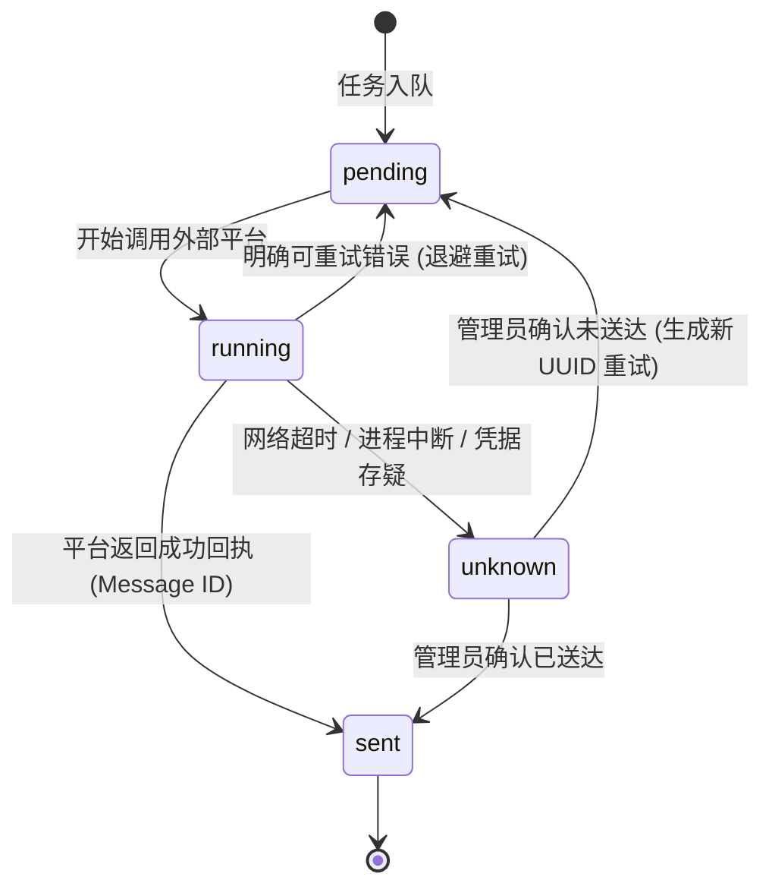

# Moerise 通知调度与发送队列

[English](NOTIFICATIONS.en.md)

Moerise 内置统一的通知调度器与持久发送队列（`internal/notifications.go`），负责驱动每日回顾的定时分发、长正文分片、平台重试以及异常交付确认。所有任务状态均持久化存储于 `state.sqlite3`，即使重建索引或重启服务也不会丢失调度记录。

---

## 一、调度配置与全天计划绑定

```json
{
  "notifications": {
    "enabled": true,
    "times": ["09:00", "18:00"]
  },
  "timezone": "Asia/Shanghai"
}
```

1. **时区与时段驱动**：
   - 调度器按照指定的 IANA 时区运行；
   - `times` 为互不重复的 24 小时制 `HH:MM` 列表（每天支持 1 至 24 次推送）。默认时段为 `["09:00"]`，列表不能为空。
2. **确定性时段绑定**：
   - 当到达设定的推送时刻时，调度器从当天的全天计划中提取属于时段的专属条目区间（`slot_id`），生成发送批次。
   - 若某一时段无合格候选笔记，系统仅记录该时段已处理，绝不向平台发送空白扰民消息。
3. **停机补发与跨日保护**：
   - 遭遇机器断电或服务暂停后重新恢复运行时，调度器仅自动补发当天**最近一个已错过的时段**，历史错过的其余时段标记为跳过，防止同一时刻发生消息风暴。
   - 跨日不补建往日计划；已入队任务独立恢复，Web 展示当天计划。

---

## 二、发送状态机与重试策略

每一条通知分片在数据库中维护明确的状态流转：



| 状态 | 含义与流转条件 |
| --- | --- |
| `pending` | 等待首次发送，或被外部平台限流（HTTP 429）后处于退避冷却中。 |
| `running` | 已分配发送 UUID 并记录发送尝试，正在向第三方平台发起网络请求。 |
| `unknown` | 网络中断、网关超时、响应未确认或从崩溃快照中恢复。自动重发将暂停，等待管理员核验。 |
| `sent` | 收到第三方平台的明确成功回执（如平台 `message_id`），或经人工核验确认为成功。 |

### 错误重试与限流退避
- **错误分类与退避**：明确可重试的平台错误自动退避；网络超时、进程中断等结果不明的发送进入 `unknown`，暂停自动重发。
- **速率限制遵循**：严格遵守 Telegram 的 `retry_after` 指令，冷却时间在多任务与跨重启间持久生效。

---

## 三、长文本分片与富媒体投递

为兼顾各平台的 API 请求体体积限制并完整保留笔记格式，`review_delivery.go` 实现了顺序投递管道：

1. **投递时序与结构**：
   - 单次推送首先发送独立标题：飞书为 `「今日回顾」`，Telegram 为 `Daily review`；
   - 随后按笔记顺序发送：**完整正文分片 → 图片原文件 → 标签与日期尾注**；
   - 前一片必须处于 `sent` 确认状态，才会放行下一片的发送。
2. **正文安全切分算法**：
   - **飞书**：按请求编码后的 **18 KiB 请求预算**严格沿段落换行切分；
   - **Telegram**：按 **4,096 UTF-16 单元**上限切分，纯空白分片以 `.txt` 附件兜底保真发送。
3. **原图保障**：
   - 图片通过 Memos 提取原始字节上传并复用 `image_key` 或文件 ID，不进行二次有损压缩。

---

## 四、异常处理与管理员管理接口

当由于网络超时或上游平台无响应导致通知进入 `unknown` 状态时，为防止重复向用户发送同一篇笔记，系统要求通过管理接口手动确认：

| 方法 | 请求路径 | 认证机制 | 功能说明 |
| --- | --- | --- | --- |
| `GET` | `/api/app/v1/admin/notifications?status=unknown` | 用户会话 Cookie | 查询处于异常或未确认状态的通知列表 |
| `GET` | `/api/app/v1/admin/notifications/{id}` | 用户会话 Cookie | 查看单条通知的尝试历史与错误日志 |
| `POST` | `/api/app/v1/admin/notifications/{id}/resolve` | 用户会话 + CSRF | 提交人工核验决策 (`sent` 或 `not_sent`) |

### 核验决策提交示例

**确认消息已送达（放行后续分片）：**
```json
{
  "decision": "sent"
}
```

`sent` 可附 `receipt`，服务按渠道复查提供的回执；省略时依据人工确认完成。Telegram 无通用历史消息查询接口，需先在目标聊天中核实。

**确认消息未送达（触发重新发送）：**
```json
{
  "decision": "not_sent"
}
```
系统将为该分片重新派生发送 UUID 并回到 `pending` 状态，确保顺序不变且内容不漏发。
