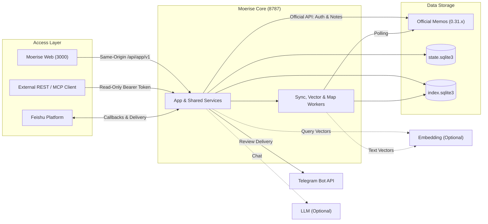

# Moerise Product & Architecture

[简体中文](PRODUCT-ARCHITECTURE.md)

Moerise is a self-hosted personal note enhancement service built on Memos. Core handles synchronization, indexing, review scheduling, retrieval, and model adapters, with access through Web, read-only REST/MCP, and Telegram or Feishu messaging.

---

## 1. Design Principles

1. **Memos as authoritative storage**: Memos owns original Markdown, native tags, images, attachments, and accounts. Moerise uses official APIs and preserves the content entered by the user.
2. **One author per instance**: Each instance binds to one Memos author. Reads, writes, synchronization, and search remain within that author boundary, including when an administrator PAT is used.
3. **Separate state and indexes**:
   - `state.sqlite3`: Product state requiring backups, including encrypted credentials, settings, review plans and history, conversations, and notification queues.
   - `index.sqlite3`: Rebuildable search and layout data, including FTS5, vectors, and 2D map snapshots.
4. **Read-only external interfaces**: Machine REST (`/api/ext/v1`) and MCP (`/mcp`) enforce server-side operation whitelists for external tools and scripts.

---

## 2. Components & Responsibilities

| Component | Responsibilities | Storage & Dependencies |
| --- | --- | --- |
| **Official Memos (0.31.x)** | Accounts, original notes, native tags, images, attachments, and source permissions | Separate storage, SQLite in the bundled deployment |
| **Moerise Core** | Official-API polling, note reads and writes, dual databases, search and vectors, reviews, chats, messaging, and MCP | Go binary, `state.sqlite3`, `index.sqlite3` |
| **Moerise Web** | Light two-column UI, English/Chinese, Markdown editing, timeline filters, map interaction, and streaming chat | Static assets and a lightweight Node same-origin proxy |
| **Messaging adapters** | Telegram English review delivery; Feishu private note capture and reviews; Feishu group webhook reviews | Core background workers |
| **External MCP** | Read-only tools for remote MCP clients to read and search notes | Stateless Streamable HTTP at `/mcp`, JSON responses |

---

## 3. Architecture & Data Flow

---

## 4. Core Subsystems

### 1. Authentication & Sessions

- **Author isolation**: Login uses the Memos account. Core verifies that its resource name, `users/{id}`, matches the bound author and rejects a different account.
- **Browser sessions**:
  - Same-origin requests carry an opaque session cookie through the Web proxy.
  - HTTPS uses `__Host-moerise_session` with `HttpOnly`, `SameSite=Lax`, and `Secure`.
  - Login checks `Origin`; authenticated non-read requests also require `X-CSRF-Token`.
  - Refresh credentials are encrypted in `state.sqlite3`; short-lived access tokens remain in memory. Ordinary restarts preserve valid sessions.
- **Machine access**:
  - REST and MCP accept independently configured Moerise Bearer credentials.
  - Server whitelists permit note retrieval, search, related notes, walks, and existing reviews; they exclude writes and state changes.

### 2. Notes & Idempotency

- **Live timeline**: Memos supplies candidates ordered by creation time and resource name descending. Core verifies the author and signs pagination cursors; ordinary edits keep creation time unchanged.
- **Duplicate prevention**:
  - Creation requires `Idempotency-Key`.
  - Core persists the key, content hash, assigned `memoId`, and write state in `state.sqlite3`.
  - Retries after uncertain network results reuse the same key and assigned source ID.

### 3. Search & Map

- **Hybrid retrieval**:
  - FTS5 indexes Chinese characters and adjacent bigrams.
  - An independent Embedding provider generates chunk vectors for cosine retrieval.
  - RRF with `k=60` combines keyword, tag, and semantic rankings.
- **2D map**:
  - Deterministic PCA projects note vectors to two dimensions.
  - Local spiral placement separates overlapping points in dense areas.
  - Snapshots are built after vector readiness, ordinary changes are combined at 24-hour intervals, and unchanged data skips computation. Map reads use persistent snapshots without model calls; pan and zoom are local, while opening a point reads live Memos content.

### 4. Reviews & Messaging

- **Fixed daily plans**:
  - The first successful background scheduling pass of the local day creates its plan; the first Web read can also create it. Source failures are retried later.
  - Candidates meet the maturity delay, default 72 hours, and exclude notes selected within the recent period, default 7 days.
  - Slots receive up to `count` distinct notes each; earlier slots fill first when candidates are scarce. The saved plan remains fixed.
- **Low-pressure reading**: No unread badges, mandatory completion marks, or streak counters.
- **Persistent delivery**:
  - Notifications move through `pending`, `running`, `unknown`, and `sent`.
  - Text chunks send in order. Known retryable errors use backoff; uncertain results enter `unknown` and continue after resolution through the owner's session API.

### 5. AI Insights

- **Explicit materials**: Select normal or archived notes independently of timeline filters.
- **Model protocols**: OpenAI Chat Completions, OpenAI Responses, and Anthropic Messages share the provider boundary.
- **Persistence and saving**: Conversations live in `state.sqlite3`. Restart preserves saved partial text and marks unfinished generation `interrupted`, without automatically calling the model again. Users can ask a follow-up or save a completed assistant reply unchanged to Memos.

---

## 5. Source Layout

| Source | Responsibility |
| --- | --- |
| `main.go` | CLI, configuration, service startup, and graceful shutdown |
| `internal/app.go` | Application lifecycle, workers, and shared services |
| `internal/memos.go`, `memos_live.go` | Official API client, protocol conversion, and live pagination |
| `internal/memos_auth.go`, `sessions.go` | Official authentication, encrypted sessions, and CSRF |
| `internal/client_api.go`, `client_models.go` | Web/mobile client routes and contracts |
| `internal/api.go`, `models.go`, `openapi.json` | Machine REST, scopes, and OpenAPI |
| `internal/mcp.go` | Read-only MCP server |
| `internal/records.go`, `attachments.go` | Persistent write idempotency and protected attachments |
| `internal/reviews.go`, `review_plans.go` | Review sampling, daily plans, and slot allocation |
| `internal/search.go`, `search_index.go` | FTS5, vector scans, cosine similarity, and RRF |
| `internal/discovery.go` | Semantic walk selection and path deduplication |
| `internal/map.go`, `map_layout.go`, `map_store.go` | PCA, local spiral placement, and background snapshots |
| `internal/chat.go`, `llm.go` | Streaming conversations, material budgets, and model protocols |
| `internal/embedding.go`, `vector_index.go` | Embedding requests, vector construction, and generations |
| `internal/notifications.go`, `review_delivery.go` | Scheduling, chunk ordering, delivery state, and resolution |
| `internal/feishu.go`, `feishu_delivery.go`, `telegram_delivery.go` | Messaging platform adapters |
| `internal/store.go`, `migrations/` | SQLite, transactions, and numbered migrations |
| `internal/maintenance.go` | Online backup, validated restore, and index rebuilding |
| `web/` | JavaScript, HTML, and CSS frontend with no runtime packages |
