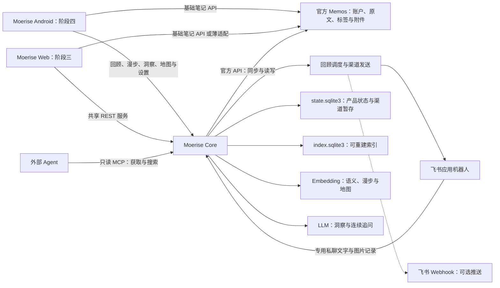
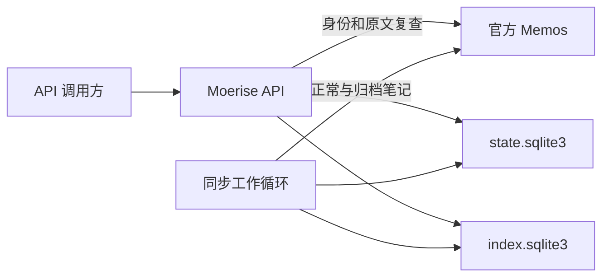

# Moerise 产品与架构

## 产品方向

Moerise 是基于 Memos 的开源、自托管个人笔记产品，以记录、阅读、回顾和思考探索为核心。产品行为以[产品需求](PRD.md)为准，按 **Core → 飞书 → 完整 Web 与一体化 Compose → Android** 交付，工程任务见[对齐计划](PRD-ALIGNMENT-PLAN.md)与[路线图](ROADMAP.md)。

首个完整产品版本包含完整 Web 笔记管理、每日回顾、随机语义漫步、自然聊天式洞察与连续追问、二维认知地图、浏览器设置、通用模型配置和一体化 Compose。全库问答、主题时间线及飞书 AI 属于已有额外能力，Web 阶段的交付不依赖这些能力。

主仓库包含 Core、接口、部署配置和工程文档，Web 可在主仓库开发。Android 的技术方案、源码复用和仓库组织在 Android 阶段确定。产品面向单人自托管，一个实例绑定一名 Memos 用户；Web 与 Android 复用 Memos 账户，使用 Moerise 的产品视觉。

具体可调用接口、配置及操作方式见 [API v1](API-V1.md)和[运行与恢复](OPERATIONS.md)，产品目标按路线图交付。

## 组件职责

| 组件 | 职责 |
| --- | --- |
| 官方 Memos | 保存原始笔记、标签、图片、附件和账户，执行原生权限，通过官方 API 提供基础读写 |
| Moerise Core | 同步、索引、身份范围、持久任务、笔记写入适配、回顾与推送协调；已有检索、向量及 LLM 基础随产品功能复用 |
| Moerise Web | 完整笔记管理、回顾、随机漫步、洞察连续讨论、二维地图和设置；与 Core、Memos 一同组成首个完整产品版本 |
| 飞书应用机器人 | 专用私聊文字、图片便捷记录和每日回顾推送 |
| REST 入口 | 向原生客户端和渠道提供各自需要的共享业务能力，区分读取与写入范围 |
| 外部 MCP | 只读获取和搜索笔记，可读取已有回顾；服务端限制工具发现与调用，不开放笔记写入或产品状态变更 |
| Moerise Android | 在 Web 阶段形成共享能力后，交付完整移动端笔记管理与扩展体验 |

表中 Web、Android 和 MCP 只读限制等目标按路线图交付。Memos 是笔记的唯一权威数据源，Core 通过官方 API 访问原文，不修改 Memos 数据库。原生客户端的基础操作可通过简单适配或直接连接官方 API；专用记录机器人调用 Core 写入服务，外部 Agent 使用只读 MCP。

回顾、检索、模型通信和地图计算由 Core 共享。客户端负责呈现与交互，消息适配器负责平台收发、格式和回执。原生记录按用户输入保存正文、标签和附件；AI 回复在洞察会话中保留，由用户主动保存为 Memos 笔记。

### 总体架构

下图表示产品组件及其职责。Web 与一体化部署属于产品阶段三，Android 属于阶段四；Core 随对应功能增强。

## 核心实现

核心服务使用 Go 1.27+、标准库 `net/http` 和 SQLite，编译为单个二进制。SQLite 驱动为 `modernc.org/sqlite`，构建无需 cgo。HTTP API 与后台工作循环通过 goroutine 在同一进程运行，同一产品数据目录只允许一个写入进程。服务端支持 Linux 原生运行和 Docker Linux 容器部署；Windows、macOS 原生服务端支持见[路线图](ROADMAP.md#后续方向与开发输入)。

| 源码 | 职责 |
| --- | --- |
| `internal/api.go`、`models.go`、`openapi.json` | REST 路由、访问范围、来源复查、分页与响应契约 |
| `internal/memos.go` | Memos 版本与身份检查、官方 API 调用及笔记格式转换 |
| `internal/records.go`、`attachments.go` | 文本、标签和附件记录、持久幂等、写入结果复查与恢复 |
| `internal/reviews.go` | 规则选择、固定每日批次、换组与打开和略过历史 |
| `internal/reviews_api.go`、`mcp.go` | 回顾 REST、只读 MCP 入口与访问范围检查 |
| `internal/search.go`、`search_index.go` | 共享混合检索、中文关键词索引、排名融合、向量缓存与结果来源复查 |
| `internal/discovery.go`、`discovery_api.go`、`feishu_discovery.go` | 语义漫步、路径去重、显式阅读历史与跨入口适配 |
| `internal/feishu.go`、`feishu_client.go`、`feishu_crypto.go`、`feishu_delivery.go` | 飞书回调校验、加密事件队列、应用与 Webhook 收发、回执复查及共享业务调用 |
| `internal/notifications.go`、`notifications_api.go` | 当地日期调度、持久发送队列、发送尝试、回执复查及结果确认 |
| `internal/sync.go` | 正常与归档扫描、增量追补、全量修复与任务调度 |
| `internal/store.go`、`migrations/` | 数据库迁移、来源绑定、持久任务、退避、扫描暂存与投影 |
| `internal/maintenance.go` | 在线状态备份、停止服务后恢复、索引重建与写入互斥 |
| `internal/embedding.go` | 独立的向量提供商接口、百炼调用、分批与并发限制、返回校验及连接检查 |
| `internal/chunks.go`、`vector_index.go` | 原文分块、可恢复向量构建、缓存复用与索引代次发布 |
| `internal/llm.go`、`ai_generation.go`、`ai_evidence.go` | 模型通信、已有结构化分析与证据业务；聊天洞察复用通信与笔记读取基础，独立设计会话业务 |
| `internal/config.go`、`main.go` | 配置校验、服务与维护命令入口 |

核心采用同一仓库内的模块化单体。新增能力按业务职责拆分包，HTTP 和平台入口调用业务服务。计算密集任务若超出进程资源预算，再通过明确的数据与任务协议拆出工作进程。

### 数据与身份

| 数据 | 存储 | 恢复方式 |
| --- | --- | --- |
| 原始笔记、标签、图片、附件、账号和 PAT 状态 | Memos | Memos 自身备份或数据导出 |
| 来源绑定、同步水位、持久任务、创建幂等、回顾历史、渠道事件与发送记录 | `state.sqlite3` | Core 在线状态备份与停服恢复 |
| 飞书入站请求、AI 生成结果与分片中的正文或来源片段副本 | `state.sqlite3` 中的加密渠道数据 | 随产品状态备份恢复，用于事件处理及发送恢复 |
| 笔记投影、扫描暂存、片段、关键词 FTS5、向量和索引代次 | `index.sqlite3` | 从 Memos 重建 |
| Memos 连接、入口及模型凭据、运行参数 | 配置文件 | 配置备份 |

Memos 是笔记主库，保存原文；Core 保存扩展业务状态。渠道数据中的正文或证据副本仅用于入站处理、结果保留及发送恢复。`state.sqlite3` 中的渠道数据可能包含私人内容，须与配置凭据一同妥善保管。

笔记创建幂等记录保存幂等键、规范化内容摘要、分配的 `memoId` 和处理状态，不保存附件文件字节。回顾历史、发现阅读记录、渠道事件和发送记录在重启及索引重建后保留；分块、向量、近邻和地图布局属于可重建数据。产品设置和人工调整随相应功能进入产品状态。

飞书待处理消息使用 AES-GCM 加密暂存，事件业务完成后清除入站密文。既有搜索结果引用保存加密查询，发送时重新搜索；既有飞书 AI 数据另行保存加密请求、完整结果及回复分片，结果中的引用可包含来源片段。这些数据不会随入站密文一同删除，恢复行为见[飞书入口](FEISHU.md#事件与恢复)。事件按消息标识去重，笔记和附件资源标识持久保存，读取与发送执行各自业务的来源检查。

Web 阶段将基础设施参数放入 `.env`，由浏览器管理并持久保存日常回顾、模型、默认洞察 Prompt、飞书和 Webhook 设置。密钥保存在服务端，界面只显示配置状态或遮蔽值。设置与洞察会话的持久化按对应功能设计，聊天会话的数据模型独立于旧渠道中的证据副本及 `AIResult` 格式。

SQLite 使用 WAL。迁移按编号执行并校验摘要，产品状态与投影分别迁移。两份数据库通过先发布投影、后推进水位的顺序保证中断后可重放。

每个部署绑定一个 Memos 实例和一个账号，只索引并输出该账号本人创建的笔记。读取前复查来源版本、身份和原文。资源标识、访问 Scope 和失败行为见 [API v1](API-V1.md)。

### 笔记创建流程

`POST /api/ext/v1/notes` 要求 `notes:write` Scope 与必填 `Idempotency-Key`，接收 `content`、可省略的 `tags` 和 `attachments`。键为 1 至 128 个 ASCII 字母、数字或 `._:-`。正文必填且非空白；标签输入最多 20 项，每项 1 至 100 个 Unicode 字符，由 Unicode 字母、十进制数字、下划线和连字符组成的非空段以 `/` 分隔，不含 `#` 或空白。附件有序，最多 10 个，合计至多 8 MiB，通过 Base64 传入。

1. 检查凭据、请求头与字段，标签去重并按字符串升序排序。非空标签生成 `#tag1 #tag2\n\n` 前缀，与原正文合计 UTF-8 编码不超过 65536 字节；空标签不添加前缀。
2. 以原正文和规范化标签计算内容摘要，将幂等键、摘要、分配的 `memoId` 和处理状态持久写入产品数据库。同键不同规范化内容返回 409 `IDEMPOTENCY_CONFLICT`。
3. 验证来源身份，通过官方 API 为绑定账号创建 `PRIVATE` 笔记，将标签前缀写入正文供 Memos 解析。接口不开放 `creator`、`visibility` 或 `state`。附件按位置持久分配资源标识，通过官方 API 上传并关联已复查作者的笔记，每次上传前再次检查来源身份与父笔记。
4. 超时、5xx、响应不可信等结果不明时返回 503 `WRITE_OUTCOME_UNKNOWN`，`retryable=true`。调用方只用相同键和请求体重试；服务先复查持久分配的 `memoId`，必要时才以同一 ID 创建，避免生成重复 ID。来源资源冲突返回 409 `WRITE_CONFLICT`。
5. 确认创建时检查请求标签是否在 Memos 中完整保留；不完整时返回 409 `WRITE_CONFLICT`。返回前验证来源身份并复查作者与正文，首次请求成功返回 201 和 `Note`。同键相同规范化内容重放时再次复查来源，成功返回 200 和最新 `Note`；来源故障不输出旧正文。
6. 已确认成功的来源笔记被删除后，重放返回 404 `SOURCE_NOT_FOUND`，不重建笔记。

附件失败后使用同一请求继续，复查已分配的附件资源并只补齐缺失项。正文与全部附件关联成功后才确认整次写入；部分成功后的父笔记已删除时不重建。产品数据库只保存请求摘要、附件标识和父笔记确认状态，不存文件字节。

### 同步流程

1. 检查 Memos 版本及 `/api/v1/auth/me` 返回的账号资源名。
2. 分页读取 `NORMAL` 和 `ARCHIVED`，将结果写入扫描暂存表。增量条件从水位向前保留重叠时间。
3. 全量扫描后，再追补扫描期间的变化，减小偏移分页漂移造成的遗漏。
4. 对全量结果中缺失的既有笔记逐条复查，确认不可用后移除。
5. 两种状态和全部分页均成功后，再检查来源身份、发布投影并推进水位。失败扫描丢弃暂存结果。
6. 服务启动请求全量修复，运行期间轮询增量并定期全量比较，修复删除、归档及回溯时间修改。

Memos 0.31.0 的时间排序字段为 `update_time`，CEL 筛选字段为 `updated_ts`，条件使用 `updated_ts >= timestamp("...")`。正常与归档需要分别列出；`show_deleted` 在该版本没有提供可依赖的删除变更流。笔记更新时间可被修改，单一最大时间水位无法覆盖回溯修改。依据为固定版本的[笔记协议](https://github.com/usememos/memos/blob/v0.31.0/proto/api/v1/memo_service.proto)与[服务实现](https://github.com/usememos/memos/blob/v0.31.0/server/api/v1/memo_service.go)。

Memos 事件 Webhook 可在后续作为同步加速信号。0.31.0 的发送端限制回环和私有地址，使用进程内队列，缺少持久重试；接收端需验签并返回 `{"code":0}` 等 JSON 响应。轮询和全量修复始终承担补漏职责。依据见[事件生成](https://github.com/usememos/memos/blob/v0.31.0/server/api/v1/memo_service_webhooks.go)与[发送实现](https://github.com/usememos/memos/blob/v0.31.0/internal/webhook/webhook.go)。

### 混合搜索

REST `POST /api/ext/v1/search` 与 MCP `semantic_search` 共用 `SearchService`，无需 LLM，要求 `notes:read`；默认只搜正常笔记，状态和精确 AND 标签过滤对全部检索通道共同生效。

关键词使用预分词 FTS5：连续中文生成单字与相邻双字，英文数字整词小写；至少两字的中文查询使用相邻双字，单字走专门召回路径，生成的词项安全引用，原查询不作为 SQL 或 FTS 语法。关键词 BM25、标签匹配和正余弦语义分别取前 100 个片段，以 k=60 的 RRF 先融合片段，再按笔记合并。笔记分数取最高片段分数，每条最多 3 个片段，稳定排序并返回分块时保存的原文位置。

每个服务复用一个活动代次的内存 float32 向量缓存，仅在向量空间与配置、投影修订号一致时使用。关闭模型、索引未就绪或模型错误时降级为关键词与标签，并返回显式语义状态；取消不降级。搜索前验证来源版本与身份，输出前逐条读原文；修改、删除、作者越界或过滤变化的候选丢弃并修正投影，最后再次验证身份。来源故障使整个请求失败，不返回缓存正文。

索引迁移 003 建立关键词索引；片段和关键词独立于 embedding，升级启动为旧投影补建。它们属于可重建数据，不进入产品状态备份。请求字段、排名、来源位置与恢复语义见[搜索](SEARCH.md)。

### 相关笔记

REST `GET /api/ext/v1/notes/{memo_id}/related` 与 MCP `get_related_memos` 复用检索业务。原文全量提取词项并选取最多 64 个，结合共同标签和同一活动代次的文档向量召回；无需查询模型、LLM 或额外 embedding 调用。排除自身、融合和正文去重后复用 `SearchHit` 及来源位置，不新增配置、迁移或产品状态。

候选状态和显式 AND 标签过滤不限制原笔记。先验证来源身份、读取原笔记并修正投影，候选逐条复查同搜索；输出前再次读取原笔记并验证摘要与身份。原笔记消失或越界返回 404 `SOURCE_NOT_FOUND`，处理中改变返回可重试的 409 `SOURCE_CHANGED`；来源故障使整个请求失败。请求、算法与降级原因见[相关笔记](SEARCH.md#相关笔记)。

## 模型与扩展能力的架构约定

### 共享接口与模型

REST、MCP、飞书和客户端复用相应业务服务与资源标识；入口按职责开放操作，不要求暴露完全相同的工具或结果格式。Memos 协议、模型协议和消息平台分别封装，业务层使用 Moerise 自己的数据结构。

embedding 与 LLM 使用独立配置。embedding 通过提供商适配器生成向量，索引业务负责保存并检索；LLM 生成洞察和回答。百炼向量模型使用 `qwen3.7-text-embedding` 和默认 1024 维，支持配置、分批文档与查询调用及独立连接检查，具体字段见[向量模型](EMBEDDING.md)。

语义搜索使用连续 float32 向量的内存精确检索，限制批次、计算线程和模型并发。10000 个 1024 维向量的裸数据约为 39.1 MiB，投影与查询中间结果需额外内存。是否引入专用计算库、近似索引或独立向量数据库，以真实规模和延迟测量为依据。

向量索引记录模型、维度、分块版本和内容摘要；笔记与查询必须使用同一向量空间。更换向量模型时建立并重建新索引，完成后切换；更换 LLM 无需重建向量。检索矩阵复用内存缓存，正文变化才重新生成向量。

分块与向量构建位于 `internal/chunks.go`、`internal/vector_index.go`。索引数据库保存投影修订号、构建与发布代次、片段来源位置和同空间正文向量缓存。每批提交后可恢复进度，发布事务只接受与投影修订一致且片段完整的代次；投影变化重新规划，复用已完成向量。分块规则和状态接口见[向量模型](EMBEDDING.md#分块与向量索引)。

向量业务只依赖 `EmbeddingProvider`，已有百炼适配使用 DashScope 原生协议，明确设置文档或查询类型、连续向量输出和维度。Web 阶段增加最小通用 Embedding 协议适配，并在浏览器中管理地址、密钥、模型及必要维度，保留百炼接入。LLM 业务只依赖 `LLMProvider`，已有适配器支持 OpenAI Chat Completions、OpenAI Responses 和 Anthropic Messages；协议、地址、凭据及模型分别配置。对话能力与向量能力分别检查，同一服务可能只提供其中一种。

外部模型凭据只由服务端模型适配器读取。模型、飞书分别按需启用；基础笔记、时间线、关键词搜索和每日回顾独立运行。随机语义漫步和二维地图使用 Embedding，洞察连续讨论使用 LLM，无需启用 Embedding。

### 已有分析接口

`internal/ai_evidence.go` 通过 `EvidenceService` 收集指定笔记、相关历史或混合检索片段，按绑定身份、状态、标签及创建时间过滤，并按完整 JSON 大小限制预算。引用 ID 由服务器分配，绑定来源版本、字节区间、行号和链接；生成服务在调用模型、输出内容和结束时复用来源复查。证据在请求内组织，飞书结果持久化时会一并保存其中的来源片段副本；字段与省略规则见 [AI](AI.md#证据与引用)。

`internal/ai_generation.go` 的 `AIService` 组织提示词、证据与模型调用，将生成内容解析为事实、解释和追问。完整条目通过引用及来源复查后才进入内容回调；模型结束与最终来源复查通过后，才返回完整结果及完成事件。请求取消或任何故障均不能生成成功完成事件，普通洞察不创建笔记。

`internal/ai_timeline.go` 在问答证据收集前划分创建时间范围，按段执行共享混合检索并分配上下文预算。时间段保存代表来源、事实和解释的索引以及空段原因；创建、修改和正文日期分别处理，模型不能自行生成时间范围或来源位置。

REST 与 MCP 共享 `AIService` 及模型提供商。既有飞书 AI 任务将生成请求、结果和回复分片加密保存于产品状态；生成任务先登记再调用模型，发送片段复用通知队列的稳定标识、回执和结果不明处置。重启或恢复快照后，生成中断作为终态保存；已完成结果在每片发送前重新核实来源。

### Web 洞察与二维地图目标

Web 洞察以所选笔记和消息上下文组织自然聊天，支持手选单条、多条，或按日期、标签及组合条件选择。界面显示所选数量，以正文总字符数限制输入；超限时提示调整范围，不静默截断材料。默认分析材料就是所选笔记，单条洞察不额外召回历史。

一键洞察使用可查看、修改和恢复的默认 Prompt，自由提问和连续追问共享所选材料及前文。回复使用自然语言或 Markdown，鼓励联想、质疑、假设和多种解释，自然区分笔记原意与新想法。回复留在会话中，用户可选择保存某条回复，或先生成总结再保存；生成和追问本身不创建笔记。

聊天业务复用模型消息数组、文本流、超时、取消、笔记读取和幂等保存，独立于旧证据收集与结构化分析链路。正常聊天回复无需满足固定分析类别、引用编号、逐句附证、片段哈希、行号及旧完成状态的要求。读取笔记时检查账户归属、可见性和内容正确性，具体方式按实际开销选择；聊天回复无需逐段证据核验。

二维地图以笔记为点，语义相近的内容在空间上靠近，支持平移、缩放和点选阅读。布局由 Core 计算，属于可重建索引；算法及更新方式以真实可读性和布局稳定性确定。主题命名、时间轴、路径叠加和 3D 属于长期候选。

### 飞书与通知

飞书应用机器人绑定指定 Memos 账号，消息事件去重，记录返回 Memos 资源标识和原文链接。专用私聊的文字、图片直接作为笔记输入，文字保留正文原貌；自然正文不由查询或 AI 命令截获。具体记录方式见[飞书入口](FEISHU.md)。

| 入口 | 方向与用途 |
| --- | --- |
| 飞书应用机器人 | 双向交互，接收操作并发送结果或回顾 |
| 飞书自定义机器人 Webhook | Moerise 向群发送回顾的可选方式 |
| Memos 事件 Webhook | Memos 向 Moerise 提示笔记变化 |

采用应用机器人时，同一机器人承担交互和推送。回顾选择、时区调度、持久发送队列和阅读状态归业务服务；渠道适配器只处理收发、分片、格式转义、限流与平台回执。

每日回顾的产品目标是简单随机选取：默认创建满 72 小时、排除最近 7 天已回顾内容，时长和归档范围可配置。Core 固定当地日结果，Web 与启用的推送渠道读取相同笔记；调整规则、刷新或增加发送时段不替换已固定结果。数量不足展示实际数量，空池不发送，来源故障单独处理。Web 展示正文与图片；飞书推送只发送文字正文，不添加原文链接。阅读即可完成回顾，无需打开或略过操作。选择、调度与展示的具体工程任务见路线图 2.1—2.5。

平台能力依据：[自定义机器人](https://open.feishu.cn/document/client-docs/bot-v3/add-custom-bot?lang=zh-CN)、[接收消息](https://open.feishu.cn/document/server-docs/im-v1/message/events/receive)、[发送消息](https://open.feishu.cn/document/server-docs/im-v1/message/create)。

### MCP 与客户端

Memos 0.31.0 的[官方 MCP](https://github.com/usememos/memos/blob/v0.31.0/server/mcp/README.md)提供基于 Bearer token 的 Streamable HTTP 接口，覆盖基础笔记管理。Moerise 的 `/mcp` 使用官方 Go MCP SDK 提供无会话 HTTP 传输，复用 Core 业务服务；产品阶段一补齐单条获取和必要列表，并将外部工具收紧为只读。

只读范围包括获取、搜索及已有回顾结果；不存在的回顾由 Core 生成流程创建，MCP 返回明确结果。工具发现与直接调用均不进入创建、更换回顾、打开、略过或阅读历史写入，即使令牌包含写入 Scope。原生客户端和记录机器人通过各自写入入口工作。工具与调用方式随实现更新至 [API v1](API-V1.md)。

Memos 0.31.0 的 PAT 缺少读写 Scope；`readOnlyHint` 和客户端工具筛选只是调用方提示或限制。Moerise 的只读边界由服务端凭据检查落实，上游 PAT 保存在服务端。依据见[令牌协议](https://github.com/usememos/memos/blob/v0.31.0/proto/api/v1/user_service.proto)及[令牌创建实现](https://github.com/usememos/memos/blob/v0.31.0/server/api/v1/user_service_access_tokens.go)。

外部 Agent 和客户端按各自支持的传输与身份协议接入。私人笔记入口需验证调用方身份，并执行来源范围检查；上游 PAT 不能作为外部调用方的身份凭据。工具名与后续接口目标见路线图。

Web 和 Android 使用共享回顾、检索、模型、地图及设置服务，承担完整笔记管理与扩展体验。Web 以时间线为中心，顶部编辑区可输入正文、添加标签和附件；基础操作优先通过简单适配调用 Memos 官方 API，不建立另一份笔记主库。

## 部署与恢复

已有服务端交付支持连接既有 Memos 的 Linux 二进制和 Docker Linux 容器，配置从 JSON 文件读取。随附 Compose 可部署 Core，并通过 `local` profile 启动开发 Memos；产品阶段三交付官方 Memos、Core、Web 的一体化 Compose，同时保留连接既有 Memos 的独立部署。

一体化部署以 README、`.env` 和 `docker compose up -d` 启动，组件及数据卷分别维护与升级。Memos 数据使用 Memos 的备份和导出；Core 复用在线状态快照、停服恢复和索引重建，配置凭据单独备份。恢复及升级须保持产品设置、回顾历史和渠道记录，索引可重新生成。运行步骤见[运行与恢复](OPERATIONS.md)。

## 长期演进

- 历史上的今天、智能权重等复杂回顾策略；漫步方向调节、完全无关跳转及路径回看。
- 经用户主动启用并限制范围与成本的全库主题检索，多套洞察 Prompt；地图主题命名、时间轴及其他呈现。
- Telegram 等其他消息渠道，iOS、Windows、macOS 客户端，多用户与独立账户。
- 探索 Android 无服务器时的正式笔记存储、附件和编辑管理；本地数据源、Memos 兼容、迁移与同步语义另行设计，多设备同步以使用者自建服务为方向。
- 实际产品限制出现后，逐项评估底层职责替换，结合维护成本、数据迁移、兼容与恢复路径决定实现。

运行与资源限制见[运行与恢复](OPERATIONS.md)，开发和验证入口见[开发指南](DEVELOPMENT.md)。
