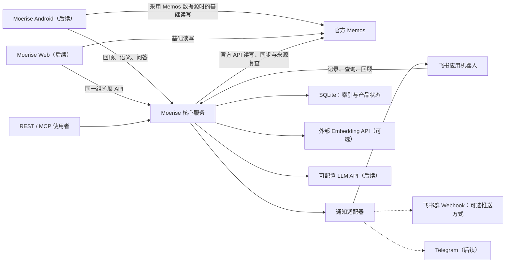
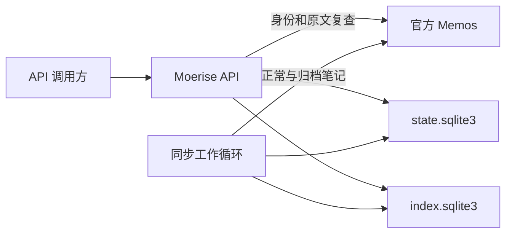

# Moerise 产品与架构

## 产品方向

Moerise 是以轻量记录、回顾和思考探索为核心的个人笔记产品。先交付基于官方 Memos 的独立扩展服务，再逐步提供 Android 和 Web 体验，各入口统一使用 Moerise 品牌。

主仓库承载核心服务、接口、部署配置和工程文档。Android 的技术底座、源码复用和仓库组织在客户端阶段确定。Web 初期可在主仓库开发。

第一版面向单人自建部署，其他使用者通过各自配置部署。阶段范围与完成状态统一维护在[路线图](ROADMAP.md)。

## 组件职责

| 组件 | 职责 |
| --- | --- |
| 官方 Memos | 保存笔记原文和附件，执行原生权限，提供基础读写与同步 API |
| Moerise 核心服务 | 同步与索引、笔记创建、混合检索与相关笔记、身份边界、持久幂等与任务、回顾及调度；后续增加 AI 和地图计算 |
| 飞书应用机器人 | 接收绑定身份的记录、查询与回顾操作，回复结果并主动推送每日回顾 |
| REST / MCP 入口 | 向客户端和 Agent 提供同一组业务能力；已实现范围见 API v1 |
| Android / Web 客户端 | 后续提供编辑、阅读、探索和地图交互，复用核心服务的业务接口 |

扩展部署中，Memos 是笔记的唯一权威数据源。Moerise 通过官方 API 访问原文，不修改 Memos 数据库。基础客户端可直接请求 Memos；消息和 Agent 入口所需的读写转接由 Moerise 适配层承担。

回顾、检索、洞察、问答和地图计算由服务端共享。客户端负责呈现与交互，消息适配器负责平台收发、格式和回执。

### 总体架构

下图展示各入口、核心服务、存储和外部模型的关系。Android、Web、AI 和 Telegram 属于后续阶段，具体范围见[路线图](ROADMAP.md)。

## 核心实现

核心服务使用 Go 1.27+、标准库 `net/http` 和 SQLite，编译为单个二进制。SQLite 驱动为 `modernc.org/sqlite`，构建无需 cgo。HTTP API 与后台工作循环通过 goroutine 在同一进程运行，同一产品数据目录只允许一个写入进程。服务端支持 Linux 原生运行和 Docker Linux 容器部署；Windows、macOS 原生服务端支持见[路线图](ROADMAP.md#后续方向与开发输入)。

| 源码 | 职责 |
| --- | --- |
| `internal/api.go`、`models.go`、`openapi.json` | REST 路由、访问范围、来源复查、分页与响应契约 |
| `internal/memos.go` | Memos 版本与身份检查、官方 API 调用及笔记格式转换 |
| `internal/records.go`、`attachments.go` | 文本、标签和附件记录、持久幂等、写入结果复查与恢复 |
| `internal/reviews.go` | 规则选择、固定每日批次、换组与打开和略过历史 |
| `internal/reviews_api.go`、`mcp.go` | 回顾 REST 与扩展 MCP 入口、Scope 检查和状态变化提示 |
| `internal/search.go`、`search_index.go` | 共享混合检索、中文关键词索引、排名融合、向量缓存与结果来源复查 |
| `internal/discovery.go`、`discovery_api.go`、`feishu_discovery.go` | 语义漫步、路径去重、显式阅读历史与跨入口适配 |
| `internal/feishu.go`、`feishu_client.go`、`feishu_crypto.go`、`feishu_delivery.go` | 飞书回调校验、加密事件队列、应用与 Webhook 收发、回执复查及共享业务调用 |
| `internal/notifications.go`、`notifications_api.go` | 当地日期调度、持久发送队列、发送尝试、回执复查及结果确认 |
| `internal/sync.go` | 正常与归档扫描、增量追补、全量修复与任务调度 |
| `internal/store.go`、`migrations/` | 数据库迁移、来源绑定、持久任务、退避、扫描暂存与投影 |
| `internal/maintenance.go` | 在线状态备份、停止服务后恢复、索引重建与写入互斥 |
| `internal/embedding.go` | 独立的向量提供商接口、百炼调用、分批与并发限制、返回校验及连接检查 |
| `internal/chunks.go`、`vector_index.go` | 原文分块、可恢复向量构建、缓存复用与索引代次发布 |
| `internal/config.go`、`main.go` | 配置校验、服务与维护命令入口 |

核心采用同一仓库内的模块化单体。新增能力按业务职责拆分包，HTTP 和平台入口调用业务服务。计算密集任务若超出进程资源预算，再通过明确的数据与任务协议拆出工作进程。

### 数据与身份

| 数据 | 存储 | 恢复方式 |
| --- | --- | --- |
| 原始笔记、附件、账号和 PAT 状态 | Memos | Memos 自身备份 |
| 来源绑定、同步水位、持久任务、笔记创建幂等记录和产品状态 | `state.sqlite3` | 扩展状态备份 |
| 笔记投影、扫描暂存、片段、关键词 FTS5、向量和索引代次 | `index.sqlite3` | 从 Memos 重建 |
| 来源、入口凭据及运行参数 | 配置文件 | 配置备份 |

回顾历史、发现阅读记录、渠道事件、发送记录、入口绑定和人工调整属于产品状态；分块、向量、近邻和主题缓存属于可重建数据。重建索引不能清空产品历史或人工调整。

笔记创建幂等记录保存幂等键、规范化内容摘要、分配的 `memoId` 和处理状态，服务重启及索引重建均保留。产品状态不缓存笔记原文，正文只从 Memos 获取。

飞书待处理消息作为入站请求使用 AES-GCM 加密暂存，业务完成后删除入站密文，仅保存结果引用；搜索结果引用包含加密查询，发送时重新搜索并复查来源，不缓存搜索正文用于发送。事件按消息标识去重，记录与附件的新资源标识按配置密钥、来源和幂等键派生后持久保存，既有记录沿用原标识。读取与发送仍逐次复查来源。

SQLite 使用 WAL。迁移按编号执行并校验摘要，产品状态与投影分别迁移。两份数据库通过先发布投影、后推进水位的顺序保证中断后可重放。

每个部署绑定一个 Memos 实例和一个账号，只索引并输出该账号本人创建的笔记。读取前复查来源版本、身份和原文。资源标识、访问 Scope 和失败行为见 [API v1](API-V1.md)。

### 笔记创建流程

`POST /api/ext/v1/notes` 要求 `notes:write` Scope 与必填 `Idempotency-Key`，接收 `content`、可省略的 `tags` 和 `attachments`。键为 1 至 128 个 ASCII 字母、数字或 `._:-`。正文必填且非空白；标签输入最多 20 项，每项 1 至 100 个 Unicode 字符，由 Unicode 字母、十进制数字、下划线和连字符组成的非空段以 `/` 分隔，不含 `#` 或空白。附件有序，最多 10 个，合计至多 8 MiB，通过 Base64 传入。

1. 检查凭据、请求头与字段，标签去重并按字符串升序排序。非空标签生成 `#tag1 #tag2\n\n` 前缀，与原正文合计 UTF-8 编码不超过 65536 字节；空标签不添加前缀。
2. 以原正文和规范化标签计算内容摘要，将幂等键、摘要、分配的 `memoId` 和处理状态持久写入产品数据库。同键不同规范化内容返回 409 `IDEMPOTENCY_CONFLICT`。
3. 验证来源身份，通过官方 API 为绑定账号创建 `PRIVATE` 笔记，将标签前缀写入正文供 Memos 解析。接口不开放 `creator`、`visibility` 或 `state`。附件按位置持久分配资源标识，通过官方 API 上传并关联已复查作者的笔记，每次上传前再次检查来源身份与父笔记。
4. 超时、5xx、响应不可信等结果不明时返回 503 `WRITE_OUTCOME_UNKNOWN`，`retryable=true`。调用方只用相同键和请求体重试；服务先复查持久分配的 `memoId`，必要时才以同一 ID 创建，避免生成重复 ID。来源资源冲突返回 409 `WRITE_CONFLICT`。
5. 确认创建时检查请求标签是否在 Memos 中完整保留；不完整时返回 409 `WRITE_CONFLICT`。返回前验证来源身份并复查作者与正文，首次请求成功返回 201 和 `Note`。同键相同规范化内容重放时再次复查来源，成功返回 200 和最新 `Note`；来源故障不输出旧正文。
6. 已确认成功的来源笔记被删除后，重放返回 404 `SOURCE_NOT_FOUND`，不重建笔记。

附件失败后使用同一请求继续，复查已分配的附件资源并只补齐缺失项。正文与全部附件关联成功后才确认整次写入；部分成功后的父笔记已删除时不重建。产品数据库只保存请求摘要、附件标识和父笔记确认状态，不存文件字节。

### 同步流程

1. 检查 Memos 版本及 `/api/v1/auth/me` 返回的账号资源名。
2. 分页读取 `NORMAL` 和 `ARCHIVED`，将结果写入扫描暂存表。增量条件从水位向前保留重叠时间。
3. 全量扫描后，再追补扫描期间的变化，减小偏移分页漂移造成的遗漏。
4. 对全量结果中缺失的既有笔记逐条复查，确认不可用后移除。
5. 两种状态和全部分页均成功后，再检查来源身份、发布投影并推进水位。失败扫描丢弃暂存结果。
6. 服务启动请求全量修复，运行期间轮询增量并定期全量比较，修复删除、归档及回溯时间修改。

Memos 0.31.0 的时间排序字段为 `update_time`，CEL 筛选字段为 `updated_ts`，条件使用 `updated_ts >= timestamp("...")`。正常与归档需要分别列出；`show_deleted` 在该版本没有提供可依赖的删除变更流。笔记更新时间可被修改，单一最大时间水位无法覆盖回溯修改。依据为固定版本的[笔记协议](https://github.com/usememos/memos/blob/v0.31.0/proto/api/v1/memo_service.proto)与[服务实现](https://github.com/usememos/memos/blob/v0.31.0/server/api/v1/memo_service.go)。

Memos 事件 Webhook 可在后续作为同步加速信号。0.31.0 的发送端限制回环和私有地址，使用进程内队列，缺少持久重试；接收端需验签并返回 `{"code":0}` 等 JSON 响应。轮询和全量修复始终承担补漏职责。依据见[事件生成](https://github.com/usememos/memos/blob/v0.31.0/server/api/v1/memo_service_webhooks.go)与[发送实现](https://github.com/usememos/memos/blob/v0.31.0/internal/webhook/webhook.go)。

### 混合搜索

REST `POST /api/ext/v1/search`、MCP `semantic_search` 与飞书“搜索”共用 `SearchService`，无需 LLM。REST 和 MCP 要求 `notes:read`；默认只搜正常笔记，状态和精确 AND 标签过滤对全部通道共同生效。

关键词使用预分词 FTS5：连续中文生成单字与相邻双字，英文数字整词小写；至少两字的中文查询使用相邻双字，单字走专门召回路径，生成的词项安全引用，原查询不作为 SQL 或 FTS 语法。关键词 BM25、标签匹配和正余弦语义分别取前 100 个片段，以 k=60 的 RRF 先融合片段，再按笔记合并。笔记分数取最高片段分数，每条最多 3 个片段，稳定排序并返回 3.2 分块的原文位置。

每个服务复用一个活动代次的内存 float32 向量缓存，仅在向量空间与配置、投影修订号一致时使用。关闭模型、索引未就绪或模型错误时降级为关键词与标签，并返回显式语义状态；取消不降级。搜索前验证来源版本与身份，输出前逐条读原文；修改、删除、作者越界或过滤变化的候选丢弃并修正投影，最后再次验证身份。来源故障使整个请求失败，不返回缓存正文。

索引迁移 003 建立关键词索引；片段和关键词独立于 embedding，升级启动为旧投影补建。它们属于可重建数据，不进入产品状态备份。请求字段、排名、来源位置与恢复语义见[搜索](SEARCH.md)。

### 相关笔记

REST `GET /api/ext/v1/notes/{memo_id}/related`、MCP `get_related_memos` 和飞书“相关”复用检索业务。原文全量提取词项并选取最多 64 个，结合共同标签和同一活动代次的文档向量召回；无需查询模型、LLM 或额外 embedding 调用。排除自身、融合和正文去重后复用 `SearchHit` 及来源位置，不新增配置、迁移或产品状态。

候选状态和显式 AND 标签过滤不限制原笔记。先验证来源身份、读取原笔记并修正投影，候选逐条复查同搜索；输出前再次读取原笔记并验证摘要与身份。原笔记消失或越界返回 404 `SOURCE_NOT_FOUND`，处理中改变返回可重试的 409 `SOURCE_CHANGED`；来源故障使整个请求失败。请求、算法与降级原因见[相关笔记](SEARCH.md#相关笔记)。

## 模型与扩展能力的架构约定

### 共享接口与模型

REST、MCP、飞书和客户端调用同一组业务服务，统一资源标识、来源引用、错误和流式事件。Memos 协议、模型协议和消息平台分别封装，业务层使用 Moerise 自己的数据结构。

embedding 与 LLM 使用独立配置。embedding 通过提供商适配器生成向量，索引业务负责保存并检索；LLM 生成洞察和回答。百炼向量模型使用 `qwen3.7-text-embedding` 和默认 1024 维，支持配置、分批文档与查询调用及独立连接检查，具体字段见[向量模型](EMBEDDING.md)。

语义搜索使用连续 float32 向量的内存精确检索，限制批次、计算线程和模型并发。10000 个 1024 维向量的裸数据约为 39.1 MiB，投影与查询中间结果需额外内存。是否引入专用计算库、近似索引或独立向量数据库，以真实规模和延迟测量为依据。

向量索引记录模型、维度、分块版本和内容摘要；笔记与查询必须使用同一向量空间。更换向量模型时建立并重建新索引，完成后切换；更换 LLM 无需重建向量。检索矩阵复用内存缓存，正文变化才重新生成向量。

分块与向量构建位于 `internal/chunks.go`、`internal/vector_index.go`。索引数据库保存投影修订号、构建与发布代次、片段来源位置和同空间正文向量缓存。每批提交后可恢复进度，发布事务只接受与投影修订一致且片段完整的代次；投影变化重新规划，复用已完成向量。分块规则和状态接口见[向量模型](EMBEDDING.md#分块与向量索引)。

向量业务只依赖 `EmbeddingProvider`，百炼适配使用 DashScope 原生协议，明确设置文档或查询类型、连续向量输出和维度。其他向量供应商与通用协议兼容按社区需求扩展，范围见路线图的后续方向。LLM 业务只依赖 `LLMProvider`，通过独立适配器支持 OpenAI Chat Completions、OpenAI Responses 和 Anthropic Messages；协议、地址、凭据及模型分别配置。对话能力与向量能力分别检查，不假设同一服务同时提供两者。

外部模型凭据只由服务端模型适配器读取。模型调用、回顾发送和 AI 引用均沿用使用者的来源范围，输出前复查笔记。

`internal/ai_evidence.go` 通过 `EvidenceService` 收集指定笔记、相关历史或混合检索片段，按绑定身份、状态、标签及创建时间过滤，并按完整 JSON 大小限制预算。引用 ID 由服务器分配，绑定来源版本、字节区间、行号和链接；生成服务在调用模型、输出内容和结束时复用来源复查。证据是请求内的派生数据，不写入产品状态；字段与省略规则见 [AI](AI.md#证据与引用)。

`internal/ai_generation.go` 的 `AIService` 组织提示词、证据与模型调用，将生成内容解析为事实、解释和追问。完整条目通过引用及来源复查后才进入内容回调；模型结束与最终来源复查通过后，才返回完整结果及完成事件。请求取消或任何故障均不能生成成功完成事件，普通洞察不创建笔记。

`internal/ai_timeline.go` 在问答证据收集前划分创建时间范围，按段执行共享混合检索并分配上下文预算。时间段保存代表来源、事实和解释的索引以及空段原因；创建、修改和正文日期分别处理，模型不能自行生成时间范围或来源位置。

REST、MCP 与飞书共享 `AIService` 及模型提供商。飞书将生成请求、结果和回复分片加密保存于产品状态；生成任务先登记再调用模型，发送片段复用通知队列的稳定标识、回执和结果不明处置。重启或恢复快照后，生成中断作为终态保存；已完成结果在每片发送前重新核实来源。

### 飞书与通知

飞书是首个完整消息入口，使用应用机器人接收消息、返回结果和发送每日回顾。普通问答不自动保存笔记，记录操作返回 Memos 资源标识和原文链接。飞书身份绑定指定 Memos 账号，消息事件去重。

| 入口 | 方向与用途 |
| --- | --- |
| 飞书应用机器人 | 双向交互，接收操作并发送结果或回顾 |
| 飞书自定义机器人 Webhook | Moerise 向群发送回顾的可选方式 |
| Memos 事件 Webhook | Memos 向 Moerise 提示笔记变化 |

采用应用机器人时，同一机器人承担交互和推送。回顾选择、时区调度、持久发送队列和阅读状态归业务服务；渠道适配器只处理收发、分片、格式转义、限流与平台回执。

平台能力依据：[自定义机器人](https://open.feishu.cn/document/client-docs/bot-v3/add-custom-bot?lang=zh-CN)、[接收消息](https://open.feishu.cn/document/server-docs/im-v1/message/events/receive)、[发送消息](https://open.feishu.cn/document/server-docs/im-v1/message/create)。

### MCP 与客户端

Memos 0.31.0 的[官方 MCP](https://github.com/usememos/memos/blob/v0.31.0/server/mcp/README.md)提供基于 Bearer token 的 Streamable HTTP 接口，覆盖基础笔记管理。扩展 MCP 位于 `/mcp`，通过官方 Go MCP SDK 提供无会话 HTTP 传输，聚焦回顾、检索、关联、洞察和主题等领域能力，复用业务服务。回顾工具按 Scope 分为读取与状态变更两组，具体工具见 API v1。

Memos 0.31.0 的 PAT 缺少读写 Scope；`readOnlyHint` 和客户端工具筛选只是调用方提示或限制。Moerise 的只读边界由服务端凭据检查落实，上游 PAT 保存在服务端。依据见[令牌协议](https://github.com/usememos/memos/blob/v0.31.0/proto/api/v1/user_service.proto)及[令牌创建实现](https://github.com/usememos/memos/blob/v0.31.0/server/api/v1/user_service_access_tokens.go)。

外部 Agent 和客户端按各自支持的传输与身份协议接入。私人笔记入口需验证调用方身份，并执行来源范围检查；上游 PAT 不能作为外部调用方的身份凭据。工具名与后续接口目标见路线图。

App 使用核心服务的回顾、检索、AI 和地图数据。采用 Memos 数据源时，基础笔记读写可直接请求 Memos，扩展服务故障时仍能进行基础操作。地图计算放在服务端，Android 或 Web 负责绘制、筛选与原文跳转；飞书可发送摘要及[网页入口](https://open.feishu.cn/document/common-capabilities/message-card/introduction-of-message-cards)。

## 长期演进

- 由 Moerise 逐步承载记录、阅读、回顾、发现和 AI 的完整体验，Memos 可在后台继续提供存储和同步。
- 独立扩展稳定后，按需求将 Memos 与 Moerise 组合为统一自托管部署，简化配置、升级和恢复。
- 探索 Android 无服务器时的正式笔记存储、附件和编辑管理；本地数据源、Memos 兼容、迁移与同步语义另行设计，多设备同步以使用者自建服务为方向。
- 实际产品限制出现后，逐项评估底层职责替换，结合维护成本、数据迁移、兼容与恢复路径决定实现。

运行与资源限制见[运行与恢复](OPERATIONS.md)，开发和验证入口见[开发指南](DEVELOPMENT.md)。
