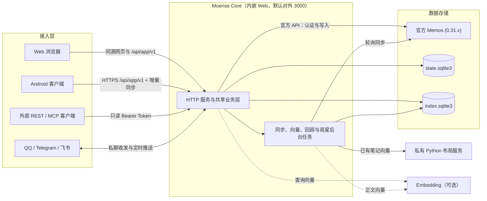

# Moerise 产品与架构

Moerise 是基于 Memos 的单用户自托管笔记系统。Moerise Core 负责数据同步、本地索引、每日回顾调度、检索与模型适配，通过内嵌 Web 界面、Android 客户端、只读 REST/MCP 接口以及 QQ、Telegram、飞书机器人提供服务。

## 一、架构设计原则

1. **Memos 权威存储**：Memos 保存原始 Markdown 正文、原生 `#标签`、图片附件与用户账户。Moerise 仅通过 Memos 官方 API 读写和同步，按用户输入原样保存内容。
2. **单实例单作者绑定**：每个 Moerise 实例绑定 Memos 中的一名作者。即使配置了管理员 PAT，所有读写、同步与检索也只作用于该绑定作者的数据。
3. **状态与索引分离（双 SQLite 架构）**：
   - `state.sqlite3`：保存需要备份的产品状态（加密凭据、用户设置、会话、每日回顾计划与通知发送记录）。
   - `index.sqlite3`：保存可随时从 Memos 完整重建的派生数据（本地笔记投影、变更日志、FTS5 全文索引、向量语义索引与观星快照）。
4. **外部接口只读**：面向外部 AI 工具与脚本的 REST API（`/api/ext/v1`）和 MCP Server（`/mcp`）在服务端限制为只读白名单，不开放写入或修改接口。

## 二、系统组件与职责

| 组件 | 职责 | 存储与运行形态 |
| --- | --- | --- |
| **官方 Memos (0.31.x)** | 笔记原文、标签、附件与账户认证底座。 | 独立服务与数据库 |
| **Moerise Core（含内嵌 Web）** | 轮询同步 Memos，提供内嵌 Web 静态资源、客户端 `/api/app/v1`、只读 `/api/ext/v1` 与 `/mcp`、本地索引检索、回顾调度与机器人收发。 | Go 单体二进制、`state.sqlite3`、`index.sqlite3` |
| **Android 客户端** | 原生 Jetpack Compose 应用，支持离线写入队列、增量同步、本地索引直读、漫步与观星。 | Android APK、Room（系统 SQLite）、Keystore |
| **布局服务** | 基于已有笔记向量计算均衡 UMAP、语义主题、增量坐标与星体属性。 | 私有 Python HTTP 服务、`layout-data` 缓存卷 |
| **消息渠道适配器** | QQ 私人机器人、Telegram 机器人、飞书应用机器人（私聊速记、查询回顾与定时推送）及飞书群 Webhook（定时推送）。 | Core 内部常驻协程驱动 |

## 三、总体架构与数据流

## 四、核心子系统设计

### 1. 认证与会话安全体系

- **作者身份校验**：登录表单复用 Memos 官方账户认证。登录成功后，Core 核对登录用户与实例绑定的 `user.name`（`users/{id}`），不匹配则拒绝。
- **客户端会话**：
  - Web 与 Android 统一访问 `/api/app/v1`，通过服务端签发的会话 Cookie 鉴权。
  - HTTPS 环境使用 `__Host-moerise_session` Cookie（`HttpOnly`、`SameSite=Lax`、`Secure`）；本地回环调试使用 `moerise_local_session`。
  - 登录校验 `Origin`；登录后的非只读请求（POST / PATCH / DELETE）同时校验 `Origin` 与 `X-CSRF-Token`。
  - 刷新凭据使用基于 AES-256-GCM 的 `MOERISE_STATE_ENCRYPTION_KEY` 加密保存在 `state.sqlite3`，短期访问令牌保存在内存，服务重启可恢复有效会话。
- **外部机器接口**：
  - `/api/ext/v1` 与 `/mcp` 仅接受 `MOERISE_ACCESS_TOKEN` Bearer 鉴权；未配置令牌时关闭入口并返回 404。
  - 仅开放 `notes:read`、`sync:read`、`reviews:read` 只读权限。

### 2. 笔记读写与幂等保障

- **本地直读与写直通**：客户端时间线、详情、标签、日历、检索、回顾、漫步及观星直接读取 `index.sqlite3`，并通过 `/api/app/v1/sync/notes` 按游标拉取增量变更与删除墓碑。笔记创建、编辑、归档与删除直通 Memos 官方 API，写成功后即时刷新本地投影并返回 `attachment_receipts`。
- **防重复创建（幂等键）**：
  - 创建和编辑请求提交 `Idempotency-Key`，Core 将幂等键、内容摘要和已分配的 `memoId` 持久化在 `state.sqlite3`。
  - 网络超时或连接中断后，客户端沿用相同幂等键和请求体重试，避免在 Memos 中生成重复笔记；编辑与删除同时校验 `source_hash` 防止覆盖外部改动。

### 3. 检索与观星

- **混合检索**：
  - 关键词通道使用 SQLite FTS5，对中文按单字与相邻双字分词，英文数字整词小写化。
  - 语义通道通过配置的 Embedding 模型生成分块向量，在内存中计算余弦相似度。
  - 混合模式用 Reciprocal Rank Fusion（RRF，k=60）融合关键词、标签与语义通道得分。
- **观星布局**：
  - 使用均衡 UMAP 将聚合后的笔记向量降为二维；独立 10 维 UMAP 与 HDBSCAN 识别主题，结合 c-TF-IDF 关键词生成星系名称。
  - 向量索引首次就绪时触发初次布局，之后在每日服务时区 `03:00` 按需检查增量变化或重建，也可手动触发重新生成。增量更新复用未变笔记的坐标与星体属性；计算期间旧快照保持可读。
  - 细节见[观星指南](STARGAZING.md)。

### 4. 每日回顾与消息渠道

- **固定日计划与时段分配**：
  - 首次全量同步完成后，后台在当天首次运行时按时区生成全天回顾计划（客户端读取也可触发）。
  - 候选笔记需满足成熟等待期（默认 72 小时）并排除近期已选笔记（默认 7 天）。
  - 各时段分配互不重叠的笔记，候选不足时优先填满较早时段；计划生成后当天保持固定。
- **无压力阅读**：不显示未读角标、不要求标记已读、不设打卡连击。
- **发送记录与重试**：
  - 通知发送记录使用 `pending`、`running`、`sent`、`failed` 四种状态，长文按平台限制顺序分片发送。
  - 仅平台明确限流时自动退避重试；其余失败保留在发送记录中，由用户在设置页核对后手动重试，沿用原平台幂等标识。

## 五、代码结构与模块职责

完整文件分组与修改清单见[代码导览](CODEBASE.md)，脚本入口见[脚本说明](../scripts/README.md)。

| 路径 | 职责 |
| --- | --- |
| `main.go` | CLI 入口、配置校验、备份/恢复/回滚、模型诊断与服务启动 |
| `internal/app.go` | 应用装配、生命周期管理与后台任务池 |
| `internal/memos*.go` | Memos 官方 API 客户端、认证适配与实时读取 |
| `internal/client_*.go`、`sessions.go` | 本人会话 API、加密 Session、CSRF 与客户端适配 |
| `internal/api.go`、`mcp.go`、`openapi_gen.go` | 外部只读 REST、MCP Server 与内嵌 OpenAPI 生成 |
| `internal/records.go`、`notes*.go`、`attachments.go` | 笔记读写、创建幂等、冲突校验与附件流 |
| `internal/sync.go`、`store*.go`、`migrations/` | 双库管理、增量同步、本地直读查询与版本化迁移 |
| `internal/search*.go`、`discovery*.go`、`related.go` | FTS5、向量检索、RRF 融合与随机漫步 |
| `internal/embedding.go`、`vector_index.go` | 分块、Embedding 适配与增量向量维护 |
| `internal/map*.go`、`services/layout/` | 观星调度、UMAP 布局服务与快照管理 |
| `internal/reviews*.go` | 每日回顾计划 |
| `internal/notifications.go`、`bot_*.go`、`feishu*.go`、`telegram_*.go` | 通知调度、分片推送与 QQ/Telegram/飞书私聊收发 |
| `internal/maintenance.go` | 自动热备份、手动备份、恢复、回滚与索引重建 |
| `web/` | 无第三方运行依赖的原生 JS/HTML/CSS 前端，构建后内嵌进 Core |
| `mobile/` | 原生 Android 应用（Jetpack Compose + Room + 纯 Kotlin 核心模块） |
