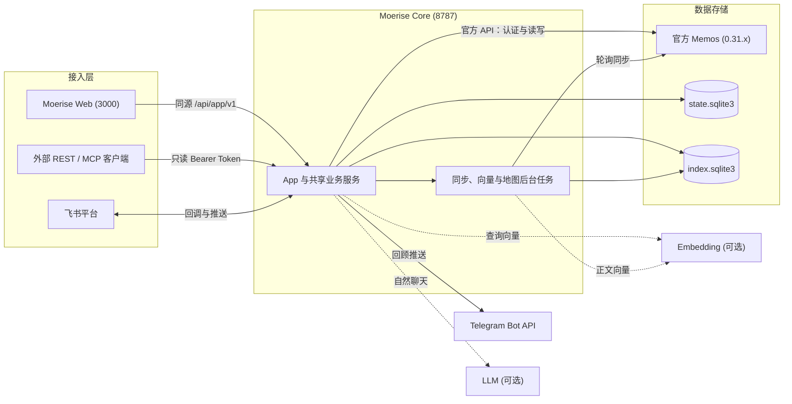

# Moerise 产品与架构

Moerise 是基于 Memos 的单用户自托管个人笔记增强服务。Moerise Core 负责同步、索引、回顾调度、检索算法与模型适配，通过现代化 Web 界面、只读 REST/MCP 接口以及消息渠道（Telegram、飞书）提供全方位能力。

---

## 一、架构设计原则

1. **Memos 权威存储**：Memos 是笔记的唯一权威数据源，存储原始 Markdown 正文、原生标签、图片与附件以及用户凭据。Moerise 仅通过 Memos 官方 API 交互，绝不破坏、重排或隐式修改用户的原始数据。
2. **单实例单作者绑定**：每个 Moerise 实例严格绑定 Memos 中的单一作者。无论使用管理员 PAT 还是普通账号，所有读写、同步与检索均严格限制在该绑定作者的数据范围内。
3. **状态与索引解耦（双数据库架构）**：
   - `state.sqlite3`：保存必须备份的产品业务状态（加密凭据、用户设置、每日回顾计划与历史、AI 对话会话与消息、通知发送队列）。
   - `index.sqlite3`：保存可随时从 Memos 完整重建的检索与布局数据（FTS5 全文索引、向量语义索引、认知地图 2D 坐标快照）。
4. **外部接口严格只读**：面向外部 AI 工具与自动化脚本的 REST API (`/api/ext/v1`) 和 MCP Server (`/mcp`) 实施服务端只读白名单机制，杜绝任何形式的外部越权写入。

---

## 二、系统组件与职责

| 组件 | 核心职责 | 存储与依赖 |
| --- | --- | --- |
| **官方 Memos (0.31.x)** | 原生数据存储底座：管理用户账户、笔记原文、`#标签`、图片与附件资源，执行原生权限校验。 | 独立存储（SQLite） |
| **Moerise Core** | 业务核心引擎：通过官方 API 轮询同步 Memos，提供笔记读写、双库数据管理、检索与向量构建、回顾计划调度、AI 会话编排、渠道消息推送及外部 MCP 协议服务。 | Go 单体二进制、`state.sqlite3`、`index.sqlite3` |
| **Moerise Web** | 现代化浏览器客户端：提供浅色两栏式界面、中英双语自适应、Markdown 编辑器、时间线组合筛选、认知地图交互及流式 AI 聊天。 | 静态资源 + 轻量 Node 同源反代服务 |
| **消息渠道适配器** | 消息触达与便捷交互：Telegram 机器人（英文回顾推送）、飞书应用机器人（私聊双向速记与定时回顾）、飞书群 Webhook（定时回顾推送）。 | 由 Core 内部常驻工作线程驱动 |
| **外部 MCP 服务** | 开放生态接入：提供符合 Model Context Protocol 标准的只读工具接口，供支持远程 MCP 的外部 Agent 检索与阅读笔记。 | `/mcp` 无会话 Streamable HTTP，JSON 响应 |

---

## 三、总体架构与数据流

---

## 四、核心子系统设计

### 1. 认证与会话安全体系

- **用户身份隔离**：Moerise 登录表单直接复用 Memos 账户认证。登录成功后，Core 校验登录用户与配置中绑定的作者资源名（`users/{id}`）。若身份不匹配，直接拒绝登录。
- **浏览器会话管理**：
  - 采用同源会话机制。Web 服务端反向代理统一通过 Cookie 传递会话标识。
  - HTTPS 生产环境采用 `__Host-moerise_session` Cookie，配置 `HttpOnly`、`SameSite=Lax` 与 `Secure` 属性。
  - 登录请求校验 `Origin`；登录后的非只读请求（POST / PATCH / DELETE）还需校验 `X-CSRF-Token`。
  - 刷新凭据使用基于 AES-256-GCM 的状态加密密钥安全持久化于 `state.sqlite3`，短期访问令牌仅保留在内存中。普通服务重启可无缝恢复登录态。
- **机器接口安全**：
  - 外部 REST (`/api/ext/v1`) 与 MCP (`/mcp`) 仅接受配置的 `MOERISE_ACCESS_TOKEN` Bearer 鉴权。
  - 外部接口实施严格的服务端白名单，仅开放笔记检索、只读获取、相关笔记与漫步，彻底屏蔽写入与状态修改接口。

### 2. 笔记读写与幂等保障

- **实时时间线读取**：客户端时间线按创建时间与资源名倒序从 Memos 读取实时候选并校验作者身份，结合服务端分页游标；普通编辑不改变创建时间。
- **防重复创建（幂等机制）**：
  - 客户端创建笔记强制提交 `Idempotency-Key`。
  - Core 将幂等键、内容哈希与分配的 `memoId` 记录在 `state.sqlite3` 中。
  - 遭遇网络抖动或超时重试时，系统识别相同幂等键，避免在 Memos 中创建重复笔记。

### 3. 检索与认知地图

- **双引擎混合检索**：
  - 中文关键词通道：采用 SQLite FTS5，对中文文本执行单字与相邻双字分词，准确匹配中文短语。
  - 语义检索通道：通过独立的 Embedding Provider 将文本分块向量化，计算余弦相似度。
  - 排序融合：利用 Reciprocal Rank Fusion (RRF, k=60) 算法将关键词、标签匹配与语义检索结果进行多通道打分融合。
- **2D 认知地图算法**：
  - 采用确定性二维主成分分析（PCA）投影算法，将高维笔记向量稳定降维到二维平面。
  - 针对密集语义簇采用局部螺旋避让算法，防止点位在视觉上严重重叠。
  - 向量索引就绪后在后台预建快照，普通变化按 24 小时间隔合并，未变时跳过计算。地图读取复用持久化快照，不调用模型；平移缩放在浏览器本地完成，点选节点再实时拉取 Memos 最新正文。

### 4. 每日回顾与消息渠道

- **固定日计划与时段分配**：
  - 后台调度在当天首次成功运行时依据时区配置生成全天回顾计划，Web 首次读取也可触发生成；来源故障时稍后重试。
  - 候选笔记需满足成熟等待期（默认创建满 72 小时），并排除近期已选笔记（默认 7 天去重）。
  - 各时段分配最多 `count` 条互不重叠的笔记；候选不足时优先填满较早时段，计划建立后保持固定。
- **无压力阅读原则**：
  - 界面不显示未读角标、不强制点击已读、不设打卡连击激励，随时打开即可重温灵感。
- **可靠发送队列**：
  - 通知调度器维护明确的状态机（`pending`、`running`、`unknown`、`sent`）。
  - 长正文按顺序分片发送；明确可重试错误自动退避，网络超时等不确定结果进入 `unknown`，通过本人会话管理接口核验后继续。

### 5. 上下文 AI 洞察

- **自由材料圈选**：用户可在 Web 界面自由选择多篇正常或归档笔记作为上下文，不受标签或日期硬性约束。
- **多协议大模型适配**：内置统一的抽象层，兼容 OpenAI Chat Completions、OpenAI Responses 以及 Anthropic Messages 协议。
- **持久化与成果转化**：对话历史持久化在 `state.sqlite3`；重启后保留中断前已保存的文本，生成标记为 `interrupted`，不自动续调模型。用户可继续追问，或将完整助手回复原样保存回 Memos。

---

## 五、代码结构与模块职责

完整的文件分组、阅读顺序与改动入口见[代码导览](CODEBASE.md)。开发工具与验收入口见[脚本说明](../scripts/README.md)。

| 源码路径 | 模块职责 |
| --- | --- |
| `main.go` | 命令行入口、配置初始化、服务装配与优雅退出 |
| `internal/app.go` | 核心应用装配器：持有全局生命周期、工作池与服务实例 |
| `internal/memos.go`, `memos_live.go` | Memos 官方 API 客户端、协议转换与实时时间线分页 |
| `internal/memos_auth.go`, `sessions.go` | Memos 官方认证适配、加密 Session 管理与 CSRF 防御 |
| `internal/client_api.go`, `client_models.go` | 面向 Web/移动端的前端应用 API 路由与契约 |
| `internal/api.go`, `models.go`, `openapi.json` | 开放机器 REST API 路由、权限作用域检查与 OpenAPI 定义 |
| `internal/mcp.go` | Model Context Protocol 只读 Server 协议适配 |
| `internal/records.go`, `attachments.go` | 笔记内容持久幂等、媒体附件读写流与安全性校验 |
| `internal/reviews.go`, `review_plans.go` | 每日回顾抽样算法、全天计划生成与时段分配策略 |
| `internal/search.go`, `search_index.go` | FTS5 预分词、向量扫描、余弦相似度与 RRF 混合融合算法 |
| `internal/discovery.go` | 语义漫步候选抽取、单次漫步去重算法 |
| `internal/map.go`, `map_layout.go`, `map_store.go` | 2D 认知地图 PCA 投影、局部螺旋避让与后台快照 |
| `internal/chat.go`, `llm.go` | AI 洞察流式会话编排、上下文容量控制与多模型协议通信 |
| `internal/embedding.go`, `vector_index.go` | 文本分块、向量批量生成、代次管理与索引维护 |
| `internal/notifications.go`, `review_delivery.go` | 通知调度器、长文本分片器、发送状态机与管理恢复接口 |
| `internal/feishu.go`, `feishu_delivery.go`, `telegram_delivery.go` | 飞书开放平台与 Telegram Bot API 平台级协议适配 |
| `internal/store.go`, `migrations/` | SQLite 双库读写、事务保障与版本化数据库迁移脚本 |
| `internal/maintenance.go` | 生产环境在线热备份、恢复校验与索引重建工具 |
| `web/` | 现代化前端工程：无外部运行依赖的轻量级 JavaScript/HTML/CSS 实现 |
