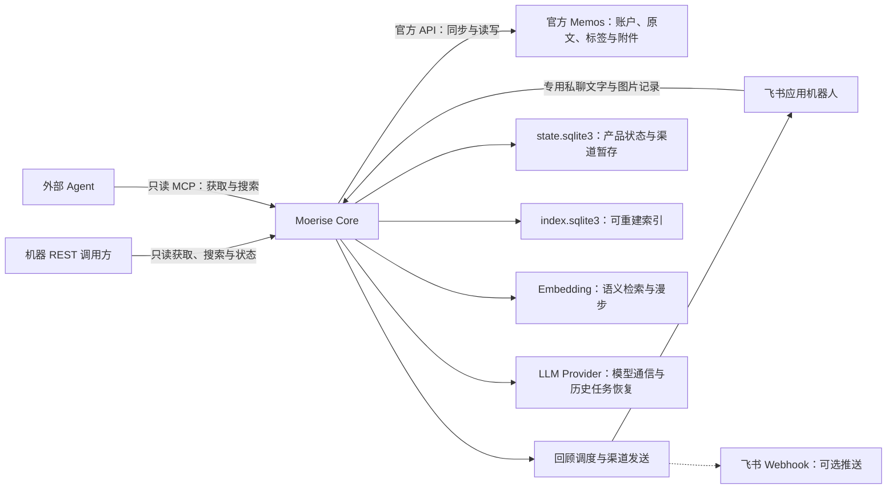
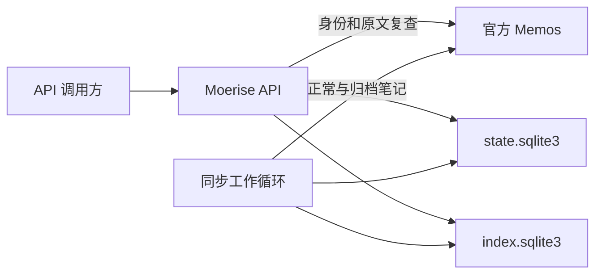

# Moerise 产品与架构

## 功能范围

Moerise 是基于 Memos 的开源、自托管个人笔记服务。Core 提供同步、记录、回顾、检索和模型适配，通过 Web、只读 REST/MCP 和飞书提供入口。

一个实例绑定一名 Memos 用户。Memos 保存原文、标签、附件和账户，Core 保存产品状态与可重建索引。Web 支持登录、组合筛选时间线、完整笔记管理、附件和持久设置；自然聊天式洞察、二维地图和 Android 的开发计划见[路线图](ROADMAP.md)。

产品行为见[产品需求](PRD.md)，可调用接口、配置及操作方式见 [API v1](API-V1.md)和[运行与恢复](OPERATIONS.md)。

本文的核心实现与协议说明对应已有代码。Web 集成沿用 Memos + Core + Web 的模块化单体架构，接口隔离、共享装配及产品状态扩展按[阶段三](ROADMAP.md#阶段三完整-web-与一体化-compose)交付；旧批次、带权漫步和结构化生成的实现不能作为新增客户端的产品规则。

## 组件职责

| 组件 | 职责 |
| --- | --- |
| 官方 Memos | 保存原始笔记、标签、图片、附件和账户，执行原生权限，通过官方 API 提供基础读写 |
| Moerise Core | 同步、索引、身份范围、持久任务、笔记写入适配、回顾、检索、模型调用与通知 |
| Moerise Web | 独立构建的浏览器客户端、同源固定代理、登录、组合筛选、笔记管理与受保护附件 |
| 飞书应用机器人 | 专用私聊文字、图片与文件记录，以及每日回顾推送 |
| 飞书自定义机器人 Webhook | 向群发送每日回顾 |
| 机器 REST 入口 | 同时检查 Bearer Scope 和只读操作白名单，提供笔记、同步状态、已有回顾和检索 |
| 外部 MCP | 只读获取和搜索笔记，可读取已有回顾；服务端限制工具发现与调用，不开放笔记写入或产品状态变更 |

Memos 是笔记的唯一权威数据源，Core 只通过官方 API 访问原文。原生客户端与专用记录机器人调用同一写入服务，外部 Agent 使用只读 REST 或 MCP。笔记编辑和删除通过 Memos 完成。

回顾、检索和模型调用由业务服务处理；HTTP 与消息适配器负责请求、平台收发、格式和回执。旧生成编排用于历史任务恢复，外部机器不能发起新生成。

### Web 集成边界

Web 通过同源 `/api/app/v1` 调用 Core，Core 只通过 Memos 官方认证、笔记和文件接口访问来源，不开放任意 Memos 路径透传。浏览器会话、后台 PAT 和外部机器 Bearer 分离，登录身份必须匹配绑定作者。App 统一持有 Store、共享业务服务、Provider 和后台循环，REST、MCP、飞书和客户端适配器通过依赖注入复用。

对外机器 REST/MCP 使用只读操作白名单；外部结构化生成入口关闭。通知确认等操作使用绑定作者会话的受控管理适配。笔记编辑、删除与附件能力由共享服务调用官方 API，Web 路由、Cookie 和展示状态不进入业务层。

日常设置使用带版本的加密产品状态，部署值只负责首次初始化。App 排空使用旧版本的操作后发布新配置，按变化替换模型与渠道客户端，复用 Store 和共享服务；LLM 变化不重建向量，Embedding 按空间代次隔离。飞书旧队列在密钥变更前迁移为稳定状态密钥，保留任务及回执状态。协议见[产品设置](SETTINGS.md)。

`state.sqlite3` 随阶段增加浏览器会话、持久设置、全天回顾计划与时段分配、聊天会话/消息/材料引用。向量与地图布局属于 `index.sqlite3` 的可重建状态。3.6 扩展回顾计划和调度，3.7 增加自然聊天编排；旧结构化生成专用编排随 3.9 清理，保留 LLM Provider、流式通信、搜索、已应用迁移及未完成发送恢复。产品规则只在 PRD 维护。

### 总体架构

服务组件及数据流如下：

## 核心实现

核心服务使用 Go 1.27+、标准库 `net/http` 和 SQLite，编译为单个二进制。SQLite 驱动为 `modernc.org/sqlite`，构建无需 cgo。HTTP API 与后台工作循环通过 goroutine 在同一进程运行，同一产品数据目录只允许一个写入进程。服务端支持 Linux 原生运行和 Docker Linux 容器部署；Windows、macOS 原生服务端支持见[路线图](ROADMAP.md#后续方向与开发输入)。

| 源码 | 职责 |
| --- | --- |
| `internal/app.go` | 唯一服务装配、Provider 和工作循环、资源关闭与写锁所有权 |
| `internal/notes.go` | 共享笔记读取、来源复查与机器索引分页 |
| `internal/client_api.go`、`client_models.go` | 同源 Cookie、Origin、CSRF、原生笔记与受控通知恢复路由 |
| `internal/memos_auth.go`、`sessions.go` | 官方密码认证、加密持久会话、串行续期与本地撤销 |
| `internal/memos_live.go`、`notes_live.go` | 创建时间倒序的来源分页、同时间组排序及独立签名游标 |
| `internal/api.go`、`models.go`、`openapi.json` | REST 路由、访问范围、来源复查、分页与响应契约 |
| `internal/memos.go` | Memos 版本与身份检查、官方 API 调用及笔记格式转换 |
| `internal/records.go`、`attachments.go` | 文本、标签和附件记录、持久幂等、写入结果复查与恢复 |
| `internal/reviews.go` | 规则选择、固定每日批次、换组与打开和略过历史 |
| `internal/reviews_api.go`、`mcp.go` | 回顾 REST、只读 MCP 入口与访问范围检查 |
| `internal/search.go`、`search_index.go` | 共享混合检索、中文关键词索引、排名融合、向量缓存与结果来源复查 |
| `internal/discovery.go`、`discovery_api.go` | 语义漫步、路径去重与显式阅读历史 |
| `internal/feishu.go`、`feishu_client.go`、`feishu_crypto.go`、`feishu_delivery.go`、`feishu_review_parts.go` | 飞书回调校验、加密事件队列、私聊记录、全文与图片分片推送及回执复查 |
| `internal/notifications.go`、`notifications_api.go` | 当地日期调度、持久发送队列、发送尝试、回执复查及结果确认 |
| `internal/sync.go` | 正常与归档扫描、增量追补、全量修复与任务调度 |
| `internal/store.go`、`migrations/` | 数据库迁移、来源绑定、持久任务、退避、扫描暂存与投影 |
| `internal/maintenance.go` | 在线状态备份、停止服务后恢复、索引重建与写入互斥 |
| `internal/embedding.go` | 独立的向量提供商接口、百炼调用、分批与并发限制、返回校验及连接检查 |
| `internal/chunks.go`、`vector_index.go` | 原文分块、可恢复向量构建、缓存复用与索引代次发布 |
| `internal/llm.go`、`ai_generation.go`、`ai_evidence.go`、`ai_timeline.go` | 模型通信、结构化分析、证据收集、引用检查与主题时间线 |
| `internal/config.go`、`config_environment.go`、`main.go` | JSON 与环境配置、配置校验、服务与维护命令入口 |

核心采用模块化单体，HTTP 和平台入口调用共享业务服务。

### 数据与身份

| 数据 | 存储 | 恢复方式 |
| --- | --- | --- |
| 原始笔记、标签、图片、附件、账号和 PAT 状态 | Memos | Memos 自身备份或数据导出 |
| 来源绑定、同步水位、持久任务、创建幂等、回顾历史、渠道事件与发送记录 | `state.sqlite3` | Core 在线状态备份与停服恢复 |
| 飞书入站请求、渠道 AI 任务的请求、结果与正文分片 | `state.sqlite3` 中的加密渠道数据 | 随产品状态备份恢复，用于事件处理及发送恢复 |
| 笔记投影、扫描暂存、片段、关键词 FTS5、向量和索引代次 | `index.sqlite3` | 从 Memos 重建 |
| Memos 连接、入口及模型凭据、运行参数 | JSON 与进程环境 | 配置文件和部署环境备份 |

Memos 是笔记主库，保存原文；Core 保存扩展业务状态。渠道数据中的正文或证据副本仅用于入站处理、结果保留及发送恢复。`state.sqlite3` 中的渠道数据可能包含私人内容，须与配置凭据一同妥善保管。

笔记创建幂等记录保存幂等键、规范化内容摘要、分配的 `memoId` 和处理状态，不保存附件文件字节。回顾历史、发现阅读记录、渠道事件和发送记录在重启及索引重建后保留；分块、向量和索引代次从 Memos 重建。

飞书待处理消息使用 AES-GCM 加密暂存，事件业务完成后清除入站密文。队列中的搜索结果引用保存加密查询，发送时重新搜索；AI 任务保存加密请求、完整结果及回复分片，结果中的引用可包含来源片段。恢复行为见[飞书入口](FEISHU.md#事件与恢复)。事件按消息标识去重，笔记和附件资源标识持久保存，读取与发送执行各自业务的来源检查。

运行参数按内置默认值、JSON、非空环境变量依次覆盖，服务启动时加载。模型参数从 JSON 读取；支持环境覆盖的字段见[配置说明](OPERATIONS.md#配置)。服务不提供浏览器设置或聊天会话存储。

SQLite 使用 WAL。迁移按编号执行并校验摘要，产品状态与投影分别迁移。两份数据库通过先发布投影、后推进水位的顺序保证中断后可重放。

每个部署绑定一个 Memos 实例和一个账号，只索引并输出该账号本人创建的笔记。读取前复查来源版本、身份和原文。资源标识、访问 Scope 和失败行为见 [API v1](API-V1.md)。

### 笔记创建流程

`POST /api/app/v1/notes` 要求本人浏览器会话、Origin、CSRF 与必填 `Idempotency-Key`，接收 `content` 和可选附件。键为 1 至 128 个 ASCII 字母、数字或 `._:-`。正文最多 65536 UTF-8 字节；非空白正文或至少一个合法附件即可保存。

1. 检查会话、请求头与字段，将真实正文交给共享 Records 服务；不拆分标签或添加前缀。受保护请求绑定可取消的会话 context，退出撤销会话时一并取消排队请求。
2. 以原正文和附件摘要计算请求摘要，将幂等键、摘要、分配的 `memoId` 和处理状态持久写入产品数据库。同键不同请求返回 409 `IDEMPOTENCY_CONFLICT`。历史请求按持久摘要识别并恢复旧写入形式。
3. 验证来源身份，通过官方 API 为绑定账号创建 `PRIVATE` 笔记，保留首尾空白、换行和正文标签。接口不开放 `creator`、`visibility` 或 `state`。
4. 超时、5xx、响应不可信等结果不明时返回 503 `WRITE_OUTCOME_UNKNOWN`，`retryable=true`。调用方只用相同键和请求体重试；服务先复查持久分配的 `memoId`，必要时才以同一 ID 创建，避免生成重复 ID。来源资源冲突返回 409 `WRITE_CONFLICT`。
5. 返回前验证来源身份并复查作者与正文，首次请求成功返回 201 和 `Note`。同键同正文重放时再次复查来源，成功返回 200 和最新 `Note`；来源故障不输出缓存正文。
6. 已确认成功的来源笔记被删除后，重放返回 404 `SOURCE_NOT_FOUND`，不重建笔记。

原生客户端和内部渠道共用原文规则：标签留在实际正文，由 Memos 解析，不使用独立标签数组添加前缀。纯附件正文为空，不补文件名。附件按位置持久分配资源标识，通过官方 API 上传并关联已复查作者的笔记。附件失败后使用同一请求继续，只补齐缺失项；每次上传前检查来源身份和父笔记。正文与全部附件关联成功后才确认整次写入，部分成功后的父笔记已删除时不重建。产品数据库只保存请求摘要、附件标识和父笔记确认状态，不存文件字节。

`NoteService.Update` 保存步骤摘要、来源版本和附件资源名，按新增附件、正文或状态更新、移除附件的顺序执行。响应丢失后复查已完成步骤，重启重试沿用相同资源名。编辑和删除要求来源摘要一致；官方更新没有原子条件写入，来源复查与写入之间的外部竞争按最后一次写入生效。

客户端来源列表在 Memos 端组合关键词、精确 AND 标签、状态与产品时区创建日，再按创建时间和资源名倒序分页。签名游标绑定全部筛选；标签及日历聚合扫描完整来源范围并复查，设有条数、字节及分页预算，超限返回错误。文件流复查浏览器会话、作者、父笔记与附件关联，只访问固定来源地址，不建立持久文件副本。客户端只接收同源文件路径，主动内容按下载处理。

### 同步流程

1. 检查 Memos 版本及 `/api/v1/auth/me` 返回的账号资源名。
2. 分页读取 `NORMAL` 和 `ARCHIVED`，将结果写入扫描暂存表。增量条件从水位向前保留重叠时间。
3. 全量扫描后，再追补扫描期间的变化，减小偏移分页漂移造成的遗漏。
4. 对投影中存在、但全量结果未包含的笔记逐条复查，确认不可用后移除。
5. 两种状态和全部分页均成功后，再检查来源身份、发布投影并推进水位。失败扫描丢弃暂存结果。
6. 服务启动请求全量修复，运行期间轮询增量并定期全量比较，修复删除、归档及回溯时间修改。

Memos 0.31.0 的时间排序字段为 `update_time`，CEL 筛选字段为 `updated_ts`，条件使用 `updated_ts >= timestamp("...")`。正常与归档需要分别列出；`show_deleted` 在该版本没有提供可依赖的删除变更流。笔记更新时间可被修改，单一最大时间水位无法覆盖回溯修改。依据为固定版本的[笔记协议](https://github.com/usememos/memos/blob/v0.31.0/proto/api/v1/memo_service.proto)与[服务实现](https://github.com/usememos/memos/blob/v0.31.0/server/api/v1/memo_service.go)。

同步通过轮询和全量修复执行，不接收 Memos 事件 Webhook。

### 混合搜索

REST `POST /api/ext/v1/search` 与 MCP `semantic_search` 共用 `SearchService`，无需 LLM，要求 `notes:read`；默认只搜正常笔记，状态和精确 AND 标签过滤对全部检索通道共同生效。

关键词使用预分词 FTS5：连续中文生成单字与相邻双字，英文数字整词小写；至少两字的中文查询使用相邻双字，单字走专门召回路径，生成的词项安全引用，原查询不作为 SQL 或 FTS 语法。关键词 BM25、标签匹配和正余弦语义分别取前 100 个片段，以 k=60 的 RRF 先融合片段，再按笔记合并。笔记分数取最高片段分数，每条最多 3 个片段，稳定排序并返回分块时保存的原文位置。

每个服务复用一个活动代次的内存 float32 向量缓存，仅在向量空间与配置、投影修订号一致时使用。关闭模型、索引未就绪或模型错误时降级为关键词与标签，并返回显式语义状态；取消不降级。搜索前验证来源版本与身份，输出前逐条读原文；修改、删除、作者越界或过滤变化的候选丢弃并修正投影，最后再次验证身份。来源故障使整个请求失败，不返回缓存正文。

片段和关键词索引独立于 embedding，服务启动时补齐投影对应的索引。它们属于可重建数据，不进入产品状态备份。请求字段、排名、来源位置与恢复语义见[搜索](SEARCH.md)。

### 相关笔记

REST `GET /api/ext/v1/notes/{memo_id}/related` 与 MCP `get_related_memos` 使用共享检索业务。原文全量提取词项并选取最多 64 个，结合共同标签和同一活动代次的文档向量召回；无需查询模型、LLM 或额外 embedding 调用。排除自身、融合和正文去重后返回 `SearchHit` 及来源位置，不写入产品状态。

候选状态和显式 AND 标签过滤不限制原笔记。先验证来源身份、读取原笔记并修正投影，候选逐条复查同搜索；输出前再次读取原笔记并验证摘要与身份。原笔记消失或越界返回 404 `SOURCE_NOT_FOUND`，处理中改变返回可重试的 409 `SOURCE_CHANGED`；来源故障使整个请求失败。请求、算法与降级原因见[相关笔记](SEARCH.md#相关笔记)。

## 模型与扩展能力的架构约定

### 共享接口与模型

REST、MCP、飞书和客户端复用相应业务服务与资源标识；入口按职责开放操作，不要求暴露完全相同的工具或结果格式。Memos 协议、模型协议和消息平台分别封装，业务层使用 Moerise 自己的数据结构。

embedding 与 LLM 使用独立配置。embedding 通过提供商适配器生成向量，索引业务负责保存并检索；LLM 生成洞察和回答。百炼向量模型使用 `qwen3.7-text-embedding` 和默认 1024 维，支持配置、分批文档与查询调用及独立连接检查，具体字段见[向量模型](EMBEDDING.md)。

语义搜索使用连续 float32 向量的内存精确检索，限制批次、计算线程和模型并发。10000 个 1024 维向量的裸数据约为 39.1 MiB，投影与查询中间结果需额外内存。是否引入专用计算库、近似索引或独立向量数据库，以真实规模和延迟测量为依据。

向量索引记录模型、维度、分块版本和内容摘要；笔记与查询必须使用同一向量空间。更换向量模型时建立并重建新索引，完成后切换；更换 LLM 无需重建向量。检索矩阵复用内存缓存，正文变化才重新生成向量。

分块与向量构建位于 `internal/chunks.go`、`internal/vector_index.go`。索引数据库保存投影修订号、构建与发布代次、片段来源位置和同空间正文向量缓存。每批提交后可恢复进度，发布事务只接受与投影修订一致且片段完整的代次；投影变化重新规划，复用已完成向量。分块规则和状态接口见[向量模型](EMBEDDING.md#分块与向量索引)。

向量业务只依赖 `EmbeddingProvider`，百炼适配使用 DashScope 原生协议，明确设置文档或查询类型、连续向量输出和维度，不支持通用 Embedding 协议。LLM 业务只依赖 `LLMProvider`，支持 OpenAI Chat Completions、OpenAI Responses 和 Anthropic Messages；协议、地址、凭据及模型分别配置。两类模型分别进行连接检查。

外部模型凭据只由服务端模型适配器读取。Embedding、LLM、飞书分别按需启用，笔记读写、关键词搜索和每日回顾独立运行。语义漫步的 `continue`、`angle` 模式需要 Embedding，`random` 模式无需模型；AI 生成需要 LLM。

### AI 分析接口

本节描述待退场的结构化协议及旧渠道任务恢复。Web 聊天使用独立编排和持久会话，不继承这里的自动历史召回、状态过滤、预算裁切或固定分析格式。退场次序见 ROADMAP 3.1、3.7、3.9。

`internal/ai_evidence.go` 通过 `EvidenceService` 收集指定笔记、相关历史或混合检索片段，按绑定身份、状态、标签及创建时间过滤，并按完整 JSON 大小限制预算。引用 ID 由服务器分配，绑定来源版本、字节区间、行号和链接；生成服务在调用模型、输出内容和结束时复用来源复查。证据在请求内组织，飞书结果持久化时会一并保存其中的来源片段副本；字段与省略规则见 [AI](AI.md#证据与引用)。

`internal/ai_generation.go` 的 `AIService` 组织提示词、证据与模型调用，将生成内容解析为事实、解释和追问。完整条目通过引用及来源复查后才进入内容回调；模型结束与最终来源复查通过后，才返回完整结果及完成事件。请求取消或任何故障均不能生成成功完成事件，普通洞察不创建笔记。

`internal/ai_timeline.go` 在问答证据收集前划分创建时间范围，按段执行共享混合检索并分配上下文预算。时间段保存代表来源、事实和解释的索引以及空段原因；创建、修改和正文日期分别处理，模型不能自行生成时间范围或来源位置。

REST 与 MCP 共享 `AIService` 及模型提供商。渠道队列中的 AI 任务将生成请求、结果和回复分片加密保存于产品状态，发送片段使用通知队列的稳定标识、回执和结果确认机制。重启或恢复快照后，生成中断作为终态保存；已完成结果在每片发送前重新核实来源。飞书私聊不提供 AI 命令入口。

### 飞书与通知

飞书应用机器人绑定指定 Memos 账号，消息事件去重，记录返回保存结果、Memos 资源标识和原文链接。专用私聊的文字、图片和文件直接作为笔记输入，文字保留正文原貌；私聊不执行查询、AI 或回顾命令。具体记录方式见[飞书入口](FEISHU.md)。

| 入口 | 方向与用途 |
| --- | --- |
| 飞书应用机器人 | 接收私聊记录，发送保存结果和每日回顾 |
| 飞书自定义机器人 Webhook | Moerise 向群发送回顾的可选方式 |

采用应用机器人时，同一机器人承担交互和推送。回顾选择、时区调度、持久发送队列和阅读状态归业务服务；渠道适配器只处理收发、分片、格式转义、限流与平台回执。

既有每日批次等概率随机选取笔记：默认创建满 72 小时、排除最近 7 天已选内容，时长和归档范围可配置。Core 固定当地日结果，REST、MCP 与飞书读取相同批次；调整规则、刷新或增加发送时段不替换已固定结果。数量不足返回实际数量，空池不发送，来源故障单独报错并重试。3.6 在此基础上增加全天计划及互不重复的时段分配，并保留旧批次读取和恢复；规则见 PRD 第三章。

飞书每次先单独发送一次 `「今日回顾」`，再逐篇发送正文和原图，末尾显示标签与创建日期。日期取来源 `create_time` 并按配置 `timezone` 换算，无标签时只显示创建日期，不附加链接、片号或状态提示。没有可发送内容的笔记不发尾注，整次均无内容时不发标题。阅读即可完成回顾，无需打开或略过操作。具体规则见[每日回顾](DAILY-REVIEW.md)和[调度说明](NOTIFICATIONS.md)。

平台能力依据：[自定义机器人](https://open.feishu.cn/document/client-docs/bot-v3/add-custom-bot?lang=zh-CN)、[接收消息](https://open.feishu.cn/document/server-docs/im-v1/message/events/receive)、[发送消息](https://open.feishu.cn/document/server-docs/im-v1/message/create)。

### MCP 与客户端

Moerise 的 `/mcp` 使用官方 Go MCP SDK 提供无会话 Streamable HTTP 传输。工具包括单条获取、分页列表、搜索、相关笔记、语义漫步、回顾读取及 AI 分析，按令牌的读取 Scope 注册。

回顾尚未生成时 MCP 返回 `REVIEW_NOT_FOUND`，由 Core 生成流程创建。工具发现与直接调用都不开放笔记写入、创建或更换回顾、打开、略过、阅读历史写入及 AI 生成，即使令牌包含写入 Scope 或 `ai:generate`。工具及权限见 [API v1](API-V1.md#每日回顾与-mcp)。

Memos 0.31.0 的 PAT 缺少读写 Scope；`readOnlyHint` 和客户端工具筛选只是调用方提示或限制。Moerise 的只读边界由服务端凭据检查落实，上游 PAT 保存在服务端。依据见[令牌协议](https://github.com/usememos/memos/blob/v0.31.0/proto/api/v1/user_service.proto)及[令牌创建实现](https://github.com/usememos/memos/blob/v0.31.0/server/api/v1/user_service_access_tokens.go)。

外部调用方使用独立的 Moerise 访问令牌，服务端检查身份、Scope 和来源范围。Memos PAT 保存在服务端，不作为外部调用方凭据。

## 部署与恢复

服务端支持 Linux 二进制和 Docker Linux 容器，连接可访问的 Memos 0.31.x。随附 Compose 部署 Core，通过 `local` profile 可同时启动开发用 Memos；配置从 JSON 与进程环境读取，不包含 Web 服务。

Memos 数据使用 Memos 的备份和导出；Core 提供在线状态快照、停服恢复和索引重建，配置凭据单独备份。恢复及升级保留回顾、幂等、阅读和渠道记录，索引可重新生成。运行步骤见[运行与恢复](OPERATIONS.md)。

运行与资源限制见[运行与恢复](OPERATIONS.md)，开发和验证入口见[开发指南](DEVELOPMENT.md)。
