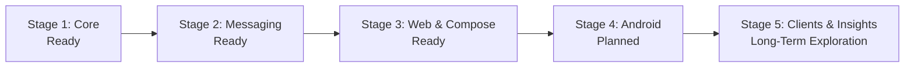

# Moerise Roadmap

[简体中文](ROADMAP.md)

This roadmap describes product stages, delivered capabilities, and future development directions.

---

## 1. Product Stages

| Stage | Status | Scope |
| --- | --- | --- |
| **1. Core** | Ready | Official Memos APIs, polling and note writes, author isolation, dual SQLite databases, REST, and read-only MCP |
| **2. Messaging** | Ready | Feishu private capture and reviews, group webhooks, and Telegram reviews |
| **3. Web & Compose** | Ready | Bilingual Web, Markdown, combined filters, 2D map, streaming insights, persistent settings, and integrated deployment |
| **4. Android** | Planned | Native note client, offline capture, mobile timeline, and daily review |
| **5. Clients & Exploration** | Long-term | iOS/desktop clients, additional review strategies, and further map visualization |

---

## 2. Delivered Capabilities

### 1. Storage & Synchronization

- **Memos integration**: Official API polling and note reads/writes for Memos 0.31.x, preserving original Markdown, tags, and attachments.
- **Author isolation**: One account per instance, with reads and writes scoped to that author.
- **Dual databases**: Persistent `state.sqlite3` and rebuildable `index.sqlite3`.

### 2. Search & Exploration

- **Keyword retrieval**: FTS5 with Chinese characters and adjacent bigrams.
- **Semantic and hybrid search**: OpenAI-compatible or Bailian DashScope embeddings, with RRF ranking.
- **Random Walk**: Semantic candidates, controlled sampling, and path deduplication.
- **Cognitive Map**: PCA and local spiral placement, background snapshots, pan/zoom, and live note reading.

### 3. Reviews & Messaging

- **Fixed daily plans**: Equal-probability selection with maturity delay, default 72 hours, and recent exclusion, default 7 days. Notes are allocated by slot; earlier slots fill first when candidates are scarce.
- **Low-pressure reading**: No unread badges or mandatory completion.
- **Optional channels**: Telegram English reviews, Feishu reviews and private capture, or Feishu group webhooks.
- **Persistent queue**: Long text, original images, retry backoff, and uncertain-result confirmation.

### 4. Web & AI Insights

- **English/Chinese**: In-place language switching.
- **Live timeline**: Inline editing, save shortcuts, creation-time ordering, and keyword/tag/date/archive filters.
- **Streaming chat**: Explicit note selection, OpenAI/Anthropic protocols, follow-ups, and saving replies to Memos.

### 5. External Tools

- **Read-only MCP**: Note retrieval and search for compatible remote clients.
- **Read-only REST**: Server-enforced operation whitelists for scripts and integrations.

---

## 3. Future Directions

### 1. Android

- Offline capture and synchronization after reconnecting.
- Home-screen widgets and photo capture.
- Mobile timeline and offline daily review.
- System sharing for links and images.

### 2. Review & Discovery Strategies

- Notes from the same date in earlier years.
- Older notes that have remained unread or unconnected.
- Spaced-review strategies.
- Topic- and tag-oriented exploration.

### 3. Map Visualization

- Cluster labels and generated topic names.
- A timeline showing changes in the map.
- Walk and reading-path overlays.

### 4. Clients & Deployment

- Explore iOS, macOS, and Windows clients.
- Simplify initial configuration, secret generation, and author binding with a graphical setup flow.
