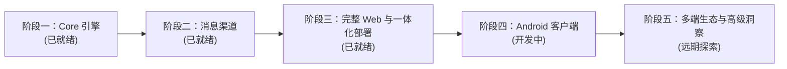

# Moerise 路线图

本文档记录 Moerise 的产品演进阶段、已交付核心能力以及未来的开发规划。

---

## 一、产品阶段演进



| 产品阶段 | 状态 | 目标与范围 |
| --- | --- | --- |
| **阶段一：Core 核心引擎** | 已就绪 | Memos 官方 API 适配、轮询同步与笔记读写、单作者身份隔离、双 SQLite 架构、基础 REST 与只读 MCP 协议。 |
| **阶段二：消息渠道与推送** | 已就绪 | 飞书应用机器人（私聊双向速记与定时回顾）、飞书群 Webhook，以及 Telegram 机器人定时回顾。 |
| **阶段三：完整 Web 与一体化 Compose** | 已就绪 | 现代化双语 Web 前端、Markdown 编辑器、时间线多维筛选、观星、流式 AI 洞察、动态设置管理与 Docker Compose 一体化部署。 |
| **阶段四：Android 原生客户端** | 开发中 | v0.1.0 交付接入 Core 的快速记录、笔记管理、搜索、回顾、漫步、洞察与观星；独立本地模式和完整离线同步分阶段实现。 |
| **阶段五：多端生态与高级探索** | 远期规划 | iOS / 桌面客户端、更丰富的回顾算法策略、观星 3D 与主题拓扑演进。 |

---

## 二、已就绪核心能力

### 1. 存储与数据同步底座
- **Memos 权威集成**：复用 Memos 0.31.x 原生存储，通过官方 API 轮询同步并提供读写，保留原生 Markdown、标签与附件。
- **单用户隔离**：一个实例绑定一个 Memos 账户，所有查询与写操作均受限于绑定作者。
- **双数据库架构**：业务状态库（`state.sqlite3`）与可完全重建的索引库（`index.sqlite3`）清晰分离，保障核心业务数据的备份与恢复安全。

### 2. 检索与探索体验
- **全文关键词检索**：内置 SQLite FTS5，支持中文单字与相邻双字预分词，精确召回中文短语。
- **语义与混合检索**：支持对接 OpenAI 兼容 Embedding 或阿里云百炼 DashScope 向量模型，采用 Reciprocal Rank Fusion (RRF) 进行混合多通道排序。
- **随机漫步 (Random Walk)**：结合高维向量相似度与受控随机抽样，支持单次漫步去重，打破笔记分类孤岛。
- **观星 (Stargazing)**：均衡 UMAP 布局、语义主题、稳定增量定位与星图渲染；后台发布快照，支持平移缩放、全屏和点击阅读实时笔记。

### 3. 回顾与消息通知
- **固定全天日计划**：每日依据成熟期（默认 72 小时）与近期排除（默认 7 天）等概率随机抽取笔记，保存计划并按时段分配，候选不足时优先填满较早时段。
- **无压力阅读**：无未读角标、无强制打卡，界面与消息推送均可轻松重温灵感。
- **多渠道推送**：支持 Telegram 机器人（英文回顾推送）、飞书应用机器人（图文分片推送与私聊双向速记）、飞书自定义群 Webhook。
- **高可靠通知队列**：支持长正文分片、图片上传复用、网络中断退避重试与人工确认恢复机制。

### 4. 现代化 Web 与 AI 洞察
- **原生双语支持**：内置极简轻量的前端 i18n 框架，支持中文与英文无感切换。
- **即时时间线**：卡片内就地编辑、快捷键保存、按创建时间严格排序、组合条件（关键词、标签、日期、归档）过滤。
- **流式 AI 洞察**：自由多选笔记作为上下文材料，兼容 OpenAI 与 Anthropic 协议，支持流式对话与追问，并支持一键将成果沉淀回 Memos。

### 5. 开放生态接入
- **只读 MCP Server**：原生实现 Model Context Protocol，支持 Claude Desktop、Cursor 等外部 AI 工具安全读取与检索笔记。
- **只读机器 REST API**：提供严格白名单控制的开放接口，供自动化流水线调用。

---

## 三、后续规划与演进方向

### 1. 阶段四：Android 客户端

#### 1.1 v0.1.0 目标与范围

交付可供日常使用的 Android APK，连接已有 Moerise 服务。完成首次配置和登录后，打开应用即可进入主页写作；会话检查、列表刷新、标签和日历请求不阻塞本机草稿编辑。

v0.1.0 以 Memos 为笔记权威存储，通过 Moerise Core 读写。本机保存草稿、最近时间线快照和未确认请求；笔记保存成功以 Core 的有效成功响应为准。断网可继续编辑草稿，恢复连接后由用户提交或重试。

| 功能 | v0.1.0 交付范围 |
| --- | --- |
| 应用与账户 | 服务地址配置、登录、退出、登录状态保持、会话过期处理、连接异常处理 |
| 主页与笔记 | 时间线分页、刷新、详情、Markdown 阅读、新建、编辑、删除、归档与恢复 |
| 标签与日期 | 正文中的原生标签、标签筛选、日历与日期筛选 |
| 图片与附件 | 文件选择、上传、正文图片显示、附件下载和使用系统应用打开 |
| 搜索 | 关键词、语义、混合搜索，组合筛选、结果分页与详情跳转 |
| 回顾 | 阅读 Core 生成的每日计划，在条目间切换并跳转详情 |
| 漫步 | 随机开始、指定笔记开始、连续探索、结束及错误恢复 |
| 洞察 | 材料选择、新建对话、流式回复、停止、追问、历史列表、删除对话、保存回复为笔记 |
| 观星 | 星图与主题展示、平移缩放、主题聚焦、点星阅读、未定位笔记、全屏与取景、氛围切换、刷新和重新生成 |
| 设置与交付 | 服务连接、账号、本机语言、中英双语、版本信息、签名 APK 与升级安装 |

独立本地笔记库、完整双向离线同步、iOS 成品、Widget、系统分享接收、拍照入口、端侧模型和 Core 全量管理设置划入后续版本。模型与渠道配置继续通过 Web 管理；模型未配置时，基础记录和关键词搜索仍可使用。

#### 1.2 技术选择与工程边界

| 部分 | 方案 |
| --- | --- |
| 共享业务 | Kotlin Multiplatform：领域模型、用例、网络协议、本机持久化和页面状态 |
| 共享界面 | Compose Multiplatform；Android 使用 Compose，页面按手机 Web 的视觉与行为实现 |
| 网络 | Ktor Client；Android 使用 OkHttp 引擎，JSON 使用 kotlinx.serialization |
| 本机存储 | Room KMP + SQLite；附件使用应用私有目录中的文件 |
| 异步任务 | Kotlin Coroutines 与 Flow，任务随页面、账号和应用生命周期取消 |
| 凭据 | Android Keystore 保护持久会话 Cookie；密码仅参与单次登录，CSRF Token 仅放内存 |
| Android 包 | `io.github.fermin214.moerise`；`versionName=0.1.0`，首次发布 `versionCode=1`，`minSdk=26` |
| 版本管理 | M0 验证并固定兼容的稳定版 Kotlin、Compose、AGP、Gradle、KSP、Room、Ktor 与 SDK；版本写入目录，Wrapper 固定发行包摘要 |

采用以下目录结构；平台路径、凭据、文件和系统调用通过窄接口接入共享代码：

```text
mobile/
  gradle/                  # Wrapper、版本目录和依赖校验
  androidApp/              # Application、Activity、Manifest、系统适配
  shared/
    src/commonMain/        # 业务、协议、持久化定义、页面与设计资源
    src/commonTest/        # 协议与恢复路径的专项测试
    src/androidMain/       # Android 数据库路径、网络引擎等实现
    src/jvmMain/           # Linux JVM 测试所用的数据库与网络适配
    src/jvmTest/           # 真实 SQLite 持久化、重开与事务恢复检查
  benchmark/               # M8 的 Android 启动与观星性能测量
scripts/android/           # 构建、联调、设备验收和发行入口
```

Android 应用模块与 KMP 库模块分开，KMP Android 库采用官方 `com.android.kotlin.multiplatform.library` 插件。`commonMain` 不引用 `android.*`、Activity 或 Android 专用持久化类型。iOS 交付阶段添加平台实现与应用入口，使用 macOS/Xcode 构建验证。

共享模块同时声明 Android 和 JVM 目标，Linux 使用 `:shared:jvmTest` 运行共享协议与状态测试；Room 采用 BundledSQLiteDriver，在 JVM 临时文件上执行真实事务、关闭重开和迁移检查。Android 设备测试验证 Android 数据库路径、生命周期与文件适配。M0 固定各任务名并检查非零测试数量，不能用只有源码集而没有执行目标的检查替代。

共享层分为 `domain`、`data`、`presentation` 三个包，不增加多余的 Gradle 模块。`NoteRepository`、`SessionRepository`、`AttachmentStore` 隔离 UI 与 Core DTO、Cookie 及文件系统；Core 资源名保存在远端引用字段中，本机草稿使用独立 UUID。独立本地模式通过新的存储与用例实现扩展。

#### 1.3 界面与交互基线

- 设计来源为提交 `88e36c3` 的手机页面，以及 `web/src/shell.css`、`web/src/styles.css`、`web/src/shell.js`。提取颜色、字号、间距、圆角、卡片、按钮、空态和导航规则；Web 源码用于行为比对。
- 观星的视觉、取景与交互依据 M1 固定 Core 版本中的 `docs/STARGAZING.md`、`web/src/map.js`、`web/src/map-stars-scene.js` 和 `web/src/map-star-paint.js`，按该版本的快照契约实现移动端绘制。
- 一级导航为主页、回顾、漫步、洞察、观星，账号区域进入归档与设置。延续手机 Web 的顶部工具栏、导航抽屉与搜索入口。
- 主页顶部保留编辑器，时间线接在下方；打开应用恢复主页草稿，从笔记、搜索或探索返回时恢复原页面的筛选、滚动与材料选择。
- 返回操作先收起键盘或关闭临时界面，再返回上级页面。处理系统返回手势、安全区、横竖屏、字体缩放、键盘遮挡和输入法组合输入。
- 设置使用分区或页签；不使用折叠栏目。错误在相关操作附近提供重试或登录入口，成功保存和本机草稿落盘分别反馈。
- 本机语言支持跟随系统、简体中文和英语；语言切换保留草稿、筛选、页面位置及对话内容。图标提供无障碍标签，主要触控区域不小于 48dp。
- Markdown 范围对齐 `web/src/markdown.js`：段落、标题、列表、引用、代码、链接、表格及受保护图片。M0 用短文、64 KiB 长文、表格和图片验证跨平台渲染组件后固定依赖；原始 HTML 按纯文本处理，系统浏览器打开外部链接。

#### 1.4 Core 连接与接口契约

服务地址填写 Moerise 对外 Web 入口，例如部署时配置的 `web.public_origin`；API 请求在该入口下访问 `/api/app/v1`。地址仅包含 scheme、host 和可选端口，不包含账号密码、路径、查询或片段。生产连接使用 HTTPS；调试构建仅为回环地址开放 HTTP，通过 `adb reverse` 联调。调试入口与服务端配置使用相同来源。

契约依据为 [API v1](API-V1.md)、`internal/openapi.json`、`internal/client_*.go` 和 `internal/*models.go`。M1 固定联调所用 Core 提交与 Memos 镜像摘要；观星基线包含 `umap-balanced-v1` 快照和重建接口，同时固定各状态的响应样本。接口变化同步检查服务端、OpenAPI、文档和移动调用端。

| 用途 | `/api/app/v1` 下的方法与路径 | 客户端要求 |
| --- | --- | --- |
| 连接检查 | `GET /capabilities` | 检查 `login_methods`、`notes`；不推断接口未提供的服务端版本或模型能力 |
| 账户 | `POST /session`、`GET /session`、`DELETE /session` | 处理 Cookie、`instance_id`、`user.name`、`timezone`、`expires_at` 与 `csrf_token` |
| 时间线 | `GET /notes` | `state`、`order=created_desc`、`page_size`、`page_token`，以及搜索词、标签、日期 |
| 笔记详情与写入 | `GET/POST /notes`、`GET/PATCH/DELETE /notes/{id}` | 创建与编辑使用固定幂等键；编辑、归档、恢复及删除使用来源摘要 |
| 标签与日历 | `GET /tags`、`GET /calendar` | 服务端时区，月份、日期和正常/归档状态保持一致 |
| 附件 | `GET/HEAD /notes/{id}/attachments/{id}/content` | 同来源受保护下载，支持 Range，校验资源归属 |
| 搜索 | `POST /search` | 读取返回的 `mode`、`semantic.used`、`semantic.reason`，区分降级与失败 |
| 回顾与漫步 | `GET /reviews/daily`、`POST /walks/start`、`POST /walks/next` | 使用服务端日期、时区、条目状态和访问路径 |
| 观星快照 | `GET /map` | 读取 `status`、`algorithm`、`layout_version`、`layout_frame`、`points`、`topics`、`links` 和 `update_state` |
| 重新生成星图 | `POST /map/rebuild` | 本人会话、Origin、CSRF 与空 JSON 请求体；`202 queued` 仅表示排队成功，继续读取快照判断结果 |
| 材料与对话 | `GET /chat-materials`、`POST /chat-materials/resolve`、`GET/POST /chats`、`GET/PATCH/DELETE /chats/{id}` | 材料预算、请求 ID 和对象版本与服务端一致 |
| 流式生成 | `POST /chats/{id}/messages` | JSON POST + SSE，提交固定 `request_id`、`version`、`kind` 和适用的正文、语言 |
| 停止与沉淀 | `POST /chats/{id}/messages/{request_id}/cancel`、`POST /chats/{id}/messages/{request_id}/save` | 明确停止生成；保存助手回复携带消息版本 |

**会话与请求规则：**

1. 原生 HTTP 客户端持久保存服务端签发的 Cookie，执行有效期、来源、路径与 `Secure` 约束。密码不落盘；不使用 Memos PAT、外部机器 Token 或 `Authorization` 请求头调用客户端接口。
2. 登录及其余非 GET/HEAD 请求都携带与配置完全匹配的 `Origin`；除登录外，再携带 `X-CSRF-Token`，包括搜索、漫步和材料解析等 POST 读取操作。
3. 启动后在后台 `GET /session` 获取身份和内存 CSRF。写入前确保会话可用；`CSRF_REJECTED` 仅刷新一次会话后重放原请求，仍失败则显示错误。身份恢复使用单个共享任务，避免并发刷新。
4. 401 暂停远端操作并隐藏时间线缓存，保留本账号编辑器草稿和未确认请求，提供重新登录入口。只有相同来源、实例与作者登录成功后才能恢复原请求。
5. 显式退出先落盘草稿，再注销服务端会话并清除本机 Cookie、CSRF、列表、图片缓存和内存页面状态。网络失败时立即完成本机退出，记录远端注销失败；下次使用重新登录。草稿和请求记录按账号隔离保留，登录页不展示正文；提供删除本机数据入口。
6. 切换服务地址时取消旧连接，并通过连接代次丢弃迟到响应。账号隔离键包含规范化来源、`instance_id` 和 `user.name`。服务端重新绑定后不得重放旧实例请求。
7. 关闭携带 Cookie 的自动跨来源重定向。附件、图片和系统外链分别处理，外部链接不继承会话。凭据、数据库、草稿及未确认请求附件使用免备份路径；受保护图片和下载使用免备份或缓存路径。同时提供 Android 11 及以下的 `fullBackupContent` 和 Android 12 以上的 `dataExtractionRules`，排除云备份和设备迁移中的受保护内容；同签名升级继续保留本机数据。
8. 普通请求的 request/socket 预算为 65 秒、connect 为 10 秒；SSE 的 request/socket 预算为 135 秒、connect 为 10 秒。OkHttp callTimeout 关闭，由 Ktor 总预算和任务取消约束；显式覆盖引擎 read/writeTimeout，避免默认读取预算提前断流。SSE 使用普通流式 POST 解析，不启用自动重连插件。页面离开或账号改变时取消读取；取消写请求后仍按结果不明处理。
9. 错误统一解析 `code`、`retryable`、`request_id`；日志记录请求 ID、接口、耗时及状态，不记录密码、Cookie、正文、附件或对话文本。

#### 1.5 本机数据与写入恢复

| 数据 | 最小字段与用途 | 保留规则 |
| --- | --- | --- |
| 连接档案 | 本机 ID、规范化来源、实例、作者、显示名称、时区、上次验证时间 | Cookie 独立加密保存，CSRF 不入库 |
| 草稿 | UUID、账号隔离键、目标笔记引用、正文、附件引用、来源摘要、编辑修订号、落盘修订号 | 自动落盘；显式保存立即刷入事务 |
| 时间线快照 | 隔离键、筛选条件、笔记内容及摘要、服务端时间、拉取时间 | 持久保存主页最近 100 条；搜索和探索页面先使用内存状态 |
| 未确认请求 | 操作 UUID、隔离键、方法、路径、幂等键、冻结请求体、附件摘要、状态、关联草稿修订号 | 请求发送前持久化，成功处理后清理 |
| 附件暂存 | UUID、所属草稿或请求、私有路径、名称、MIME、字节数和摘要 | 按引用回收；未确认请求持有的文件不可被缓存清理删除 |

草稿正文采用不超过 300 毫秒的防抖写入，保存、切页和进入后台时立即提交；只有 Room 事务完成后才显示草稿已保存。进程重启恢复最后完成落盘的版本，不依赖 `onStop` 作为唯一写入时机。磁盘不足或事务失败时保留编辑器内容并展示失败，不显示保存成功。

时间线快照是本机阅读副本，带上次刷新时间；HTTP 层关闭响应缓存。进入详情优先实时读取，编辑、删除和探索按 Core 的实时来源校验。网络失败可保留本机快照；401、实例变化、作者变化或明确资源删除时隐藏或清理相应内容。

**写入状态与恢复规则：**

- 创建和编辑按 `prepared → sending → confirmed` 持久化；超时、断线、取消或发送期间进程终止转入 `unknown`。启动时把遗留 `sending` 视为 `unknown`，通过显式重试恢复。
- 发送前冻结正文、附件、来源摘要与幂等键。创建和 PATCH 重试始终复用同键同体，不把不确定结果当作新建请求，也不根据时间线中“看起来相同”的正文猜测成功。
- 一笔草稿同时最多有一个未确认的写请求。提交期间继续输入属于同一篇笔记的新修订；创建成功后，在同一个本机事务中绑定返回的资源名、来源摘要和已有远端附件，保留较新正文及提交后添加的附件，后续保存使用 PATCH。没有较新修订时清理已提交草稿并建立新的空白 UUID。编辑成功也在事务中更新基线和快照，旧响应不得覆盖较新输入。
- 确认原写入成功与接纳远端基线分开：Core 的成功重放可能返回外部修改后的实时笔记。存在提交后修订时，比较冻结的预期结果、本机修订和返回的正文、状态及附件；远端偏离预期结果时，保留三份材料并进入冲突合并，后续 PATCH 在比较完成前不可发送。成功响应也执行此规则，不能仅替换 `source_hash`；新增与移除附件意图继续保留。没有续写时可清理已提交草稿，时间线展示实时结果。
- 结果不明时先按原键原体恢复。`SOURCE_CHANGED` 后读取实时正文与完整附件集合，合并正文、新增和移除意图；PATCH 的附件步骤可能已经部分执行。只对可确定映射的远端资源确认已上传，不能凭同名判断；无法对应的暂存附件由用户在实时附件集合中选择是否重新添加。已移除的资源从移除列表剔除。合并完成后冻结新的请求与幂等键，原请求保留为冲突记录，不能直接换键重放原附件列表。`IDEMPOTENCY_CONFLICT` 停止重放并保留原请求。
- 删除先确认，再携带 `source_hash` 请求。结果不明时通过详情复查：资源不存在可按删除完成处理；401、权限问题、网络失败或来源不可用仍保留异常状态，不直接重发删除。
- v0.1.0 采用前台提交和用户重试，不配置后台自动发送队列。恢复网络不自动发布草稿，恢复会话不自动发起付费模型生成。

#### 1.6 附件、阅读与流式洞察

**附件与 Markdown：**

- 新增附件单次最多 10 个，原始字节合计最多 8 MiB；正文最多 65,536 UTF-8 字节。限制依据 `internal/records.go`，不能以 Kotlin 字符串长度代替 UTF-8 字节数。
- 系统选择文件后复制到私有暂存目录，完成大小检查和摘要计算再绑定草稿，不依赖临时 URI 在进程重启后继续有效。
- 接口保持 JSON：新增附件字段为 `filename`、`type`、Base64 `content`。控制编码内存峰值，校验 Base64 膨胀后的请求不超过服务端 12 MiB 预算；超限在发送前提示。
- 编辑时区分新增附件与 `remove_attachments`。移除被正文图片引用的附件时，根据 `ATTACHMENT_REFERENCED`、`ATTACHMENT_DELETE_REJECTED` 保留草稿并提示修正。
- 只向正确资源路径和相同来源发送受保护附件请求。正文图片默认只加载笔记管理的图片；外部图片显示链接，避免读取任意远程内容。
- 下载到应用私有目录，通过 FileProvider 与只读 URI 交给系统应用；下载中断可重试，缓存可回收。文件暂存和下载不在主线程执行。

**洞察与 SSE：**

- 材料选择支持正常与归档笔记，并以 `/chat-materials/resolve` 返回的预算为准；服务端上限为 20,000 Unicode 码点，不按 UTF-16 代码单元计数。
- 新建对话持久保存 `request_id`；生成提交 `request_id`、会话 `version`，`kind` 使用 `insight` 或 `question`。同一请求 ID 的重试沿用原始请求；发生版本冲突先重新读取会话。
- 恢复旧结果与重新生成分开：先读取会话，completed 使用持久化结果，running 继续查看或停止；failed、canceled、interrupted 由用户显式点击重新生成，创建新 `request_id`，读取适用版本并保留原问题内容、旧部分文本和记录。自动恢复不调用模型。
- SSE 使用 POST，解析 `message`、`delta`、`complete`、`error`，覆盖 UTF-8 跨块、CRLF、多行 `data`、半帧和异常结束。没有合法 `complete` 不能标记生成完成。
- 不启用会自动重新发送生成 POST 的断线重连。中断、进入后台或重启后通过 `GET /chats/{id}` 读取已持久化状态，不自动续调模型。
- “停止”调用服务端 cancel 接口，并释放读取连接；仅关闭客户端流不视为服务端停止成功。停止失败时复查会话状态。
- 流式文本合并后批量更新 UI，避免每个 token 触发整页重组。保存回复按服务端消息版本调用 save 接口，重试不拼接前缀、摘要或额外标签。

#### 1.7 观星

**客户端与 Core 分工：**

- Core 负责向量、UMAP、主题识别、增量定位和快照发布，Android 接收布局与星体属性并使用 Compose Canvas 绘制。客户端不下载原始向量、不执行 Python 布局，也不把整个星图页面交给 WebView。
- 快照模型覆盖 `projection_revision`、`vector_generation`、`generated_at`，以及点位、主题、子主题、关联和 `stellar.seed/role/radius/luminosity`。校验有限坐标、重复资源、成员与关联引用，不把缺失数据静默转成随机星点。
- `semantic=false` 的笔记进入“未定位笔记”列表；点星和列表阅读都通过已有笔记接口读取实时正文、标签与附件。点选过期资源时处理不存在或无法访问的结果。
- 星图和视口在账号内保留会话内状态；切换来源、实例、作者或退出时清理。首次进入观星才读取快照并初始化绘图资源。

**显示与触控：**

- 延续星体亮度、尺寸、主题色和局部辉光，提供星图/摄影氛围切换。远景显示主题与整体密度，中景显示子主题，近景按需显示少量笔记摘要。
- 支持单指平移、双指缩放、放大/缩小按钮、主题聚焦、主体/全图取景、全屏及刷新。全屏返回先退出全屏，详情返回先关闭阅读面板，再恢复星图。
- 使用统一坐标变换绘制和命中测试；拖动、双指手势和点击相互区分。密集星点按扩大后的触控范围选择最近候选；主题与笔记列表提供可访问的替代入口。
- 点星后以底部阅读面板展示正文，可打开完整详情、开始漫步或进入洞察；返回时恢复视口和选中项。摘要请求按可见范围限量、去重并在手势或页面变化时取消，禁止为全部星点预取正文。
- 按视口裁剪与缩放级别控制绘制细节，复用文字和辉光绘制资源，不为每个星点创建独立 Compose 节点。只在数据、视口或选中状态变化时重绘，静止页面不运行持续动画。

**快照更新与异常：**

- 分别处理 `disabled`、`waiting`、`building`、`unavailable`、`ready`、`empty`。Embedding 关闭时提供 Web 设置入口；等待、生成、空数据和失败各有对应状态，不影响返回主页写作。
- 已有可读快照且 `update_state=building/unavailable` 时继续展示该快照，并显示更新状态。用户刷新不会清空已有星图；后台响应必须通过账号隔离与连接代次检查。
- 同一 `layout_frame` 的增量更新保留视口，选中资源删除时清除选中项；框架变化时重新取景并复核选中资源。正文和摘要按账号、资源名、`source_hash` 关联；摘要变化时取消旧请求、清理旧内容并按需重读。每次写回核对资源、来源摘要与请求代次；快照读取串行化并丢弃失效代次的响应。快照版本未变时仍更新状态提示，不重建绘图资源。
- “重新生成星图”调用 `POST /map/rebuild`，持久记录账号、发起前 frame、发起时间及观察状态，合并重复点击。该 POST 无幂等键，202 响应丢失后进入结果不明状态，先以 GET 观察，离页、后台恢复和重启后继续观察，不能自动重发。新 frame 的 ready/empty 结果表示已有新框架可用，不推断其对应某个任务；顶层 `unavailable` 或 `update_state=unavailable` 结束等待并进入退避。只有明确失败或用户显式选择再次生成时才允许重新 POST。
- 页面可见时，稳定快照每 60 秒检查更新，等待/生成/重建时每 3 秒检查，失败后至少间隔 10 秒退避；离开页面或进入后台时停止轮询、绘制和摘要请求。网络断开保留已有星图，401 清理账号内容。
- 支持 Core 已发布的旧 PCA 快照降级展示；旧服务缺少必要契约或返回未知算法时明确提示兼容性问题，停止自动重建，不伪装成空星图。

#### 1.8 快速启动与性能目标

启动关键路径限定为：读取连接档案和主页草稿、创建编辑器、完成可输入帧。最近时间线异步读取；网络检查、Markdown 长文渲染、图片解码、模型状态、标签、日历、数据库清理及观星快照解析和绘制资源均不进入关键路径。数据库初始化和迁移在工作线程执行，恢复草稿期间禁用输入，避免迟到数据覆盖新输入。

| 场景 | 目标与测量口径 |
| --- | --- |
| 已配置账号的冷启动 | 从启动 Intent 到草稿恢复完成且编辑器可输入的首个绘制帧，P95 ≤ 1,000 毫秒 |
| 进程存活的后台恢复 | 从恢复 Intent 到原编辑内容可继续输入，P95 ≤ 300 毫秒 |
| 断网、请求挂起、会话过期 | 编辑器不等待网络；沿用相同本机就绪指标 |
| 草稿与提交恢复 | 杀进程后恢复已落盘修订、暂存文件、原始请求和幂等键 |
| 长列表和长文 | 100 条快照、64 KiB 正文、10 个附件下输入和滚动不被同步解码或序列化阻塞 |
| 观星首绘与手势 | 1,000/5,000 点两档固定快照，收到响应体后解析与首绘 P95 分别 ≤ 1/2 秒；平移缩放 P95 帧耗时 ≤ 33 毫秒，静止页面无持续绘制 |
| 观星返回主页 | 停止轮询、摘要和绘制任务后恢复草稿，保持主页就绪目标，不重新加载观星资源 |

M2 提供 `note_editor_ready` 性能标记及首个输入校验；M7 记录观星响应体大小、解析、首绘、帧耗时和摘要请求数量，客户端耗时与网络、Core 布局耗时分开统计。M8 使用 Macrobenchmark、Perfetto 与接近发行配置的构建测量，不使用 debug 耗时作性能结论。分别记录 TTID、编辑器就绪、TTFD、P50、P95 和启动网络请求，明确进程存活恢复与 Activity 重建的区别。

基准固定一台有记录的中端 arm64 真机，记录型号、Android 版本、构建摘要、编译模式、数据量、网络场景和温度条件；冷启动与后台恢复各至少 50 次，账号已配置与首次配置分开测量。冷启动序列使用相同编译预置，不计入安装或首次配置时间。增加 Baseline Profile 后复测同一场景。

#### 1.9 开发里程碑

按 M0 → M1 → M2 → M3 推进；M4、M5、M6、M7 在笔记与账号基础稳定后实施，M8 汇总全部功能并完成发行。M7 复用已有观星 Core 与 Web 的契约、视觉和验收样本，补充 Android 绘制、触控与页面生命周期。

| 里程碑 | 工作内容 | 交付物与完成条件 |
| --- | --- | --- |
| M0：工程与工具链 | 配置用户目录中的 JDK、Android 命令行 SDK，固定稳定依赖矩阵，建立 Android/JVM 共享工程，提取设计资源，验证 Markdown 候选组件 | Linux 干净检出构建 debug APK，`:shared:jvmTest` 实际执行非零测试并使用 BundledSQLiteDriver；Android 安装后显示主页样式和中英文资源；固定版本目录、Wrapper 摘要和 SDK 清单 |
| M1：连接与会话 | 地址规范化、capabilities、登录、Cookie 安全持久化、内存 CSRF、退出、401、账号隔离及受保护 API 请求，固定观星快照与重建契约 | 真机连接隔离的 Core + Memos 环境；重启后恢复会话；一次新建后可读回并清理；错误来源、失效 Cookie 和错误 CSRF 按预期处理；观星响应样本与服务端版本对应 |
| M2：快速记录闭环 | Room、草稿落盘、附件暂存基础、主页编辑器、创建笔记、冻结请求、幂等重试、最近时间线快照与性能标记 | 打开 → 写作 → 保存 → 读回；断网写草稿后恢复；发送后丢响应、进程终止和输入继续修改均不丢已落盘内容、不重复创建；产出首份真机启动基准 |
| M3：笔记管理与附件 | 时间线分页与刷新、Markdown 详情、编辑、归档、恢复、删除、图片上传、附件移除/下载/系统打开 | 真机完成笔记全生命周期；Core 与 Memos 原文和附件一致；来源冲突、文件超限、文件引用冲突、软键盘和旋转恢复均有验证 |
| M4：搜索与筛选 | 标签、日历、日期筛选，关键词/语义/混合搜索与分页，结果详情和返回恢复 | 组合筛选和关键词结果正确；模型未配置、混合降级、游标失效及查询切换不串结果；中英界面可完成相同流程 |
| M5：回顾与漫步 | 当日回顾、条目阅读、指定/随机漫步、访问路径、下一条、结束与重试 | 日期与服务端时区一致；不可用条目和空计划可处理；漫步无重复请求并遵循服务端路径，模型不可用不阻塞其他功能 |
| M6：洞察 | 选材、预算、新建与历史会话、流式生成、停止、追问、删除和保存回复 | 材料、版本和请求 ID 正确；半帧、断线、后台返回与服务端错误恢复不自动重复生成；保存笔记可从时间线读回 |
| M7：观星 | Compose 星图绘制、主题/子主题、触控、取景/全屏/氛围、未定位列表、点星阅读与探索跳转、快照增量及重新生成 | 真机完成星图 → 笔记 → 漫步/洞察 → 返回；同框架保留视口，重建后重新取景；覆盖全部快照状态、服务故障、旧快照、增删笔记、离页停止任务与 1,000/5,000 点基准 |
| M8：性能与发布 | 集成设备流程、启动及观星调优、Baseline Profile、依赖与资源裁剪、签名、发行自动化、升级验证和文档 | 全部功能流程完成；固定真机达到启动及观星目标；签名发行 APK 经系统信任的 HTTPS 完成精简设备闭环，结果关联相同构建摘要；覆盖 API 26 与 targetSdk 对应系统、native 库的 16 KiB 对齐及运行、同签名升级、数据库迁移和草稿/会话恢复；归档 APK、SHA-256 与许可说明 |

M0 同时记录 Linux 构建所需的 JDK、SDK、Gradle JVM 参数和依赖仓库。4 核服务器默认单 Gradle worker，构建 JVM 使用单处理器并限制堆内存，不并发运行多个构建；可用内存低于 2 GiB 时先释放资源，必要时停用本机 Embedding 服务。iOS 编译和模拟器运行不纳入 Linux 的成功条件；共享层的 Android 独占依赖通过源码检查与模块边界控制。

#### 1.10 验证与自动化

验证分为服务器构建、真实服务集成、Android 设备流程和真机性能四层。已有 Web 浏览器流程用于行为参照，不能代替 Android 设备流程。

| 层级 | 执行位置 | 入口与覆盖 |
| --- | --- | --- |
| 构建与共享检查 | Linux 服务器、CI | M0 提供 `scripts/android/check.sh`，聚合 Kotlin 检查、`:shared:jvmTest`、Android lint 与 `assembleDebug`，核对真实 SQLite 测试及非零执行数量 |
| 真实服务联调 | Linux Docker + ADB 设备 | M1 提供 `scripts/android/start-fixture.sh`，复用已有 Memos 初始化逻辑，启动独立 Core/Web/Memos；观星场景加入布局服务和固定测试向量，输出非敏感连接信息与设备反向端口配置 |
| Android 端到端 | 连接的真机，或有硬件加速的 CI 模拟器 | M2 起提供 `scripts/android/acceptance.sh`；使用 Android instrumentation 驱动应用完成记录、管理、搜索和探索流程 |
| 协议异常 | Linux 主机测试与可控服务 | Ktor MockEngine 或本地故障服务注入超时、错误码、断帧、重复响应、来源冲突和写入成功后丢响应 |
| 性能 | 固定真机 | M8 提供 `scripts/android/benchmark.sh`，执行启动 Macrobenchmark 与观星首绘/手势场景，输出 JSON 与 trace |
| 发布 | Linux 服务器、CI | M8 提供 `scripts/android/release.sh`，固定版本号、构建 release、签名、签名校验、SHA-256 与产物归档 |

设备流程至少包含以下场景：

1. 首次配置 → 登录 → 写笔记 → 上传图片 → 保存 → 详情 → 时间线读回。
2. 编辑、保留附件、移除附件、归档、恢复、删除，以及正文与附件在 Memos 中的对应结果。
3. 标签/日期/搜索组合、分页、切换查询、打开详情和返回位置。
4. 会话过期后保留草稿、同账号重新登录、切换服务地址、丢弃旧响应、显式退出。
5. 网络断开、提交响应丢失、提交期间继续输入、杀进程、重启、重试和磁盘写入失败；含附件的 A 提交期间追加 B 和另一附件，成功后再保存，核对只有一篇 A+B、附件不重复；创建与编辑均覆盖成功后丢响应、外部修改、杀进程、原键恢复成功，后续保存必须先比较合并，不能覆盖外部修改。
6. 回顾跨日与空计划；漫步指定起点、连续探索、结束和模型关闭。
7. 洞察选材、预算超限、流式生成、停止、断线复查、追问、历史、删除和保存回复；实际 OkHttp 经 Web 代理在 message 后静默至少 15 秒仍能完成，覆盖总预算超时和后台取消；failed/canceled/interrupted 复查不调用模型，显式重新生成只增加一次调用。
8. 简体中文与英语、输入法组合输入、字体缩放、横竖屏、系统返回、键盘避让和无障碍标签。
9. 观星平移/缩放/主题聚焦、点星阅读、探索跳转、未定位列表、全屏与取景、氛围切换；验证拖动不误点、详情返回恢复视口和辅助列表可用。
10. 观星等待/生成/空数据/禁用/故障、旧快照继续显示、增量增删笔记、框架更换、重建失败与重试、页面离开和账号切换，以及 1,000/5,000 点绘制负载；已接受但丢失 202 时不自动重发，无旧快照故障结束等待；正文改变后同框架更新，延迟的旧正文、摘要及快照均不能覆盖新数据。
11. 编辑新增附件成功、正文失败、外部编辑、冲突合并及新键提交，核对 Memos 附件数量、资源名和内容；覆盖移除已执行后遇到冲突。
12. API 26 与现代 Android 的签名发行配置，通过系统信任的 HTTPS 验证登录、重启、附件、SSE、观星及升级草稿恢复；检查 Secure Cookie、文件打开、云备份/设备迁移排除和 16 KiB 页面。独立 benchmark 包仅承担性能测量。

LLM 与 Embedding 在自动化环境中使用可控本地模拟服务，笔记读写必须经过真实 Core 和 Memos。测试使用独立实例、虚构笔记与临时凭据，清理 fixture 容器和测试数据。用户资料、日志、截图、性能报告和 trace 放在 `.local/android/`。

观星复用 `scripts/acceptance/check-stars.mjs` 的服务链路与快照断言；fixture 显式启动和清理真实布局 worker 及独立模型卷，设置覆盖冷启动编译和布局的等待预算。固定 32 篇虚构笔记与有差异、可形成主题的向量，验证真实 UMAP 首次拟合、同空间新增及向量变化的 transform、删除、主动重建和模型文件丢失后的重新拟合；记录实际布局分支，断言未变点坐标和星体属性、frame、旧快照可读及 Android 视口。1,000/5,000 点客户端性能采用固定快照，覆盖两种氛围、缩放层级、摘要到达和刷新，并测量完整呈现帧。既有浏览器星图验证不替代 Android 绘制与手势验收。

仅为设备端到端无法稳定构造的边界增加少量共享层测试：请求持久化与事务恢复、同键同体重试、跨账号迟到响应、UTF-8/SSE 分块、字节数/码点边界，以及星图坐标变换与快照框架切换。其余产品行为优先通过设备完整流程验证。

Android 代码单独使用 `.github/workflows/android-checks.yml`；涉及 Android 调用契约的 Core 接口变化也触发对应检查。只修改移动端时运行 Android 流程；修改 Core 时追加相关 Go 测试和真实 Memos 集成验证，修改 Web 时追加既有 Web 验证。

#### 1.11 APK 发行与后续扩展

- Android 发行标签使用 `android-v0.1.0`，专用 `.github/workflows/android-release.yml` 匹配 `android-v*`，与服务端 `v*` 标签分开。
- APK 文件名为 `moerise-android-v0.1.0.apk`，至少覆盖 arm64-v8a；x86_64 用于设备自动化。M0 检查依赖 ABI，M8 固定发行 ABI 范围。
- 签名密钥从 CI Secret 或 `.local/` 中读取，并保留可恢复的备份；同一应用后续版本沿用签名身份并递增 `versionCode`。使用 `apksigner verify` 检查发行签名。
- 发行包包含 APK、SHA-256、安装/升级说明与第三方许可。升级验证保留草稿、未确认请求、会话和语言偏好；新装、清数据与升级安装分别测试。
- 构建工具说明、设备步骤和 API 适配说明在实现时补入开发文档，说明已实现的命令和行为。规划继续集中维护在本章节。

后续依次评估独立本地笔记库与备份恢复、完整增量同步及冲突处理、iOS 平台实现、Widget/系统分享/拍照，以及端侧模型。Room 表结构与用例接口保留扩展空间，不提前实现独立模式或把服务端 Go 进程嵌入应用。

#### 1.12 技术依据

- [Kotlin Multiplatform：共享业务与界面](https://developer.android.com/kotlin/multiplatform)
- [KMP Android 库插件与模块边界](https://developer.android.com/kotlin/multiplatform/plugin)
- [Room Kotlin Multiplatform](https://developer.android.com/kotlin/multiplatform/room)
- [Android 命令行构建](https://developer.android.com/build/building-cmdline)
- [Macrobenchmark 与启动测量](https://developer.android.com/topic/performance/benchmarking/macrobenchmark-overview)
- [Compose Canvas 与绘图](https://developer.android.com/develop/ui/compose/graphics/draw/overview)
- [KMP 开发环境与 iOS 构建](https://kotlinlang.org/docs/multiplatform/quickstart.html)

### 2. 回顾与灵感算法扩展
- **智能回顾策略**：
  - “历史上的今天”（回顾一年前、两年前写下的文字）；
  - “沉睡的灵感”（优先挖掘长时间未被查看或关联的旧笔记）；
  - “艾宾浩斯遗忘曲线”间隔复习策略；
  - 基于主题与标签的特定方向漫游。

### 3. 认知地图与知识可视化进阶
- **地图智能聚类与标签**：利用聚类算法自动为密集笔记群生成主题名称标签；
- **思维演进时间轴**：以时间滑动条方式回放知识地图随时间的生长过程；
- **漫步轨迹叠加**：将随机漫步或阅读历史直观绘制在认知地图上，形成思想足迹图。

### 4. 生态与部署体验增强
- **更多桌面与移动平台支持**：探索 iOS、macOS 与 Windows 原生应用的适配可能；
- **一键式图形化安装与向导**：简化首次配置、密钥生成与 Memos 绑定的操作门槛。
