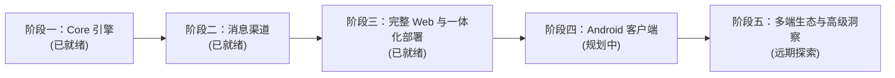

# Moerise 路线图

本文档记录 Moerise 的产品演进阶段、已交付核心能力以及未来的开发规划。

---

## 一、产品阶段演进

| 产品阶段 | 状态 | 目标与范围 |
| --- | --- | --- |
| **阶段一：Core 核心引擎** | 已就绪 | Memos 官方 API 深度适配、双向数据同步、单作者身份隔离、双 SQLite 架构、基础 REST 与只读 MCP 协议。 |
| **阶段二：消息渠道与推送** | 已就绪 | 飞书应用机器人（私聊双向速记与定时回顾）、飞书群 Webhook，以及 Telegram 机器人定时回顾。 |
| **阶段三：完整 Web 与一体化 Compose** | 已就绪 | 现代化双语 Web 前端、Markdown 编辑器、时间线多维筛选、2D 认知地图、流式 AI 洞察、动态设置管理与 Docker Compose 一体化部署。 |
| **阶段四：Android 原生客户端** | 规划中 | 独立构建的高性能 Android 笔记客户端，支持离线速记、移动端时间线与每日回顾。 |
| **阶段五：多端生态与高级探索** | 远期规划 | iOS / 桌面客户端、更丰富的回顾算法策略、认知地图 3D 与主题拓扑演进。 |

---

## 二、已就绪核心能力

### 1. 存储与数据同步底座
- **Memos 权威集成**：严格复用 Memos 0.31.x 原生存储，支持实时双向同步，保护原生 Markdown、标签与附件不被破坏。
- **单用户隔离**：一个实例绑定一个 Memos 账户，所有查询与写操作均受限于绑定作者。
- **双数据库架构**：业务状态库（`state.sqlite3`）与可完全重建的索引库（`index.sqlite3`）清晰分离，保障核心业务数据的备份与恢复安全。

### 2. 检索与探索体验
- **全文关键词检索**：内置 SQLite FTS5，支持中文单字与相邻双字预分词，精确召回中文短语。
- **语义与混合检索**：支持对接 OpenAI 兼容 Embedding 或阿里云百炼 DashScope 向量模型，采用 Reciprocal Rank Fusion (RRF) 进行混合多通道排序。
- **随机漫步 (Random Walk)**：结合高维向量相似度与受控随机抽样，支持单次漫步去重，打破笔记分类孤岛。
- **2D 认知地图 (Cognitive Map)**：基于主成分分析（PCA）投影与局部螺旋避让算法，定时预建二维思维地图快照，支持平移缩放与点击阅读实时笔记。

### 3. 回顾与消息通知
- **确定性全天日计划**：每日依据成熟期（默认 72 小时）与近期排除（默认 7 天）生成唯一日计划，并按配置时段均匀分发。
- **无压力阅读**：无未读角标、无强制打卡，界面与消息推送均可轻松重温灵感。
- **多渠道推送**：支持 Telegram 机器人（英文回顾推送）、飞书应用机器人（图文分片推送与私聊双向速记）、飞书自定义群 Webhook。
- **高可靠通知队列**：支持长正文分片、图片上传复用、网络中断退避重试与人工确认恢复机制。

### 4. 现代化 Web 与 AI 洞察
- **原生双语支持**：内置极简轻量的前端 i18n 框架，支持中文与英文无感切换。
- **即时时间线**：卡片内就地编辑、快捷键保存、按创建时间严格排序、组合条件（关键词、标签、日期、归档）过滤。
- **流式 AI 洞察**：自由多选笔记作为上下文材料，兼容 OpenAI 与 Anthropic 协议，支持流式对话与追问，并支持一键将成果沉淀回 Memos。

### 5. 开放生态接入
- **只读 MCP Server**：原生实现 Model Context Protocol，支持 Claude Desktop、Cursor 等外部 AI 工具安全读取与检索笔记。
- **只读机器 REST API**：提供严格白名单控制的开放接口，供自动化流水线调用。

---

## 三、后续规划与演进方向

### 1. 阶段四：Android 客户端
- **核心目标**：为个人用户提供随时随地、高效灵动的移动端记录与回顾体验。
- **核心功能**：
  - 离线优先与网络恢复自动同步；
  - 快速桌面小组件 (Widget) 记录想法与拍照记录；
  - 移动端优化的时间线浏览与离线每日回顾；
  - 手机系统级原生分享接入（将网页链接或图片一键收纳进笔记）。

### 2. 回顾与灵感算法扩展
- **智能回顾策略**：
  - “历史上的今天”（回顾一年前、两年前写下的文字）；
  - “沉睡的灵感”（优先挖掘长时间未被查看或关联的旧笔记）；
  - “艾宾浩斯遗忘曲线”间隔复习策略；
  - 基于主题与标签的特定方向漫游。

### 3. 认知地图与知识可视化进阶
- **地图智能聚类与标签**：利用聚类算法自动为密集笔记群生成主题名称标签；
- **思维演进时间轴**：以时间滑动条方式回放知识地图随时间的生长过程；
- **漫步轨迹叠加**：将随机漫步或阅读历史直观绘制在认知地图上，形成思想足迹图。

### 4. 生态与部署体验增强
- **更多桌面与移动平台支持**：探索 iOS、macOS 与 Windows 原生应用的适配可能；
- **一键式图形化安装与向导**：简化首次配置、密钥生成与 Memos 绑定的操作门槛。
